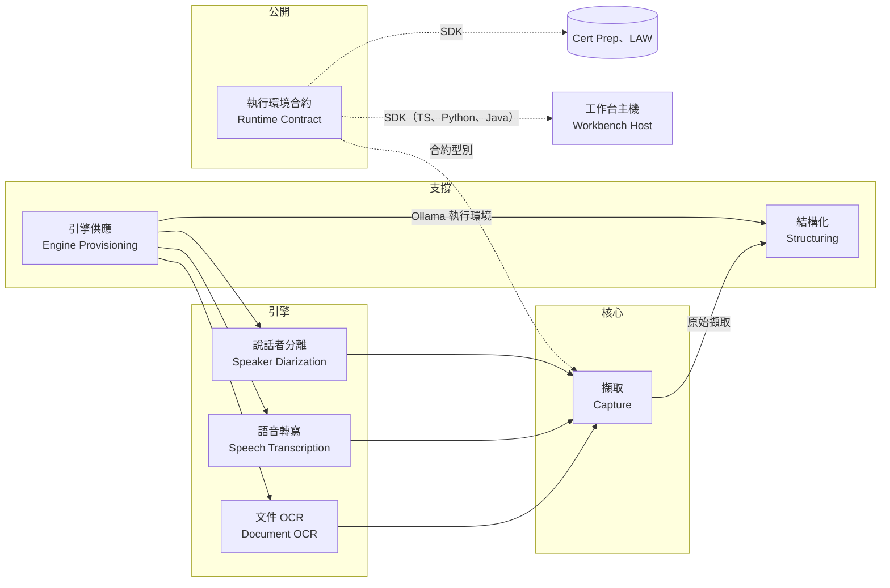
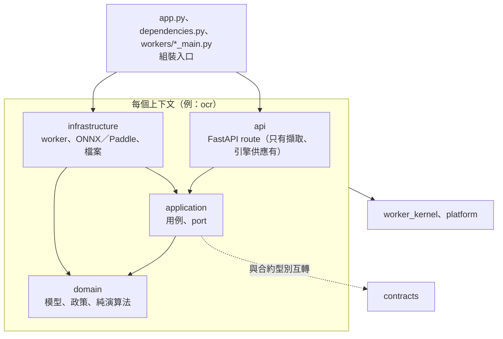

# Capture Workbench 領域驅動重構計畫（DDD）

狀態：**草案，待產品負責人核可**（2026-10-26）。結構比照 LAW 已定案的 DDD 重構計畫（`gx.law-prep/.agents/PLANS/ddd-refactor/`，決策 A30、A31）。待定的決策見 [decisions.md](decisions.md)，術語見 [glossary.md](glossary.md)，每個上下文的說明見 [docs/domain/](../../../docs/domain/README.md)。

這份文件給產品負責人和之後加入的人讀。程式名稱用英文，說明用繁體中文。數字取自 2026-10-26 對 main 的唯讀盤點。

**這份計畫要取代一項既有決策的一部分**：[capture-large-file-refactor.md](../../DECISIONS/capture-large-file-refactor.md) 第 3 條「不採用四層 DDD 結構」。同一份決策拒絕「只為了 DDD 資料夾名稱加薄包裝層」，這一點保留：這裡只建有內容的層，不加轉手的空殼（[decisions.md](decisions.md) P1）。

## 1. 為什麼要重構

Capture Runtime（`packages/capture-runtime/src/capture_runtime`）有 101 個 Python 檔、約 36,000 行，大多平放在同一層，靠檔名前綴（`ocr_*`、`_engine_*`、`progressive_*`）分辨用途。沒有模組層級的循環，FastAPI 也只出現在 `app` 與 `routes`。但：

| 現況                                                                                                                                                                     | 影響                                                       |
| ------------------------------------------------------------------------------------------------------------------------------------------------------------------------ | ---------------------------------------------------------- |
| `engine_adapters.py` 2,661 行同時放 OCR 型別、Paddle 結果正規化、DirectML 執行證據、WindowsML adapter、語音辨識的 `Whisper*` 型別、通用 `EngineProbe` 與離線 import stub | 改 OCR 要讀過語音的型別；語音與說話者分離都依賴 OCR 的檔案 |
| `extractors.py` 1,747 行：媒體分派、worker 執行、PDF 點陣化、影像正規化、音訊解碼與逾時、併入說話者、OCR 出處，另有一個測試用的確定性 extractor                          | 一個類別 30 個方法，橫跨所有引擎                           |
| 11 個職責群組之間有 9 對互相依賴，例如 OCR ↔ worker、引擎安裝 ↔ OCR、引擎安裝 ↔ 結構化（經 `services/__init__`、`storage/__init__` 兩個門面）                         | 分不出上游、下游，改一個群組常要跟著改另一個               |
| 13 處跨模組 import 底線開頭的私有名稱，例如語音與說話者分離 import `engine_adapters._directory_digest`                                                                   | 私有實作被當成公開介面                                     |
| `worker_client.py` 1,309 行放 OCR、語音、說話者分離三種結果的解析                                                                                                        | 三個引擎的協定細節集中在一處                               |
| 只有 Nx 專案標籤（規則是 `* → *`，不生效）與打包內容檢查（`verify_boundaries.py`）；沒有任何 import 方向的檢查                                                           | 新的跨群組依賴不會被擋下                                   |

前端（`capture-workbench-ui`、桌面殼層）與 Rust（launcher、`src-tauri`）已有清楚的分工，問題較小，排在後面。

## 2. 目標

1. **依業務意義分上下文**：六個 runtime 上下文、一個公開合約、一個主機上下文，加上共用的 worker 核心與平台（第 3 節）。
2. **上下文內分層**：`domain`（模型、狀態機、政策與純演算法，例如閱讀順序）、`application`（用例與 port）、`infrastructure`（worker、ONNX／Paddle／PyTorch adapter、檔案、下載）、`api`（FastAPI route）。只建有內容的層。
3. **公開合約不動**：`capture_runtime.contracts` 留在原地，contract set 雜湊（`60c62267…`）在整個重構期間不變；各上下文在自己的 `api`／`application` 與合約型別互轉。
4. **worker 協定與打包不動**：`workers/*_main.py` 是各 worker 的組裝入口，路徑不變（PyInstaller spec 以路徑引用）；重量級函式庫（torch、transformers、onnxruntime、paddle）只在 `infrastructure`、維持延遲 import，core exe 的打包內容檢查與大小預算照舊。
5. **自動檢查守住結構**：Python 用 import-linter，Angular 用 Sheriff，Nx 專案用 `@nx/enforce-module-boundaries`，Rust 用模組可見性。既有違規先列為已知例外，只擋新增。
6. **給人讀的文件**：每個上下文一份 `docs/domain/<上下文>.md`，圖用 Mermaid。

不在這次範圍：改 REST、SSE、worker 協定或 SDK API；改持久化格式（JSON／JSONL repository、引擎安裝快照、`library-index-v1.json`）；改 `CAPTURE_*` 環境變數名稱；改畫面。

## 3. 上下文地圖



實線箭頭表示資料由上游流向下游：下游使用上游公開的資料，上游不知道下游。虛線是公開合約：所有主機只經它與 runtime 溝通。

| 上下文       | 套件（重構後）                             | 負責                                                                 | 現在的程式                                                                                                                                                               |
| ------------ | ------------------------------------------ | -------------------------------------------------------------------- | ------------------------------------------------------------------------------------------------------------------------------------------------------------------------ |
| 擷取         | `capture`                                  | 匯入（分塊上傳）、擷取作業的狀態機、事件、取消、取回結果；依媒體分派 | `services.streaming_capture_service`、`storage.streaming_repository`、`storage._streaming_*`、`streaming`、`extractors` 的分派、`pdf_page_selection`、`routes.streaming` |
| 文件 OCR     | `ocr`                                      | 運算計畫、DirectML 執行證據、閱讀順序、直書閱讀器、OCR 投影與出處    | `ocr_*`、`engine_adapters` 的 OCR 部分、`image_normalization`、`workers.ocr_main`、`_vendor`                                                                             |
| 語音轉寫     | `speech`                                   | TEA-ASR 與對齊、分窗串流、迴圈停止、暖 worker                        | `speech_recognition`、`progressive_*`、`whisper_session`、`workers.speech_recognition_main`、`workers.session_server`                                                    |
| 說話者分離   | `diarization`                              | Nemotron 說話者片段、對齊到逐字稿                                    | `speaker_diarization`、`speaker_turns`、`speaker_alignment`、`workers.diarization_main`                                                                                  |
| 結構化       | `structuring`                              | 結構化工作階段、Ollama 供應者與生命週期、模型清單                    | `structuring/*`、`ollama/*`、`structuring_provider`、`model_catalog`、結構化與模型安裝的 service／repository                                                             |
| 引擎供應     | `provisioning`                             | 引擎目錄、安裝、下載與快取、模型來源鎖                               | `engine_catalog`、`engine_installation`、`_engine_*`、`installation_service` 與 repository、`routes.runtime`                                                             |
| 執行環境合約 | `contracts`（不動）                        | 公開的型別、操作、問題代碼、版本與 contract set                      | `contracts`、`contract_set`、`_contract_set_bundle`、`problem_registry`、`release`；三種 SDK                                                                             |
| 工作台主機   | `capture-workbench-ui`、`apps/*`、launcher | 桌面殼層、Web Component、Tauri、sidecar launcher、主機自有的文件庫   | `packages/capture-workbench-ui`、`apps/capture-workbench`、`apps/capture-workbench-desktop`、`packages/capture-sidecar-launcher`                                         |
| worker 核心  | `worker_kernel`                            | worker 行程、JSON-lines 協定、階段政策、暖 worker（不是上下文）      | `worker_contracts`、`worker_process`、`worker_stage_policy`、`workers.server`、`worker_client` 的共用部分                                                                |
| 平台         | `platform`                                 | 設定、時鐘、常數（不是上下文）                                       | `config`、`clock`、`constants`                                                                                                                                           |

## 4. 程式結構

```text
packages/capture-runtime/src/capture_runtime/
  contracts.py  contract_set.py  problem_registry.py  release.py    公開合約（原地不動）
  platform/        config、clock、constants
  worker_kernel/   行程、協定、階段政策、暖 worker
  capture/         domain/  application/  infrastructure/  api/
  ocr/             domain/（閱讀順序、區塊、運算計畫政策） application/  infrastructure/（WindowsML、DXGI、ONNX）
  speech/          domain/（分窗、迴圈停止） application/  infrastructure/（TEA-ASR、PyAV）
  diarization/
  structuring/
  provisioning/
  workers/         ocr_main.py、speech_recognition_main.py、diarization_main.py（worker 的組裝入口，路徑不變）
  app.py  dependencies.py  __main__.py                               runtime 的組裝入口
```



## 5. 自動檢查

| 範圍      | 工具                                                                                                         | 規則                                                                                                                                                                                                                                                                                                                                          |
| --------- | ------------------------------------------------------------------------------------------------------------ | --------------------------------------------------------------------------------------------------------------------------------------------------------------------------------------------------------------------------------------------------------------------------------------------------------------------------------------------- |
| Runtime   | import-linter（`packages/capture-runtime/pyproject.toml`，Nx target `lint-architecture`，CI 的 runtime job） | 每個上下文 `api`／`infrastructure` → `application` → `domain`；`domain` 不 import FastAPI、httpx、torch、transformers、onnxruntime、paddle、av、PIL（可以用 `contracts` 的值型別）；上下文只依地圖方向引用，不引用別人的 `infrastructure`、`api`；`worker_kernel`、`platform`、`contracts` 不引用任何上下文；不 import 別的模組的底線私有名稱 |
| UI 與殼層 | Sheriff（`@softarc/eslint-plugin-sheriff`，跑在既有 ESLint）                                                 | `capture-workbench-ui` 與 `apps/capture-workbench` 依功能分資料夾（擷取流程、引擎安裝、文件庫），元件 → service → contracts，只經 `index.ts`                                                                                                                                                                                                  |
| Nx 專案   | 既有 `@nx/enforce-module-boundaries`                                                                         | 把 `* → *` 換成實際規則：`type:sdk` 不依賴 UI 或 app，`type:ui` 只依賴 `type:sdk`，任何套件不依賴 `type:tool`                                                                                                                                                                                                                                 |
| 打包      | 既有 `verify_boundaries.py`、worker probe、大小預算                                                          | 不變；重構後仍是 core exe 不含 torch 等重量級函式庫的最後防線                                                                                                                                                                                                                                                                                 |
| Rust      | 模組可見性（`pub(crate)`）                                                                                   | launcher 的 `process.rs`（約 9,900 行非測試程式）拆分時加上；排在最後                                                                                                                                                                                                                                                                         |
| 已知例外  | import-linter `ignore_imports`、ESLint bulk suppressions                                                     | 規則上線時把現有違規逐條列入，每個 PR 只能減少                                                                                                                                                                                                                                                                                                |

## 6. 遷移步驟

每一步都是可以單獨合併、跑完全部檢查的 PR。凡是動到 worker 會打包的程式，另外要通過第 7 節的打包版檢查。

| 步驟 | 內容                                                                                                                                                                                                   | 驗證                                                |
| ---- | ------------------------------------------------------------------------------------------------------------------------------------------------------------------------------------------------------ | --------------------------------------------------- |
| W0   | 本文件、[decisions.md](decisions.md)、[glossary.md](glossary.md)、`docs/domain/` 骨架；`capture-large-file-refactor.md` 第 3 條標為被取代                                                              | 產品負責人核可                                      |
| W1   | import-linter、Sheriff 與 Nx 標籤規則上線，規則依現有模組寫，現有違規列為已知例外                                                                                                                      | 故意加一個違規時 CI 失敗；既有測試全過              |
| W2   | 拆 `engine_adapters`：OCR 型別與 adapter 歸 OCR，`Whisper*` 型別歸語音，`EngineProbe` 與目錄雜湊歸 worker 核心，離線 stub 歸 OCR worker；13 處私有名稱的跨模組 import 改成公開介面                     | contract set 雜湊不變；第 7 節打包版檢查            |
| W3   | 拆 `extractors`：分派歸擷取的 `application`，PDF、影像、音訊的準備歸各引擎的 `infrastructure`；確定性 extractor 與其他測試替身移到 `capture_runtime.testing`                                           | 確定性模式（桌面 e2e 用）行為不變；第 7 節          |
| W4   | `worker_client` 的三種結果解析移到各引擎上下文，`worker_kernel` 只留行程、協定與暖 worker                                                                                                              | 協定測試不變；第 7 節                               |
| W5   | 依上下文機械式搬移，每個上下文一個 PR：引擎供應 → 說話者分離 → 語音轉寫 → 文件 OCR → 結構化 → 擷取；移除 `services/__init__`、`storage/__init__` 門面；測試、scripts、tools、spec 的路徑同一個 PR 更新 | 逐檔比對只差 import；contract set 雜湊不變；第 7 節 |
| W6   | 拆 `StreamingCaptureService`（729 行的類別）：匯入、排程、事件、查詢、主機結構化提交                                                                                                                   | 特性測試先寫；串流 API 行為不變                     |
| W7   | UI 套件與桌面殼層依功能分資料夾，Sheriff 規則全面生效                                                                                                                                                  | 單元測試、Playwright e2e、`production-bundle-check` |
| W8   | Rust launcher 拆 `process.rs`，模組改 `pub(crate)`                                                                                                                                                     | cargo test、`cargo-package-dry-run`；桌面打包版啟動 |
| W9   | 每個上下文的 `docs/domain/<上下文>.md` 補齊（隨 W2–W7 同一個 PR 更新）                                                                                                                                 | 文件審閱                                            |

## 7. 每個 PR 的驗證

- `ruff`、`mypy --strict`、pytest、TypeScript 與 Rust 測試全過，含新的 `lint-architecture`。
- `check-contracts`：contract set 雜湊仍是 `60c62267…`，三種 SDK 的產生檔不變；`check-worker-stage-policy` 不變。
- 動到 worker 程式的 PR：重建 OCR、語音、說話者分離 worker，跑 `verify-worker-boundaries`、`verify-core-boundary` 與 worker probe；再經 runtime API 安裝本機 catalog 並擷取一份 PNG、一份 PDF、一段錄音（含說話者），OCR 文字與逐字稿和 main 相同。這是 Capture 版的 LAW A28。
- runtime exe 的大小預算（release candidate 的 size check）。
- 這次重構不改合約，所以 Cert Prep 與 LAW 的 consumer gate 不受影響；重構可以跟著一般的 patch 版本出去。

## 8. 工作量與風險

| 步驟  | 估計（含驗證）  | 主要風險                                                                                                                                                                                             |
| ----- | --------------- | ---------------------------------------------------------------------------------------------------------------------------------------------------------------------------------------------------- |
| W1    | 1 天            | 已知例外很多（9 對互相依賴的群組）：依上下文分組列出，W2–W5 逐步刪除                                                                                                                                 |
| W2–W4 | 4–5 天          | 把頂層 import 搬錯位置會讓 core exe 帶進重量級函式庫：`verify-core-boundary` 與大小預算把關                                                                                                          |
| W5    | 5–7 天，6 個 PR | 84 個測試檔與 24 個 script 直接 import runtime 模組；約 15 處以字串 monkeypatch；`tools/release/version-sources.ts`、`project.json` 的 13 個輸出路徑、`pyproject.toml` 的 force-include 都以路徑引用 |
| W6    | 2 天            | 串流擷取的任務與取消狀態在同一個類別裡，拆開時要保持鎖與排程順序                                                                                                                                     |
| W7    | 3 天            | Angular 套件是公開的 npm 套件：`index.ts` 的匯出不能變                                                                                                                                               |
| W8    | 3–5 天          | 行程與 Job object 的清理不能退步；launcher 是公開的 crate                                                                                                                                            |

合計約 4–5 週、20–25 個 PR。建議在 Cert Prep 與 LAW 換到 0.7.2 之後才開始 W2，以免重構與版本遷移混在一起。

## 9. 給人讀的文件

每個上下文一份 `docs/domain/<上下文>.md`，固定段落：負責與不負責、用語、聚合與不變條件（類別圖）、主要流程（狀態圖或循序圖）、與其他上下文的關係、規則與資料來源。圖用 Mermaid 寫在 Markdown 裡；改程式時在同一個 PR 更新圖。
