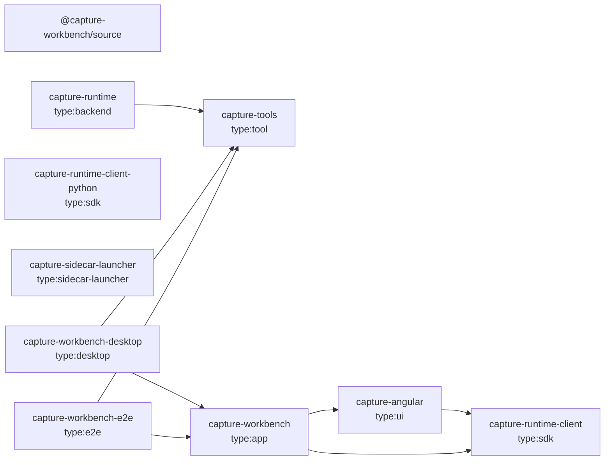

<!-- Generated by tools/architecture-graph.ts --write. Do not edit by hand. -->
# Nx projects

Each node is an Nx project, labelled with its `type:*` tag. An arrow `a --> b` means project `a` depends on project `b` (from `nx graph`).

