<!-- Generated by tools/architecture-graph.ts --write. Do not edit by hand. -->
# Capture Runtime contexts

Each node is a top-level group of the `capture_runtime` Python package. An arrow `a --> b` means a module in `a` imports a module in `b` (from grimp); imports inside one group are not drawn.

```mermaid
flowchart LR
  n_capture_runtime_main_["capture_runtime.__main__"]
  n_capture_runtime_contract_set_bundle["capture_runtime._contract_set_bundle"]
  n_capture_runtime_frozen_extraction_residue["capture_runtime._frozen_extraction_residue"]
  n_capture_runtime_generated_worker_stage_policy["capture_runtime._generated_worker_stage_policy"]
  n_capture_runtime_pdf_source["capture_runtime._pdf_source"]
  n_capture_runtime_windows_job["capture_runtime._windows_job"]
  n_capture_runtime_worker_payloads["capture_runtime._worker_payloads"]
  n_capture_runtime_app["capture_runtime.app"]
  n_capture_runtime_artifact_parts["capture_runtime.artifact_parts"]
  n_capture_runtime_capture["capture_runtime.capture"]
  n_capture_runtime_clock["capture_runtime.clock"]
  n_capture_runtime_config["capture_runtime.config"]
  n_capture_runtime_constants["capture_runtime.constants"]
  n_capture_runtime_contract_set["capture_runtime.contract_set"]
  n_capture_runtime_contracts["capture_runtime.contracts"]
  n_capture_runtime_dependencies["capture_runtime.dependencies"]
  n_capture_runtime_diarization["capture_runtime.diarization"]
  n_capture_runtime_install_progress["capture_runtime.install_progress"]
  n_capture_runtime_japanese_kanji["capture_runtime.japanese_kanji"]
  n_capture_runtime_ocr["capture_runtime.ocr"]
  n_capture_runtime_problem_registry["capture_runtime.problem_registry"]
  n_capture_runtime_provisioning["capture_runtime.provisioning"]
  n_capture_runtime_release["capture_runtime.release"]
  n_capture_runtime_routes["capture_runtime.routes"]
  n_capture_runtime_services["capture_runtime.services"]
  n_capture_runtime_speech["capture_runtime.speech"]
  n_capture_runtime_storage["capture_runtime.storage"]
  n_capture_runtime_structuring["capture_runtime.structuring"]
  n_capture_runtime_testing["capture_runtime.testing"]
  n_capture_runtime_worker_client["capture_runtime.worker_client"]
  n_capture_runtime_worker_contracts["capture_runtime.worker_contracts"]
  n_capture_runtime_worker_probe["capture_runtime.worker_probe"]
  n_capture_runtime_worker_process["capture_runtime.worker_process"]
  n_capture_runtime_worker_stage_policy["capture_runtime.worker_stage_policy"]
  n_capture_runtime_workers["capture_runtime.workers"]
  n_capture_runtime_main_ --> n_capture_runtime_frozen_extraction_residue
  n_capture_runtime_main_ --> n_capture_runtime_app
  n_capture_runtime_main_ --> n_capture_runtime_config
  n_capture_runtime_frozen_extraction_residue --> n_capture_runtime_provisioning
  n_capture_runtime_pdf_source --> n_capture_runtime_capture
  n_capture_runtime_pdf_source --> n_capture_runtime_ocr
  n_capture_runtime_worker_payloads --> n_capture_runtime_constants
  n_capture_runtime_worker_payloads --> n_capture_runtime_contracts
  n_capture_runtime_app --> n_capture_runtime_capture
  n_capture_runtime_app --> n_capture_runtime_clock
  n_capture_runtime_app --> n_capture_runtime_config
  n_capture_runtime_app --> n_capture_runtime_constants
  n_capture_runtime_app --> n_capture_runtime_contract_set
  n_capture_runtime_app --> n_capture_runtime_dependencies
  n_capture_runtime_app --> n_capture_runtime_ocr
  n_capture_runtime_app --> n_capture_runtime_provisioning
  n_capture_runtime_app --> n_capture_runtime_routes
  n_capture_runtime_app --> n_capture_runtime_structuring
  n_capture_runtime_capture --> n_capture_runtime_pdf_source
  n_capture_runtime_capture --> n_capture_runtime_worker_payloads
  n_capture_runtime_capture --> n_capture_runtime_clock
  n_capture_runtime_capture --> n_capture_runtime_config
  n_capture_runtime_capture --> n_capture_runtime_constants
  n_capture_runtime_capture --> n_capture_runtime_contracts
  n_capture_runtime_capture --> n_capture_runtime_dependencies
  n_capture_runtime_capture --> n_capture_runtime_diarization
  n_capture_runtime_capture --> n_capture_runtime_ocr
  n_capture_runtime_capture --> n_capture_runtime_provisioning
  n_capture_runtime_capture --> n_capture_runtime_routes
  n_capture_runtime_capture --> n_capture_runtime_speech
  n_capture_runtime_capture --> n_capture_runtime_structuring
  n_capture_runtime_capture --> n_capture_runtime_worker_client
  n_capture_runtime_capture --> n_capture_runtime_worker_probe
  n_capture_runtime_capture --> n_capture_runtime_worker_process
  n_capture_runtime_config --> n_capture_runtime_constants
  n_capture_runtime_contract_set --> n_capture_runtime_contract_set_bundle
  n_capture_runtime_contract_set --> n_capture_runtime_constants
  n_capture_runtime_contract_set --> n_capture_runtime_contracts
  n_capture_runtime_contract_set --> n_capture_runtime_problem_registry
  n_capture_runtime_contract_set --> n_capture_runtime_release
  n_capture_runtime_contracts --> n_capture_runtime_constants
  n_capture_runtime_dependencies --> n_capture_runtime_capture
  n_capture_runtime_dependencies --> n_capture_runtime_clock
  n_capture_runtime_dependencies --> n_capture_runtime_config
  n_capture_runtime_dependencies --> n_capture_runtime_constants
  n_capture_runtime_dependencies --> n_capture_runtime_contract_set
  n_capture_runtime_dependencies --> n_capture_runtime_contracts
  n_capture_runtime_dependencies --> n_capture_runtime_ocr
  n_capture_runtime_dependencies --> n_capture_runtime_provisioning
  n_capture_runtime_dependencies --> n_capture_runtime_speech
  n_capture_runtime_dependencies --> n_capture_runtime_structuring
  n_capture_runtime_dependencies --> n_capture_runtime_testing
  n_capture_runtime_dependencies --> n_capture_runtime_worker_process
  n_capture_runtime_diarization --> n_capture_runtime_worker_payloads
  n_capture_runtime_diarization --> n_capture_runtime_constants
  n_capture_runtime_diarization --> n_capture_runtime_worker_client
  n_capture_runtime_diarization --> n_capture_runtime_worker_probe
  n_capture_runtime_diarization --> n_capture_runtime_worker_process
  n_capture_runtime_diarization --> n_capture_runtime_worker_stage_policy
  n_capture_runtime_ocr --> n_capture_runtime_worker_payloads
  n_capture_runtime_ocr --> n_capture_runtime_capture
  n_capture_runtime_ocr --> n_capture_runtime_constants
  n_capture_runtime_ocr --> n_capture_runtime_contracts
  n_capture_runtime_ocr --> n_capture_runtime_provisioning
  n_capture_runtime_ocr --> n_capture_runtime_worker_client
  n_capture_runtime_ocr --> n_capture_runtime_worker_contracts
  n_capture_runtime_ocr --> n_capture_runtime_worker_probe
  n_capture_runtime_ocr --> n_capture_runtime_worker_process
  n_capture_runtime_ocr --> n_capture_runtime_worker_stage_policy
  n_capture_runtime_provisioning --> n_capture_runtime_worker_payloads
  n_capture_runtime_provisioning --> n_capture_runtime_clock
  n_capture_runtime_provisioning --> n_capture_runtime_constants
  n_capture_runtime_provisioning --> n_capture_runtime_contracts
  n_capture_runtime_provisioning --> n_capture_runtime_dependencies
  n_capture_runtime_provisioning --> n_capture_runtime_install_progress
  n_capture_runtime_provisioning --> n_capture_runtime_ocr
  n_capture_runtime_provisioning --> n_capture_runtime_release
  n_capture_runtime_provisioning --> n_capture_runtime_routes
  n_capture_runtime_provisioning --> n_capture_runtime_storage
  n_capture_runtime_provisioning --> n_capture_runtime_structuring
  n_capture_runtime_provisioning --> n_capture_runtime_worker_client
  n_capture_runtime_provisioning --> n_capture_runtime_worker_contracts
  n_capture_runtime_provisioning --> n_capture_runtime_worker_process
  n_capture_runtime_release --> n_capture_runtime_artifact_parts
  n_capture_runtime_release --> n_capture_runtime_constants
  n_capture_runtime_release --> n_capture_runtime_contracts
  n_capture_runtime_release --> n_capture_runtime_provisioning
  n_capture_runtime_routes --> n_capture_runtime_contract_set
  n_capture_runtime_routes --> n_capture_runtime_contracts
  n_capture_runtime_speech --> n_capture_runtime_worker_payloads
  n_capture_runtime_speech --> n_capture_runtime_clock
  n_capture_runtime_speech --> n_capture_runtime_config
  n_capture_runtime_speech --> n_capture_runtime_constants
  n_capture_runtime_speech --> n_capture_runtime_contracts
  n_capture_runtime_speech --> n_capture_runtime_japanese_kanji
  n_capture_runtime_speech --> n_capture_runtime_provisioning
  n_capture_runtime_speech --> n_capture_runtime_worker_client
  n_capture_runtime_speech --> n_capture_runtime_worker_probe
  n_capture_runtime_speech --> n_capture_runtime_worker_process
  n_capture_runtime_speech --> n_capture_runtime_worker_stage_policy
  n_capture_runtime_structuring --> n_capture_runtime_windows_job
  n_capture_runtime_structuring --> n_capture_runtime_capture
  n_capture_runtime_structuring --> n_capture_runtime_clock
  n_capture_runtime_structuring --> n_capture_runtime_config
  n_capture_runtime_structuring --> n_capture_runtime_constants
  n_capture_runtime_structuring --> n_capture_runtime_contract_set
  n_capture_runtime_structuring --> n_capture_runtime_contracts
  n_capture_runtime_structuring --> n_capture_runtime_install_progress
  n_capture_runtime_structuring --> n_capture_runtime_ocr
  n_capture_runtime_structuring --> n_capture_runtime_provisioning
  n_capture_runtime_structuring --> n_capture_runtime_storage
  n_capture_runtime_testing --> n_capture_runtime_pdf_source
  n_capture_runtime_testing --> n_capture_runtime_capture
  n_capture_runtime_testing --> n_capture_runtime_clock
  n_capture_runtime_testing --> n_capture_runtime_contracts
  n_capture_runtime_worker_client --> n_capture_runtime_worker_payloads
  n_capture_runtime_worker_client --> n_capture_runtime_worker_process
  n_capture_runtime_worker_process --> n_capture_runtime_windows_job
  n_capture_runtime_worker_process --> n_capture_runtime_config
  n_capture_runtime_worker_process --> n_capture_runtime_worker_contracts
  n_capture_runtime_worker_process --> n_capture_runtime_worker_stage_policy
  n_capture_runtime_worker_stage_policy --> n_capture_runtime_generated_worker_stage_policy
  n_capture_runtime_workers --> n_capture_runtime_capture
  n_capture_runtime_workers --> n_capture_runtime_clock
  n_capture_runtime_workers --> n_capture_runtime_constants
  n_capture_runtime_workers --> n_capture_runtime_contracts
  n_capture_runtime_workers --> n_capture_runtime_diarization
  n_capture_runtime_workers --> n_capture_runtime_ocr
  n_capture_runtime_workers --> n_capture_runtime_speech
  n_capture_runtime_workers --> n_capture_runtime_worker_contracts
  n_capture_runtime_workers --> n_capture_runtime_worker_stage_policy
```

