<!-- Generated by tools/architecture-graph.ts --write. Do not edit by hand. -->
# UI modules

Each node is a Sheriff module of the Angular UI package, the shell app, or the runtime client SDK, labelled with its Sheriff tags; `root` holds files outside every module. An arrow `a --> b` means a TypeScript file in `a` imports a file in `b`.

```mermaid
flowchart LR
  n_apps_capture_workbench_src_app_contracts["apps/capture-workbench/src/app/contracts<br/>shell:contract"]
  n_apps_capture_workbench_src_app_i18n["apps/capture-workbench/src/app/i18n<br/>shell:i18n"]
  n_apps_capture_workbench_src_app_services["apps/capture-workbench/src/app/services<br/>shell:service"]
  n_apps_capture_workbench_src_app_ui_button_src["apps/capture-workbench/src/app/ui/button/src<br/>shell:ui"]
  n_apps_capture_workbench_src_app_ui_card_src["apps/capture-workbench/src/app/ui/card/src<br/>shell:ui"]
  n_apps_capture_workbench_src_app_ui_utils_src["apps/capture-workbench/src/app/ui/utils/src<br/>shell:ui"]
  n_packages_capture_runtime_client_src["packages/capture-runtime-client/src<br/>sdk"]
  n_packages_capture_workbench_ui_src["packages/capture-workbench-ui/src<br/>ui:public-api"]
  n_packages_capture_workbench_ui_src_lib["packages/capture-workbench-ui/src/lib<br/>ui:client"]
  n_packages_capture_workbench_ui_src_lib_capture_angular_components_capture_angular["packages/capture-workbench-ui/src/lib/capture-angular/components/capture-angular<br/>ui:component"]
  n_packages_capture_workbench_ui_src_lib_capture_angular_components_capture_runtime_compute_status["packages/capture-workbench-ui/src/lib/capture-angular/components/capture-runtime-compute-status<br/>ui:component"]
  n_packages_capture_workbench_ui_src_lib_capture_angular_components_capture_runtime_setup["packages/capture-workbench-ui/src/lib/capture-angular/components/capture-runtime-setup<br/>ui:component"]
  n_packages_capture_workbench_ui_src_lib_capture_angular_components_capture_task_item["packages/capture-workbench-ui/src/lib/capture-angular/components/capture-task-item<br/>ui:component"]
  n_packages_capture_workbench_ui_src_lib_capture_angular_components_capture_task_list["packages/capture-workbench-ui/src/lib/capture-angular/components/capture-task-list<br/>ui:component"]
  n_packages_capture_workbench_ui_src_lib_capture_angular_components_capture_workbench_element_facade["packages/capture-workbench-ui/src/lib/capture-angular/components/capture-workbench-element-facade<br/>ui:component"]
  n_packages_capture_workbench_ui_src_lib_capture_angular_components_capture_workbench_header["packages/capture-workbench-ui/src/lib/capture-angular/components/capture-workbench-header<br/>ui:component"]
  n_packages_capture_workbench_ui_src_lib_capture_angular_i18n["packages/capture-workbench-ui/src/lib/capture-angular/i18n<br/>ui:i18n"]
  n_packages_capture_workbench_ui_src_lib_capture_angular_services_capture_reconciliation["packages/capture-workbench-ui/src/lib/capture-angular/services/capture-reconciliation<br/>ui:service"]
  n_packages_capture_workbench_ui_src_lib_capture_angular_services_capture_runtime_installation["packages/capture-workbench-ui/src/lib/capture-angular/services/capture-runtime-installation<br/>ui:service"]
  n_packages_capture_workbench_ui_src_lib_capture_angular_services_capture_workbench_element["packages/capture-workbench-ui/src/lib/capture-angular/services/capture-workbench-element<br/>ui:service"]
  n_packages_capture_workbench_ui_src_lib_capture_angular_services_capture_workbench_events["packages/capture-workbench-ui/src/lib/capture-angular/services/capture-workbench-events<br/>ui:service"]
  n_packages_capture_workbench_ui_src_lib_capture_angular_services_capture_workbench_store["packages/capture-workbench-ui/src/lib/capture-angular/services/capture-workbench-store<br/>ui:service"]
  n_packages_capture_workbench_ui_src_lib_capture_angular_services_capture_workflow["packages/capture-workbench-ui/src/lib/capture-angular/services/capture-workflow<br/>ui:service"]
  n_packages_capture_workbench_ui_src_lib_constants["packages/capture-workbench-ui/src/lib/constants<br/>ui:constant"]
  n_packages_capture_workbench_ui_src_lib_contracts["packages/capture-workbench-ui/src/lib/contracts<br/>ui:contract"]
  n_root["root<br/>root"]
  n_apps_capture_workbench_src_app_contracts --> n_packages_capture_runtime_client_src
  n_apps_capture_workbench_src_app_contracts --> n_packages_capture_workbench_ui_src
  n_apps_capture_workbench_src_app_services --> n_apps_capture_workbench_src_app_contracts
  n_apps_capture_workbench_src_app_services --> n_apps_capture_workbench_src_app_i18n
  n_apps_capture_workbench_src_app_services --> n_packages_capture_runtime_client_src
  n_apps_capture_workbench_src_app_services --> n_packages_capture_workbench_ui_src
  n_apps_capture_workbench_src_app_ui_button_src --> n_apps_capture_workbench_src_app_ui_utils_src
  n_apps_capture_workbench_src_app_ui_card_src --> n_apps_capture_workbench_src_app_ui_utils_src
  n_packages_capture_workbench_ui_src --> n_packages_capture_workbench_ui_src_lib
  n_packages_capture_workbench_ui_src --> n_packages_capture_workbench_ui_src_lib_capture_angular_components_capture_angular
  n_packages_capture_workbench_ui_src --> n_packages_capture_workbench_ui_src_lib_capture_angular_components_capture_runtime_compute_status
  n_packages_capture_workbench_ui_src --> n_packages_capture_workbench_ui_src_lib_capture_angular_components_capture_workbench_element_facade
  n_packages_capture_workbench_ui_src --> n_packages_capture_workbench_ui_src_lib_capture_angular_i18n
  n_packages_capture_workbench_ui_src --> n_packages_capture_workbench_ui_src_lib_capture_angular_services_capture_workbench_element
  n_packages_capture_workbench_ui_src --> n_packages_capture_workbench_ui_src_lib_capture_angular_services_capture_workbench_events
  n_packages_capture_workbench_ui_src --> n_packages_capture_workbench_ui_src_lib_capture_angular_services_capture_workbench_store
  n_packages_capture_workbench_ui_src --> n_packages_capture_workbench_ui_src_lib_constants
  n_packages_capture_workbench_ui_src --> n_packages_capture_workbench_ui_src_lib_contracts
  n_packages_capture_workbench_ui_src_lib --> n_packages_capture_runtime_client_src
  n_packages_capture_workbench_ui_src_lib --> n_packages_capture_workbench_ui_src_lib_constants
  n_packages_capture_workbench_ui_src_lib --> n_packages_capture_workbench_ui_src_lib_contracts
  n_packages_capture_workbench_ui_src_lib_capture_angular_components_capture_angular --> n_packages_capture_workbench_ui_src_lib_capture_angular_components_capture_runtime_setup
  n_packages_capture_workbench_ui_src_lib_capture_angular_components_capture_angular --> n_packages_capture_workbench_ui_src_lib_capture_angular_components_capture_task_list
  n_packages_capture_workbench_ui_src_lib_capture_angular_components_capture_angular --> n_packages_capture_workbench_ui_src_lib_capture_angular_components_capture_workbench_header
  n_packages_capture_workbench_ui_src_lib_capture_angular_components_capture_angular --> n_packages_capture_workbench_ui_src_lib_capture_angular_services_capture_reconciliation
  n_packages_capture_workbench_ui_src_lib_capture_angular_components_capture_angular --> n_packages_capture_workbench_ui_src_lib_capture_angular_services_capture_runtime_installation
  n_packages_capture_workbench_ui_src_lib_capture_angular_components_capture_angular --> n_packages_capture_workbench_ui_src_lib_capture_angular_services_capture_workbench_store
  n_packages_capture_workbench_ui_src_lib_capture_angular_components_capture_angular --> n_packages_capture_workbench_ui_src_lib_capture_angular_services_capture_workflow
  n_packages_capture_workbench_ui_src_lib_capture_angular_components_capture_angular --> n_packages_capture_workbench_ui_src_lib_contracts
  n_packages_capture_workbench_ui_src_lib_capture_angular_components_capture_runtime_compute_status --> n_packages_capture_workbench_ui_src_lib_capture_angular_i18n
  n_packages_capture_workbench_ui_src_lib_capture_angular_components_capture_runtime_compute_status --> n_packages_capture_workbench_ui_src_lib_contracts
  n_packages_capture_workbench_ui_src_lib_capture_angular_components_capture_runtime_setup --> n_packages_capture_workbench_ui_src_lib_capture_angular_components_capture_runtime_compute_status
  n_packages_capture_workbench_ui_src_lib_capture_angular_components_capture_runtime_setup --> n_packages_capture_workbench_ui_src_lib_capture_angular_services_capture_workbench_store
  n_packages_capture_workbench_ui_src_lib_capture_angular_components_capture_task_item --> n_packages_capture_workbench_ui_src_lib_capture_angular_services_capture_workbench_store
  n_packages_capture_workbench_ui_src_lib_capture_angular_components_capture_task_item --> n_packages_capture_workbench_ui_src_lib_contracts
  n_packages_capture_workbench_ui_src_lib_capture_angular_components_capture_task_list --> n_packages_capture_workbench_ui_src_lib_capture_angular_components_capture_task_item
  n_packages_capture_workbench_ui_src_lib_capture_angular_components_capture_task_list --> n_packages_capture_workbench_ui_src_lib_capture_angular_services_capture_workbench_store
  n_packages_capture_workbench_ui_src_lib_capture_angular_components_capture_workbench_element_facade --> n_packages_capture_workbench_ui_src_lib_capture_angular_components_capture_angular
  n_packages_capture_workbench_ui_src_lib_capture_angular_components_capture_workbench_element_facade --> n_packages_capture_workbench_ui_src_lib_capture_angular_services_capture_workbench_events
  n_packages_capture_workbench_ui_src_lib_capture_angular_components_capture_workbench_element_facade --> n_packages_capture_workbench_ui_src_lib_contracts
  n_packages_capture_workbench_ui_src_lib_capture_angular_components_capture_workbench_header --> n_packages_capture_workbench_ui_src_lib_capture_angular_services_capture_workbench_store
  n_packages_capture_workbench_ui_src_lib_capture_angular_i18n --> n_packages_capture_workbench_ui_src_lib_contracts
  n_packages_capture_workbench_ui_src_lib_capture_angular_services_capture_reconciliation --> n_packages_capture_workbench_ui_src_lib_capture_angular_services_capture_workbench_store
  n_packages_capture_workbench_ui_src_lib_capture_angular_services_capture_reconciliation --> n_packages_capture_workbench_ui_src_lib_constants
  n_packages_capture_workbench_ui_src_lib_capture_angular_services_capture_reconciliation --> n_packages_capture_workbench_ui_src_lib_contracts
  n_packages_capture_workbench_ui_src_lib_capture_angular_services_capture_runtime_installation --> n_packages_capture_workbench_ui_src_lib_capture_angular_services_capture_workbench_store
  n_packages_capture_workbench_ui_src_lib_capture_angular_services_capture_runtime_installation --> n_packages_capture_workbench_ui_src_lib_constants
  n_packages_capture_workbench_ui_src_lib_capture_angular_services_capture_runtime_installation --> n_packages_capture_workbench_ui_src_lib_contracts
  n_packages_capture_workbench_ui_src_lib_capture_angular_services_capture_workbench_element --> n_packages_capture_workbench_ui_src_lib_capture_angular_components_capture_workbench_element_facade
  n_packages_capture_workbench_ui_src_lib_capture_angular_services_capture_workbench_element --> n_packages_capture_workbench_ui_src_lib_capture_angular_services_capture_workbench_events
  n_packages_capture_workbench_ui_src_lib_capture_angular_services_capture_workbench_element --> n_packages_capture_workbench_ui_src_lib_contracts
  n_packages_capture_workbench_ui_src_lib_capture_angular_services_capture_workbench_events --> n_packages_capture_workbench_ui_src_lib_contracts
  n_packages_capture_workbench_ui_src_lib_capture_angular_services_capture_workbench_store --> n_packages_capture_workbench_ui_src_lib
  n_packages_capture_workbench_ui_src_lib_capture_angular_services_capture_workbench_store --> n_packages_capture_workbench_ui_src_lib_capture_angular_i18n
  n_packages_capture_workbench_ui_src_lib_capture_angular_services_capture_workbench_store --> n_packages_capture_workbench_ui_src_lib_capture_angular_services_capture_runtime_installation
  n_packages_capture_workbench_ui_src_lib_capture_angular_services_capture_workbench_store --> n_packages_capture_workbench_ui_src_lib_capture_angular_services_capture_workflow
  n_packages_capture_workbench_ui_src_lib_capture_angular_services_capture_workbench_store --> n_packages_capture_workbench_ui_src_lib_constants
  n_packages_capture_workbench_ui_src_lib_capture_angular_services_capture_workbench_store --> n_packages_capture_workbench_ui_src_lib_contracts
  n_packages_capture_workbench_ui_src_lib_capture_angular_services_capture_workflow --> n_packages_capture_workbench_ui_src_lib
  n_packages_capture_workbench_ui_src_lib_capture_angular_services_capture_workflow --> n_packages_capture_workbench_ui_src_lib_capture_angular_services_capture_reconciliation
  n_packages_capture_workbench_ui_src_lib_capture_angular_services_capture_workflow --> n_packages_capture_workbench_ui_src_lib_capture_angular_services_capture_workbench_store
  n_packages_capture_workbench_ui_src_lib_capture_angular_services_capture_workflow --> n_packages_capture_workbench_ui_src_lib_contracts
  n_packages_capture_workbench_ui_src_lib_constants --> n_packages_capture_workbench_ui_src_lib_contracts
  n_packages_capture_workbench_ui_src_lib_contracts --> n_packages_capture_runtime_client_src
  n_root --> n_apps_capture_workbench_src_app_i18n
  n_root --> n_apps_capture_workbench_src_app_services
  n_root --> n_apps_capture_workbench_src_app_ui_button_src
  n_root --> n_apps_capture_workbench_src_app_ui_card_src
  n_root --> n_apps_capture_workbench_src_app_ui_utils_src
  n_root --> n_packages_capture_workbench_ui_src
```

