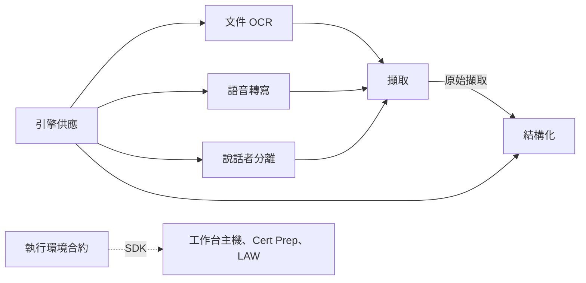

# Capture Workbench 的領域模型

Capture Workbench 依業務的意義分成幾個「上下文」，每個上下文負責一塊業務，有自己的模型、規則和用語。這個目錄給要理解或參與設計的人讀：每個上下文一份說明，圖用 Mermaid 畫，在 GitHub 上直接顯示。

- 用語對照：[glossary.md](../../.agents/PLANS/ddd-refactor/glossary.md)
- 為什麼這樣切、怎麼遷移：[DDD 重構計畫](../../.agents/PLANS/ddd-refactor/README.md)、[決策](../../.agents/PLANS/ddd-refactor/decisions.md)

## 上下文

| 上下文       | 說明文件                | 程式（重構後）                                              | 狀態             |
| ------------ | ----------------------- | ----------------------------------------------------------- | ---------------- |
| 擷取         | [說明](capture.md)      | `capture_runtime/capture`                                   | W5 搬移；W6 待辦 |
| 文件 OCR     | [說明](ocr.md)          | `capture_runtime/ocr`                                       | W6 定案          |
| 語音轉寫     | [說明](speech.md)       | `capture_runtime/speech`                                    | W6 定案          |
| 說話者分離   | [說明](diarization.md)  | `capture_runtime/diarization`                               | W6 定案          |
| 結構化       | [說明](structuring.md)  | `capture_runtime/structuring`                               | W5 搬移；W6 待辦 |
| 引擎供應     | [說明](provisioning.md) | `capture_runtime/provisioning`                              | W6 定案          |
| 執行環境合約 | 待補                    | `capture_runtime/contracts`、兩種 SDK（TypeScript、Python） | 原地             |
| 工作台主機   | 待補                    | `packages/capture-workbench-ui`、`apps/*`、launcher         | 規劃中           |

實線箭頭表示資料由上游流向下游：下游讀取上游公開的資料，上游不知道下游。各上下文的說明文件由 [W9（#177）](https://github.com/gx-capture/capture-workbench/issues/177) 補齊；程式在 [W5（#173）](https://github.com/gx-capture/capture-workbench/issues/173) 搬進上表的套件。

## 每份說明的固定段落

1. 負責什麼、不負責什麼
2. 用語（連到 glossary）
3. 聚合與不變條件（類別圖）
4. 主要流程（狀態圖、循序圖）
5. 與其他上下文的關係
6. 規則與資料來源

改程式時，在同一個 PR 更新對應的說明與圖。
