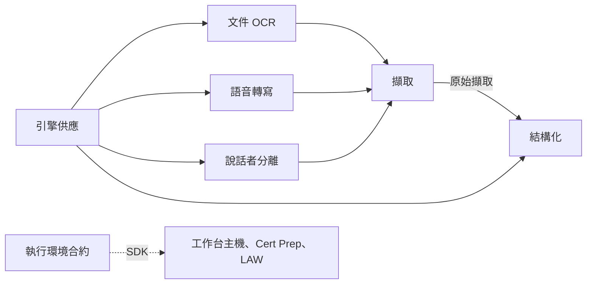

# Capture Workbench 的領域模型

Capture Workbench 依業務的意義分成幾個「上下文」，每個上下文負責一塊業務，有自己的模型、規則和用語。這個目錄給要理解或參與設計的人讀：每個上下文一份說明，圖用 Mermaid 畫，在 GitHub 上直接顯示。

- 用語對照：[glossary.md](../../.agents/PLANS/ddd-refactor/glossary.md)
- 為什麼這樣切、怎麼遷移：[DDD 重構計畫](../../.agents/PLANS/ddd-refactor/README.md)、[決策](../../.agents/PLANS/ddd-refactor/decisions.md)

## 上下文

| 上下文       | 說明文件   | 程式（重構後）                                      | 狀態   |
| ------------ | ---------- | --------------------------------------------------- | ------ |
| 擷取         | 待補（W5） | `capture_runtime/capture`                           | 規劃中 |
| 文件 OCR     | 待補（W2） | `capture_runtime/ocr`                               | 規劃中 |
| 語音轉寫     | 待補（W2） | `capture_runtime/speech`                            | 規劃中 |
| 說話者分離   | 待補（W5） | `capture_runtime/diarization`                       | 規劃中 |
| 結構化       | 待補（W5） | `capture_runtime/structuring`                       | 規劃中 |
| 引擎供應     | 待補（W5） | `capture_runtime/provisioning`                      | 規劃中 |
| 執行環境合約 | 待補（W1） | `capture_runtime/contracts`、三種 SDK               | 原地   |
| 工作台主機   | 待補（W7） | `packages/capture-workbench-ui`、`apps/*`、launcher | 規劃中 |

實線箭頭表示資料由上游流向下游：下游讀取上游公開的資料，上游不知道下游。

## 每份說明的固定段落

1. 負責什麼、不負責什麼
2. 用語（連到 glossary）
3. 聚合與不變條件（類別圖）
4. 主要流程（狀態圖、循序圖）
5. 與其他上下文的關係
6. 規則與資料來源

改程式時，在同一個 PR 更新對應的說明與圖。
