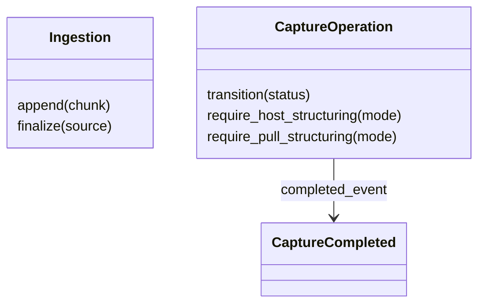
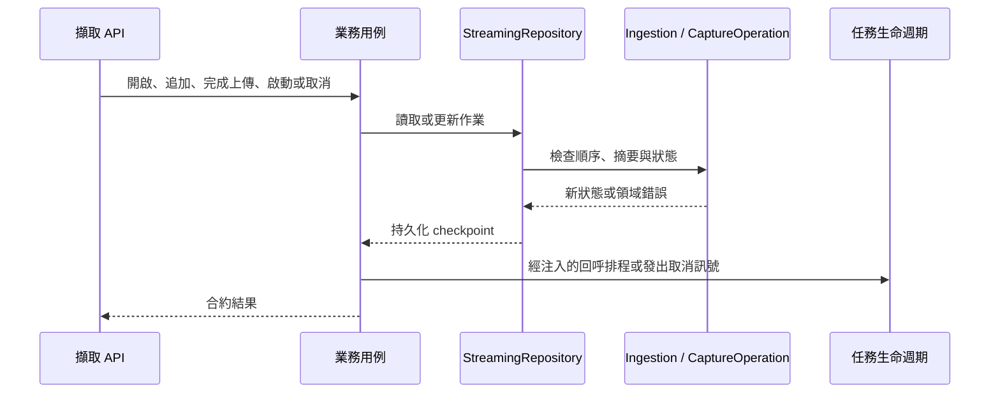

# 擷取

## 負責什麼、不負責什麼

管理來源匯入、擷取作業、事件與取消；依媒體呼叫引擎。模型推論、結構化與下載由各自上下文負責。

## 用語

用語與公開領域類別見 [glossary](../../.agents/PLANS/ddd-refactor/glossary.md)。概念 ID 與合約值映射以 `capture-vocabulary-v1.json` 為準。

## 用例

| 操作 | 程式名稱 | 說明 |
| --- | --- | --- |
| 追加分塊 | `AppendChunk` | 校驗順序及摘要，成功追加後通知相關擷取作業。 |
| 取消擷取 | `CancelCapture` | 先發出取消訊號，再持久化取消狀態。 |
| 提交主機結果 | `CommitHostStructuring` | 驗證來源出處與提交冪等性，再完成擷取。 |
| 完成匯入 | `FinalizeIngestion` | 確認完整來源後喚醒等待中的作業。 |
| 開啟匯入 | `OpenIngestion` | 建立可冪等重送的來源匯入。 |
| 讀取事件 | `PollCaptureEvents` | 從序號游標讀取有界的事件重播。 |
| 啟動擷取 | `StartCapture` | 建立作業，來源就緒時才排程。 |

## 聚合與不變條件

`Ingestion` 以 `append` 與 `finalize` 守住分塊順序、重送一致性、大小與摘要。`CaptureOperation` 管理合法轉換、主機提交與拉取結構化前置條件及終態事件。相同狀態可冪等重入，終態不可轉回活動狀態；非同步完成與取消的重播由 repository 在鎖內處理。`CaptureCompleted` 保留完整完成時間，作為終止事件的時間來源。

## 主要流程

## 與其他上下文的關係

下游使用 OCR、語音轉寫與說話者分離的結果；原始擷取交給結構化。主機持有耐久的領域資料。

## 規則與資料來源

用例只接收 repository port、時鐘、驗證器及必要回呼，不讀取服務的私有欄位。Repository 保留既有鎖、JSON/JSONL 格式、idempotency 與事件序號；完成與主機提交共用完成寫入流程。
