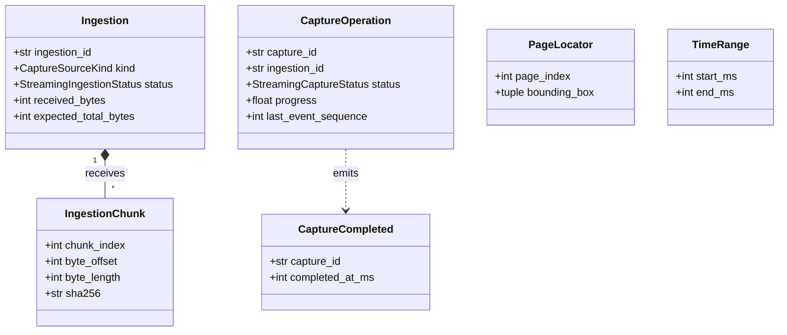
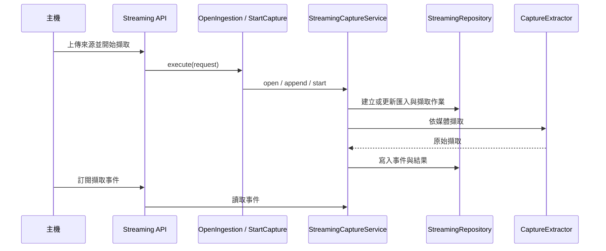

# 擷取

## 負責什麼、不負責什麼

擷取負責來源的分塊匯入、擷取作業的建立與狀態、擷取事件與取消，並依媒體把來源交給文件 OCR、語音轉寫或說話者分離。它不執行各引擎的模型推論，也不把原始擷取整理成結構化文件，也不下載或安裝引擎。

## 用語

來源、匯入、擷取作業、擷取事件、原始擷取、片段與擷取文件的定義見 [glossary 的擷取段落](../../.agents/PLANS/ddd-refactor/glossary.md#擷取)。程式、文件與公開合約沿用相同用語。

## 聚合與不變條件

領域模型依聚合組織於 `capture_runtime.capture.domain`：

- **匯入聚合（`ingestion`）**：
  - `Ingestion`：來源分塊匯入聚合根，管理匯入生命週期（`open` → `finalizing` → `ready` / `cancelled` / `failed` / `expired`）。不變條件：`received_bytes >= 0`、`expected_total_bytes` 若存在不可小於 `received_bytes`。
  - `IngestionChunk`：已校驗的分塊值物件。不變條件：`chunk_index >= 0`、`byte_offset >= 0`、`byte_length > 0`、SHA-256 雜湊不可為空。
- **擷取作業聚合（`operation`）**：
  - `CaptureOperation`：擷取作業聚合根，管理狀態機（`created` → `waiting_input` / `extracting` → `awaiting_structuring` → `structuring` → `completed` / `failed` / `cancelled`）。不變條件：`0.0 <= progress <= 1.0`、`partial_revision >= 0`、`last_event_sequence >= 0`。
  - `PageLocator`：頁面空間定位值物件。不變條件：`page_index >= 0`。
  - `TimeRange`：語音時間範圍值物件。不變條件：`start_ms >= 0`、`end_ms >= start_ms`。
  - `CaptureCompleted`：擷取完成領域事件。不變條件：`completed_at_ms >= 0`。

## 用例

應用層用例定義於 `capture_runtime.capture.application.use_cases`：

| 用例 | 程式名稱 | 說明 |
| --- | --- | --- |
| 開啟匯入 | `OpenIngestion` | 為來源檔案開啟分塊匯入作業 |
| 附加分塊 | `AppendChunk` | 驗證並寫入來源檔案的一個二進位分塊 |
| 完成匯入 | `FinalizeIngestion` | 驗證檔案總長度與 SHA-256 完整性並標記匯入就緒 |
| 開始擷取 | `StartCapture` | 從就緒的匯入建立擷取作業並分派媒體擷取管線 |
| 取消擷取 | `CancelCapture` | 取消進行中的擷取作業與相關背景任務 |
| 輪詢擷取事件 | `PollCaptureEvents` | 讀取指定序號之後的擷取進度與事件序列 |
| 提交主機結構化 | `CommitHostStructuring` | 將主機完成的結構化文件寫入擷取結果並標記完成 |

## 主要流程

## 與其他上下文的關係

文件 OCR、語音轉寫與說話者分離讀取擷取準備好的來源並產出片段；擷取把原始擷取交給結構化。引擎供應提供已安裝的 worker。

## 規則與資料來源

領域物件與事件位於 `capture_runtime.capture.domain`（`ingestion`、`operation`）。用例位於 `capture_runtime.capture.application.use_cases`；串流擷取服務位於 `capture_runtime.capture.application.streaming_capture_service`。HTTP 與 SSE 路由在 `capture_runtime.capture.api.streaming`（`register_streaming_routes`）。基礎設施在 `capture_runtime.capture.infrastructure`：`streaming_repository` 與私有的 `_streaming_persistence`、`_streaming_records`、`_streaming_transitions` 負責檔案儲存；`streaming` 是匯入埠與區塊大小；`capture_extraction` 依媒體分派；`source_sniffing` 判斷來源種類；`pdf_page_selection` 檢查頁面選擇；`audio_run_timeout` 計算整段錄音的執行時間上限；`capture_worker_client` 是擷取用的 worker client。公開型別仍由 `capture_runtime.contracts` 定義。遷移邊界與後續步驟見 [DDD 重構計畫](../../.agents/PLANS/ddd-refactor/README.md)。

## W6 ??????

?? API ??????????`AppendChunk`?`FinalizeIngestion`?`StartCapture`?`CancelCapture` ? `CommitHostStructuring` ??????????????????????? worker ?????Repository ???????????????? `Ingestion.append/finalize` ? `CaptureOperation.transition/record_event` ???????????? JSON ???????????? `CaptureCompleted`??????????????????????????
