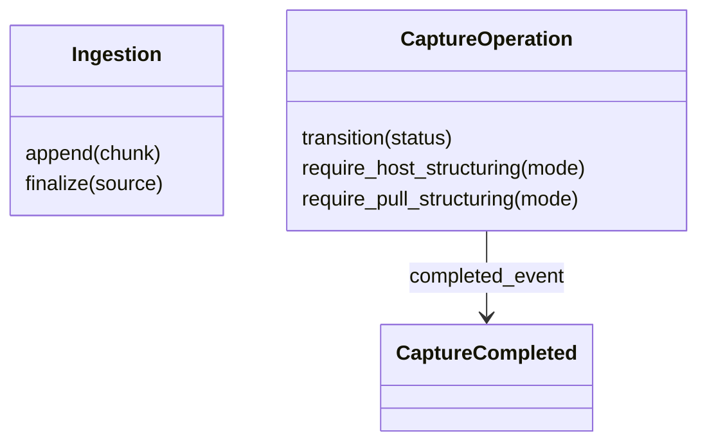
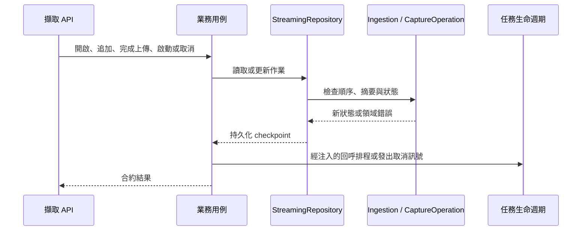

# 擷取

## 負責什麼、不負責什麼

管理來源匯入、擷取作業、事件與取消；依媒體呼叫引擎。模型推論、結構化與下載由各自上下文負責。

## 用語

用語與公開領域類別見 [glossary](../../.agents/PLANS/ddd-refactor/glossary.md)。概念 ID 與合約值映射以 `capture-vocabulary-v1.json` 為準。

擷取來源種類為 `pdf`、`image` 與 `recording`。`recording` 涵蓋音訊及含音軌的影片。開啟匯入必須帶 `kind`；匯入、作業與事件的回應也都帶 `kind`。0.10.x 存下、沒有 `kind` 的紀錄以當時的預設（錄音）讀取，不寫回。擷取診斷和結果透過 `suggestedRequirementIds` 列出建議安裝的需求 ID。

## 用例

| 操作 | 程式名稱 | 說明 |
| --- | --- | --- |
| 追加分塊 | `AppendChunk` | 校驗順序及摘要，成功追加後通知相關擷取作業。 |
| 取消擷取 | `CancelCapture` | 先發出取消訊號，再持久化取消狀態。 |
| 提交主機結果 | `CommitHostStructuring` | 驗證來源出處與提交冪等性，再完成擷取。 |
| 完成匯入 | `FinalizeIngestion` | 確認完整來源後喚醒等待中的作業。 |
| 開啟匯入 | `OpenIngestion` | 建立可冪等重送的來源匯入。 |
| 讀取事件 | `PollCaptureEvents` | 從序號游標讀取有界的事件重播。 |
| 啟動擷取 | `StartCapture` | 建立作業，來源就緒時才排程。 |

`POST /v2/captures/{id}/cancel` 只請求停止，記下 `cancelled` 後立即回覆；worker 可能還要數秒才結束（OCR 約 3 秒），因此 `cancelled` 不表示 worker 已結束。新的擷取在啟動擷取引擎前，由 runtime 等候已請求取消的擷取結束工作並釋放 worker，最多等 15 秒。逾時會記錄診斷訊息並繼續啟動引擎。`DELETE /v2/captures/{id}` 仍會等該擷取的工作與其 worker 行程都結束後，才移除擷取並回覆。呼叫端也可以刪除擷取並等待回覆，再啟動下一筆。

## 聚合與不變條件

Runtime 在 App 資料目錄下的 `logs/runtime-diagnostics.log` 寫入 UTF-8 診斷紀錄。單檔以 1 MiB 為輪替門檻，保留目前檔案及最多三份備份。每行記錄 UTC 時間與允許的欄位，涵蓋 runtime 啟動、worker 失敗、擷取終態，以及等候已請求取消的擷取結束時逾時（`cancelled-capture-wait-expired`）。擷取耗時自建立起算，至失敗或進入終態為止，以毫秒計。紀錄不包含權杖、個別擷取或來源的 ID、檔名、路徑、網址或來源內容。worker 失敗若是作業系統錯誤，該行最後另記 `workerErrorType`（`OSError` 或其內建子類別的名稱）與 `osErrorNumber`（作業系統的錯誤碼；在 Windows 上錯誤帶有 Win32 錯誤碼時記該碼，否則記 `errno`）。其他錯誤，以及早於這兩個欄位的 worker，兩欄皆記 `none`；runtime 無法驗證的值一律捨棄，錯誤訊息本身不記錄。

`Ingestion` 以 `append` 與 `finalize` 守住分塊順序、重送一致性、大小與摘要。`CaptureOperation` 管理合法轉換、主機提交與拉取結構化前置條件及終態事件。相同狀態可冪等重入，終態不可轉回活動狀態；非同步完成與取消的重播由 repository 在鎖內處理。唯一的回頭轉換是 `structuring` 回到 `awaiting_structuring`（`release_structuring`）：runtime 結構化供應者無法接受工作、回傳的結果通不過驗證，或這次呼叫以其他錯誤結束時，作業回到呼叫前的等待狀態，同一 `POST /v2/captures/{id}/structure` 可以重試，作業不會被記成失敗。取消不走這條回頭轉換，作業停在 `cancelled`。`CaptureCompleted` 保留完整完成時間，作為終止事件的時間來源。

當機後的修復只在 runtime 取得 App 資料目錄的獨佔鎖之後、於啟動時進行，請求不會執行這些修復。刪除採保守原則：暫時無法讀取（鎖定、權限或 I/O 錯誤）不是可刪除的證明；只要有任何擷取無法載入，就不刪除任何損毀的 ingestion 目錄。只有無法解析或遺失 metadata 且沒有擷取引用的 ingestion 目錄（以正規化 UUID 比對，忽略大小寫），以及位於 runtime app data 暫存目錄內的 worker 暫存檔（`capture-worker-source-`、`capture-workbench-speech-`、`capture-progressive-window-`）及語音工作階段暫存目錄（`capture-speech-session-` 開頭的目錄及其內容）會在啟動時移除；外部共用暫存目錄不動。`open` 的 ingestion 若來源比已接受的位移長，截回該位移；來源不見或比已接受的位移短，記為 `failed` 並立即到期：仍在等候輸入的擷取以 `ingestion_source_unavailable` 失敗並寫下終止的失敗事件，緊接著的到期清理就移除該 ingestion 目錄。引用它的擷取若不在等候輸入、也還沒進入終態（例如 `extracting`），或工作仍在執行，就仍保護它，來源留著。啟動時把 ingestion 或擷取記為失敗的 metadata 若寫不進磁碟，記憶體還原為寫入前的狀態，與磁碟一致；解析路徑或讀取來源發生 I/O 錯誤時同樣不改動。這些延後處理的 ingestion 在這個行程內不被任何到期清理刪除，只記一則不含路徑與內容的警告，下次啟動再試。

到期清理與啟動修復不同：它在啟動修復之後執行一次，之後每個通過 Host 與 Origin 檢查的請求（包括之後驗證失敗的）在處理前都先執行一次。擷取在最後一次更新超過保留期後到期，工作仍在執行時不會；ingestion 在到期時間已過，或種類與大小已超出現行上限時到期。引用它的擷取還沒進入終態或工作仍在執行時，ingestion 不會被刪除；啟動時延後處理的 ingestion 與引用它的擷取也不會。

重送的分塊與事件不會錯位或重複序號：分塊先截掉已接受位移之後的尾端，寫入並同步後才更新 metadata，事件序號以記錄中最後一筆完整事件為準。終止狀態已寫入但終止事件尚未寫入的擷取，除了啟動時補寫，也會在之後讀取擷取或讀取事件時重試補寫。各類尾端截斷、損毀事件列與錯誤注入案例的具體修復行為見 `packages/capture-runtime/tests/unit/test_streaming_repository.py`。

分塊的 `Content-Range` 結尾必須小於總長，否則回答 422 `invalid_chunk_headers`；大小超過上限仍是 413 `chunk_too_large`。新的擷取從 `extracting`（來源已就緒）或 `waiting_input` 開始。部分結果的 `coveredUntilMs` 只屬於錄音：文件不帶，整段轉錄的錄音在 worker 量得長度時（辨識說話者時，說話者辨識 worker 解碼整段錄音）才帶；沒有值時回應與 `partial.json` 都不寫這個鍵，不寫 null；0.10.x 文件部分結果存下的 0 讀成沒有。錄音沒有 OCR 投影：`GET /v2/captures/{id}/ocr` 對錄音回答 409 `ocr_unavailable`，不寫任何檔案，0.10.x 為失敗錄音寫下的 `ocr.json` 留在原處。

失敗的擷取以功能命名失敗代碼：一般的擷取失敗是 `extraction_failed`，被中斷的擷取是 `capture_interrupted`，擷取輸出通不過驗證是 `extraction_output_invalid`，沒有聽到或讀到任何文字是 `extraction_no_text`（不可重試），匯入的來源讀不到是 `ingestion_source_unavailable`，runtime 沒有這種來源的擷取器是 `extraction_runtime_unavailable`（不可重試）。整段轉錄或辨識說話者時，語音辨識 worker 或說話者辨識 worker 執行失敗分別回報 `speech_recognition_worker_failed`、`speaker_identification_worker_failed`，階段 `extraction`，一律不可重試；worker 的失敗類別與 allowlist 內的階段名稱只寫進 runtime 記錄，不放進失敗內容，也不記路徑、原文或 token。引擎在期限內未完成驗證時，漸進式與整段轉錄（包括說話者辨識）都回報 `requirement_unavailable`，存下的訊息是「Runtime requirement <id> could not be resolved within the bounded timeout.」。0.10.x 存下的舊失敗代碼（`progressive_*`、來源不可用）讀取時換成現行代碼，metadata、事件與 OCR 投影的位元組不變；主機回報的失敗代碼由主機決定，即使與舊代碼相同也原樣保留，即時事件與重啟後都不換。

## 主要流程

## 與其他上下文的關係

下游使用 OCR、語音轉寫與說話者分離的結果；原始擷取交給結構化。主機持有耐久的領域資料。

## 規則與資料來源

用例只接收 repository port、時鐘、驗證器及必要回呼，不讀取服務的私有欄位。Repository 保留既有鎖、JSON/JSONL 格式、idempotency 與事件序號；完成與主機提交共用完成寫入流程。

終止狀態先寫入 metadata，再追加事件。啟動時會檢查每個終止擷取的 `events.jsonl`；讀取 operation／事件時，僅重試先前因 I/O 錯誤而待修復的擷取；若缺少對應終止事件，以保存的狀態、進度及失敗錯誤補上一筆，序號接續修復後的記錄，並同步 metadata。已有對應終止事件不會重複追加。啟動修復遇到 I/O 錯誤會保留資料，只記錄不含路徑或內容的警告，留待後續讀取或下次啟動重試。
