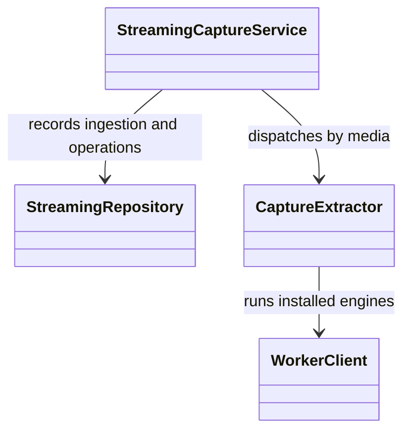
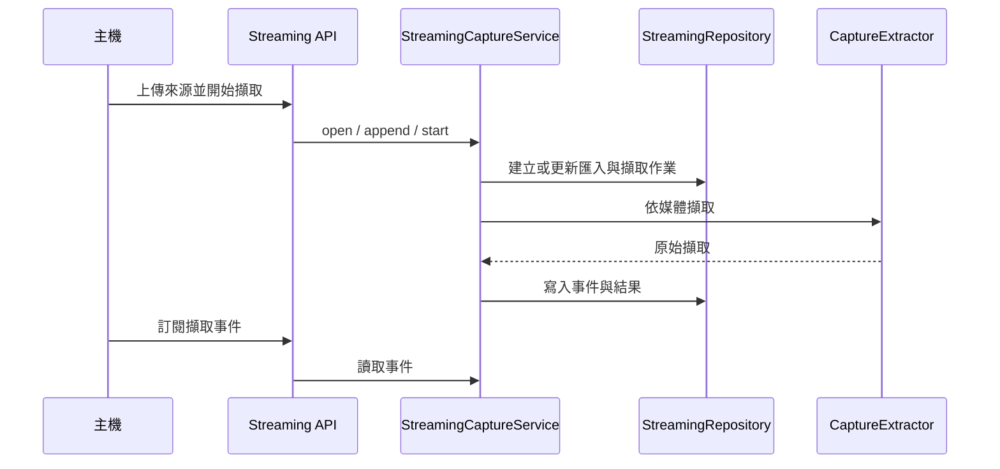

# 擷取

## 負責什麼、不負責什麼

擷取負責來源的分塊匯入、擷取作業的建立與狀態、擷取事件與取消，並依媒體把來源交給文件 OCR、語音轉寫或說話者分離。它不執行各引擎的模型推論，也不把原始擷取整理成結構化文件，也不下載或安裝引擎。

## 用語

來源、匯入、擷取作業、擷取事件、原始擷取、片段與擷取文件的定義見 [glossary 的擷取段落](../../.agents/PLANS/ddd-refactor/glossary.md#擷取)。程式、文件與公開合約沿用相同用語。

## 聚合與不變條件

W5 只搬移現有模組，保留原有行為；W6 會加入匯入與擷取作業兩個聚合，並拆開 `StreamingCaptureService`。現有 `StreamingCaptureService` 仍同時處理匯入、擷取作業、事件與取消，`StreamingRepository` 保存這些紀錄，`CaptureExtractor` 依媒體分派已安裝的引擎，`WorkerClient` 呼叫 worker。分塊順序、來源完整性與作業狀態沿用既有實作。這次不新增 domain 層。

## 主要流程

## 與其他上下文的關係

文件 OCR、語音轉寫與說話者分離讀取擷取準備好的來源並產出片段；擷取把原始擷取交給結構化。引擎供應提供已安裝的 worker。W5 保留既有跨模組依賴，不表示已完成 W6 的領域模型與分層整理。

## 規則與資料來源

HTTP 與 SSE 路由在 `capture_runtime.capture.api.streaming`（`register_streaming_routes`）。用例在 `capture_runtime.capture.application.streaming_capture_service`。基礎設施在 `capture_runtime.capture.infrastructure`：`streaming_repository` 與私有的 `_streaming_persistence`、`_streaming_records`、`_streaming_transitions` 負責檔案儲存；`streaming` 是匯入埠與區塊大小；`capture_extraction` 依媒體分派；`source_sniffing` 判斷來源種類；`pdf_page_selection` 檢查頁面選擇；`audio_run_timeout` 計算整段錄音的執行時間上限；`capture_worker_client` 是擷取用的 worker client。公開型別仍由 `capture_runtime.contracts` 定義。遷移邊界與後續步驟見 [DDD 重構計畫](../../.agents/PLANS/ddd-refactor/README.md)。
