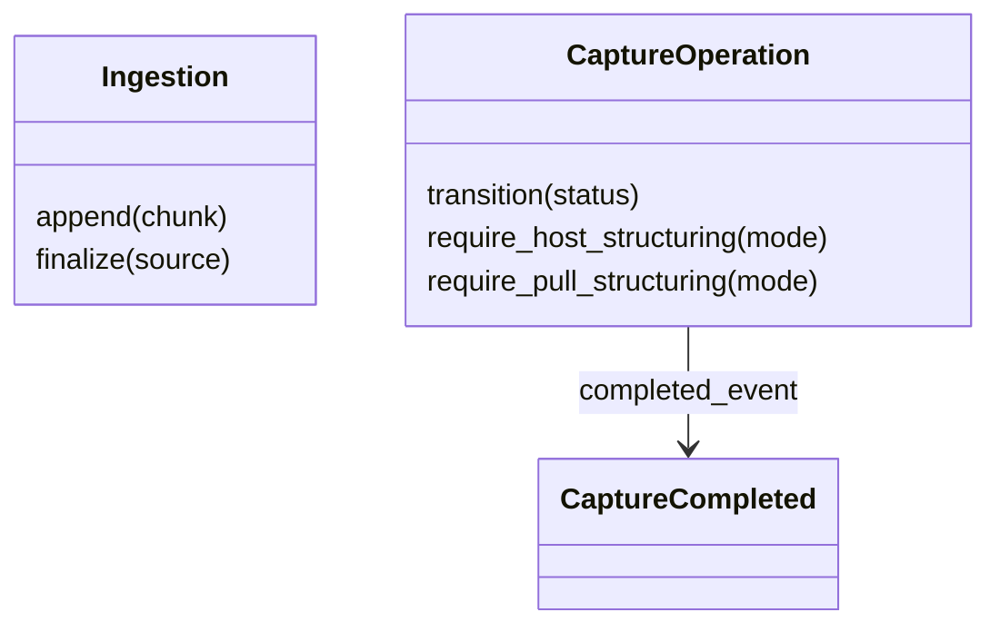
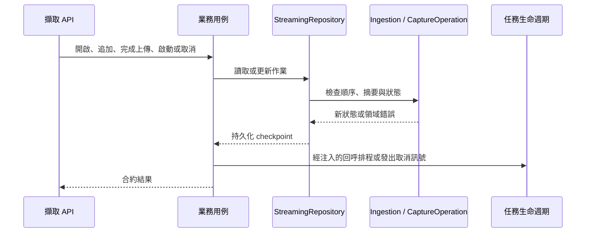

# 擷取

## 負責什麼、不負責什麼

管理來源匯入、擷取作業、事件與取消；依媒體呼叫引擎。模型推論、結構化與下載由各自上下文負責。

## 用語

用語與公開領域類別見 [glossary](../../.agents/PLANS/ddd-refactor/glossary.md)。概念 ID 與合約值映射以 `capture-vocabulary-v1.json` 為準。

## 用例

| 操作 | 程式名稱 | 說明 |
| --- | --- | --- |
| 追加分塊 | `AppendChunk` | 校驗順序及摘要，成功追加後通知相關擷取作業。 |
| 取消擷取 | `CancelCapture` | 先發出取消訊號，再持久化取消狀態。 |
| 提交主機結果 | `CommitHostStructuring` | 驗證來源出處與提交冪等性，再完成擷取。 |
| 完成匯入 | `FinalizeIngestion` | 確認完整來源後喚醒等待中的作業。 |
| 開啟匯入 | `OpenIngestion` | 建立可冪等重送的來源匯入。 |
| 讀取事件 | `PollCaptureEvents` | 從序號游標讀取有界的事件重播。 |
| 啟動擷取 | `StartCapture` | 建立作業，來源就緒時才排程。 |

## 聚合與不變條件

`Ingestion` 以 `append` 與 `finalize` 守住分塊順序、重送一致性、大小與摘要。`CaptureOperation` 管理合法轉換、主機提交與拉取結構化前置條件及終態事件。相同狀態可冪等重入，終態不可轉回活動狀態；非同步完成與取消的重播由 repository 在鎖內處理。`CaptureCompleted` 保留完整完成時間，作為終止事件的時間來源。

當機後的復原：分塊寫在已接受的位移上，先截掉未記錄的尾端再寫入並 fsync，之後才更新 metadata，所以重送的分塊不會錯位。啟動時，`open` 的 ingestion 若來源比已接受的位移長，截回該位移；來源不見或較短則記為 `failed` 並立即到期，由既有的清理移除（仍受進行中的擷取保護）。metadata 遺失或無法讀取、也沒有擷取引用的 ingestion 目錄會被刪除。worker 的暫存檔（`capture-worker-source-`、`capture-workbench-whisper-`、`capture-progressive-window-`）在啟動時移除，但只限位於 runtime app data 內的暫存目錄；被指定到外部、可能與其他 runtime 共用的目錄不動。這些復原只在 runtime 取得 App 資料目錄的獨佔鎖（#343）之後、於啟動時進行，查詢與被拒絕的請求不會刪除任何東西。

啟動復原以正規化的 UUID 比對 ingestion 的引用，大小寫不同的 ID 不會被當成沒有引用。`open` 的來源不見或較短而記為 `failed` 時，仍在等候輸入的擷取以 `streaming_source_unavailable` 結束並送出終止事件；其他進行中的擷取照樣保護該來源。解析路徑、讀取來源或寫入 metadata 時發生 I/O 錯誤，該 ingestion 的復原與到期清理延到下次啟動，只記一則不含路徑的警告。長度剛好的來源也會開啟並讀取；暫時無法存取時不動它，因為暫時的鎖定不代表資料遺失。

ingestion 的 metadata 只有在遺失或內容無法解析時才視為損毀；暫時讀不到（鎖定、權限）時目錄保留，下次啟動再讀。任何一個擷取無法載入時，無法得知它引用哪個 ingestion，這次啟動就不刪除任何損毀的 ingestion 目錄。啟動時把擷取改為失敗若無法寫入磁碟，記憶體還原為原狀態；延後處理的 ingestion 在這個行程內持續受保護，不會被之後的清理刪除。載入擷取時，事件序號以事件記錄中最後一筆完整的事件為準，寫入事件後、更新 metadata 前中斷時，下一個事件不會重複序號；記錄最後一行若寫到一半，是完整事件就補上換行，否則截掉，無法解碼的行略過。尚未處理：擷取已記為失敗、但終止事件沒有寫入時，啟動不會補寫該事件（主機以擷取狀態為準）。

## 主要流程

## 與其他上下文的關係

下游使用 OCR、語音轉寫與說話者分離的結果；原始擷取交給結構化。主機持有耐久的領域資料。

## 規則與資料來源

用例只接收 repository port、時鐘、驗證器及必要回呼，不讀取服務的私有欄位。Repository 保留既有鎖、JSON/JSONL 格式、idempotency 與事件序號；完成與主機提交共用完成寫入流程。
