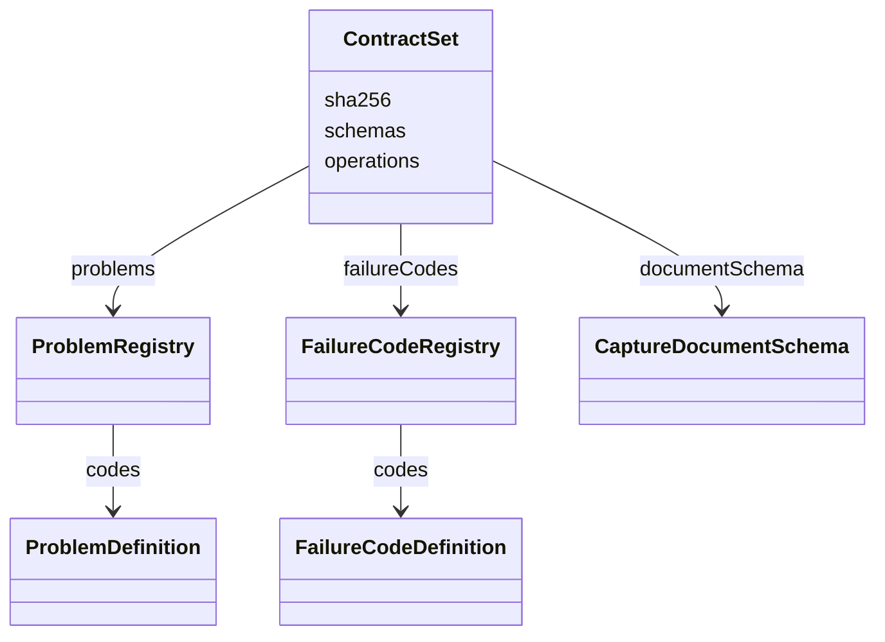
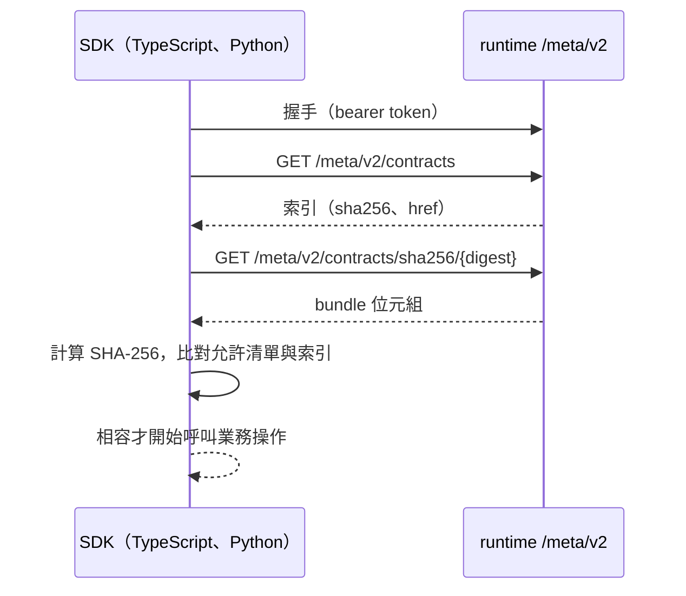

# 執行環境合約

## 負責什麼、不負責什麼

定義 runtime 對外公開的格式：型別、操作、問題代碼、失敗代碼、版本，以及把這些內容打包成一份可驗證的合約集。所有主機（工作台、Cert Prep、LAW）只經這份合約與 runtime 溝通。

合約不是領域模型。各上下文有自己的領域物件，在自己的 `application` 與 `api` 層和合約型別互轉。合約不包含業務規則，也不知道任何上下文。

## 用語

用語見 [glossary](../../.agents/PLANS/ddd-refactor/glossary.md) 的「執行環境合約」。單版型別不再帶 `V2` 或 `V3` 字尾；`/v2` 路由、payload `schemaVersion` 與 `capture-document-v2.schema.json` 保持不變。合約改名只發生在合約發布。

## 組成

| 部分 | 程式 | 內容 |
| --- | --- | --- |
| 合約型別 | `capture_runtime.contracts` | Pydantic 定義的請求、回應與事件，欄位對外用 camelCase |
| 問題代碼 | `problem_registry` 的 `DEFAULT_PROBLEM_REGISTRY`，bundle 的 `problems` | HTTP 錯誤回應的代碼，各帶狀態碼與分類；HTTP 層只能選用已登記的代碼，不能另創 |
| 失敗代碼 | `problem_registry` 的 `DEFAULT_FAILURE_CODE_REGISTRY`，bundle 的 `failureCodes` | 失敗的擷取、安裝與模型安裝在 `error` 裡回報的代碼；能否重試由每次失敗自己帶。主機自行回報的結構化失敗沿用主機選的代碼，不受這份清單限制 |
| 合約集 | `contract_set`、`_contract_set_bundle` | 把型別的 JSON Schema、操作、問題代碼與失敗代碼組成一份不可變的 bundle，以 UTF-8 正規 JSON 的 SHA-256 識別 |
| 文件格式與發布 | `release` | `CaptureDocument` 的 schema 與發布 manifest，產出固定的位元組 |
| 產生檔 | `assets/contract-set.json`、`contract-set.sha256` | 由 `capture-runtime:generate-contracts` 產生，並複製到兩種 SDK |

## 不變條件

- 合約集的雜湊就是相容性的依據：雜湊相同的 runtime 與 SDK 相容。版本號只固定格式，不參與比對，所以發新版不會改變雜湊。
- 重構不改合約：每個 PR 的合約集雜湊都要和 main 相同，兩種 SDK 的產生檔也不變（`capture-runtime:check-contracts`）。
- 合約的每個列舉值都對應到概念集 `vocabulary/capture-vocabulary-v1.json` 的一個概念（`tests/unit/test_ubiquitous_language.py`）。概念集不進合約集，不影響雜湊。

## 主要流程

主機連上 runtime 後先做探索：握手確認 runtime 就緒，讀合約索引，再依雜湊下載 bundle，算出雜湊並與 SDK 允許的清單比對。雜湊不在清單裡就停下，不送任何業務請求。

## 與其他上下文的關係

六個 runtime 上下文都使用合約的值型別，合約不引用任何上下文（import-linter 檢查）。工作台主機、Cert Prep 與 LAW 經 SDK 使用合約：TypeScript 的 `@gx-capture/capture-runtime-client`（`packages/capture-runtime-client`）與 Python 的 `capture-runtime-client`（`packages/capture-runtime-client-python`）。兩種 SDK 的型別由合約產生，不手寫。

## 規則與資料來源

- 改合約型別後執行 `capture-runtime:generate-contracts`，在同一個 PR 提交 runtime 與兩種 SDK 的產生檔。
- 改變合約集雜湊就是合約變更：要發新版，兩個消費端也要升級並跑 consumer gate（見 [release runbook](../../.agents/GUIDES/release-runbook.md)）。
- 操作的問題代碼清單屬於合約集：增減任一操作的問題代碼都會改變合約集雜湊，該次發布需經消費端關卡。
- 新的錯誤種類先登記到問題代碼，再在 HTTP 層使用；作業的新失敗原因先登記到失敗代碼。同一個代碼只有在 HTTP 回應與失敗的作業都會用到時，才同時列在兩份清單。
- 0.10.x 存下的失敗代碼（`storage.common.RETIRED_FAILURE_CODES`）在讀取時換成現行代碼，檔案位元組不變。

## 擷取引擎的裝置出處

`CaptureEngine.device` 與 `CaptureEngine.deviceName` 都是可省略、可為 null 的非空字串。共用的 `device` 欄位記錄執行的後端，對 OCR、語音與主機自訂的值保持開放。runtime 自己啟動的 Windows Ollama 依觀察到的實際執行，記錄 `cuda`、`rocm`、`vulkan` 或 `cpu`；觀察到 GPU 時，把 GPU 的描述寫在 `deviceName`。`cpu`、無法確認執行裝置與外部 Ollama 的 `deviceName` 是 null；無法確認執行裝置與外部 Ollama 的 `device` 也是 null。舊文件的 `device` 為 `local` 或 `remote`，或兩個欄位都沒有，在 `schemaVersion` `"2"` 下仍可讀取。

## 結構化生成選項

`StructuringBatch.numCtx` 維持正整數的傳輸格式，每個工作階段固定為 8192（`DEFAULT_STRUCTURING_NUM_CTX`），所有批次使用相同值。
`numPredict` 仍依各批次調整。自有與外部 Ollama 介接器使用的值，與主機供應者的工作階段 API 相同。
