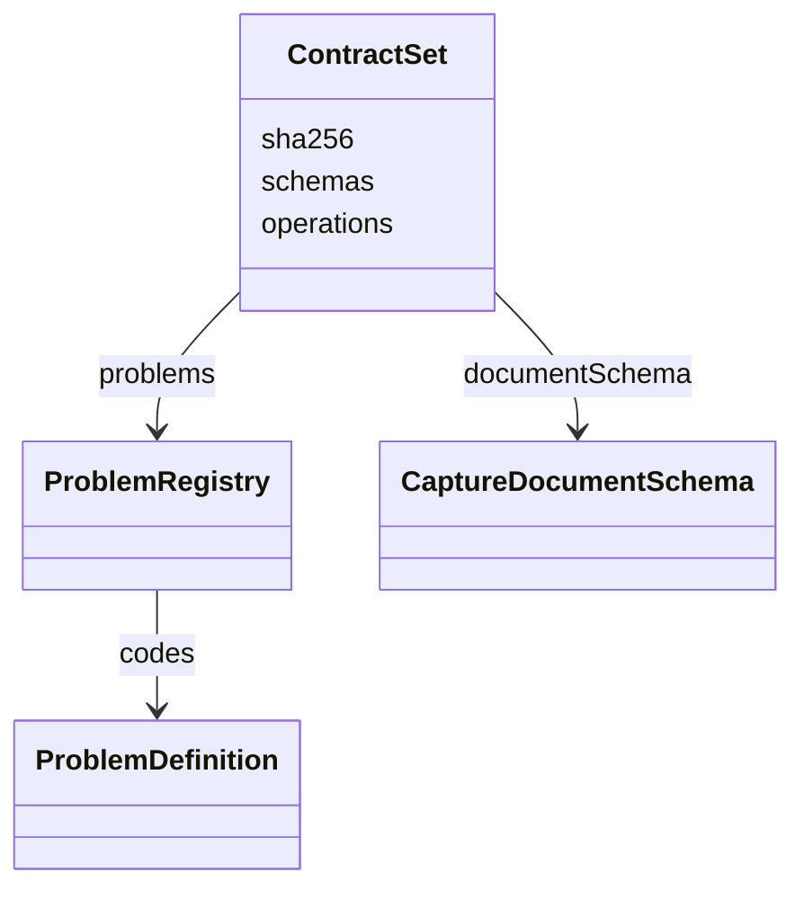
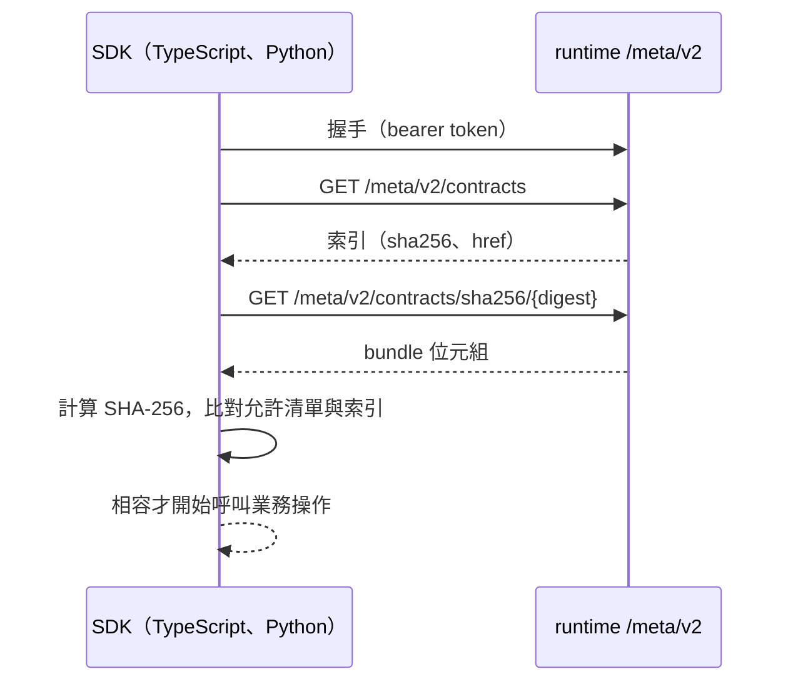

# 執行環境合約

## 負責什麼、不負責什麼

定義 runtime 對外公開的格式：型別、操作、問題代碼、版本，以及把這些內容打包成一份可驗證的合約集。所有主機（工作台、Cert Prep、LAW）只經這份合約與 runtime 溝通。

合約不是領域模型。各上下文有自己的領域物件，在自己的 `application` 與 `api` 層和合約型別互轉。合約不包含業務規則，也不知道任何上下文。

## 用語

用語見 [glossary](../../.agents/PLANS/ddd-refactor/glossary.md) 的「執行環境合約」。合約裡的名稱（`*V2`、`*V3`）不隨重構改名。

## 組成

| 部分 | 程式 | 內容 |
| --- | --- | --- |
| 合約型別 | `capture_runtime.contracts` | Pydantic 定義的請求、回應與事件，欄位對外用 camelCase |
| 問題代碼 | `problem_registry` | 對外回報的錯誤種類；HTTP 層只能選用已登記的代碼，不能另創 |
| 合約集 | `contract_set`、`_contract_set_bundle` | 把型別的 JSON Schema、操作與問題代碼組成一份不可變的 bundle，以 UTF-8 正規 JSON 的 SHA-256 識別 |
| 文件格式與發布 | `release` | `CaptureDocument` 的 schema 與發布 manifest，產出固定的位元組 |
| 產生檔 | `assets/contract-set.json`、`contract-set.sha256` | 由 `capture-runtime:generate-contracts` 產生，並複製到兩種 SDK |

## 不變條件

- 合約集的雜湊就是相容性的依據：雜湊相同的 runtime 與 SDK 相容。版本號只固定格式，不參與比對，所以發新版不會改變雜湊。
- 重構不改合約：每個 PR 的合約集雜湊都要和 main 相同，兩種 SDK 的產生檔也不變（`capture-runtime:check-contracts`）。
- 合約的每個列舉值都對應到概念集 `vocabulary/capture-vocabulary-v1.json` 的一個概念（`tests/unit/test_ubiquitous_language.py`）。概念集不進合約集，不影響雜湊。

## 主要流程

主機連上 runtime 後先做探索：握手確認 runtime 就緒，讀合約索引，再依雜湊下載 bundle，算出雜湊並與 SDK 允許的清單比對。雜湊不在清單裡就停下，不送任何業務請求。

## 與其他上下文的關係

六個 runtime 上下文都使用合約的值型別，合約不引用任何上下文（import-linter 檢查）。工作台主機、Cert Prep 與 LAW 經 SDK 使用合約：TypeScript 的 `@gx-capture/capture-runtime-client`（`packages/capture-runtime-client`）與 Python 的 `capture-runtime-client`（`packages/capture-runtime-client-python`）。兩種 SDK 的型別由合約產生，不手寫。

## 規則與資料來源

- 改合約型別後執行 `capture-runtime:generate-contracts`，在同一個 PR 提交 runtime 與兩種 SDK 的產生檔。
- 改變合約集雜湊就是合約變更：要發新版，兩個消費端也要升級並跑 consumer gate（見 [release runbook](../../.agents/GUIDES/release-runbook.md)）。
- 新的錯誤種類先登記到問題代碼，再在 HTTP 層使用。
