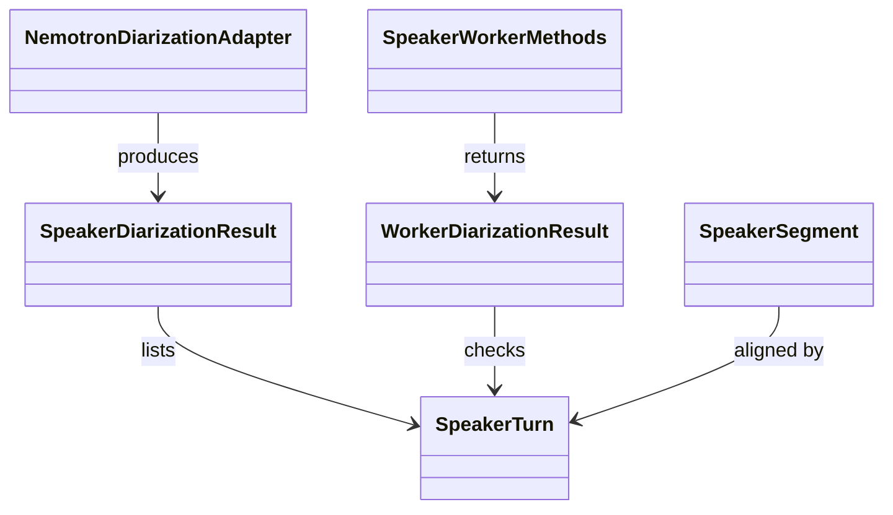
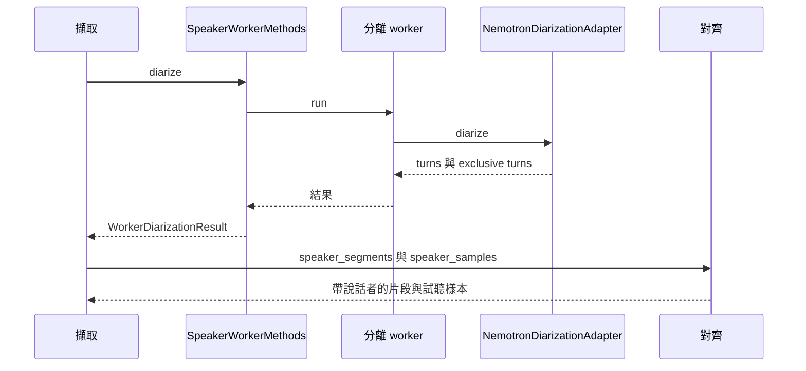

# 說話者分離

## 負責什麼、不負責什麼

說話者分離負責判斷音訊裡誰在什麼時候說話，產出可重疊的說話者片段與互不重疊的片段，並把逐字稿的時間範圍對到說話者。它不執行語音轉寫、文件 OCR 或結構化，也不下載、安裝或移除引擎。

## 用語

說話者片段與說話者的定義見 [glossary 的語音轉寫與說話者分離段落](../../.agents/PLANS/ddd-refactor/glossary.md#語音轉寫與說話者分離)。程式、文件與公開合約沿用相同用語。

## 聚合與不變條件

W5 只搬移現有模組，保留原有行為；W6 才會加入 turn 聚合。現有 `SpeakerTurn` 表示一位說話者連續發言的時間範圍。`NemotronDiarizationAdapter` 由本機模型目錄產生可重疊的 `turns` 與互不重疊的 `exclusive_turns`。對齊只依互斥片段決定一位說話者；平手或沒有覆蓋的時間範圍維持未指定，不猜測。

## 主要流程

## 與其他上下文的關係

語音轉寫提供帶時間的逐字稿；本上下文只負責說話者片段與對齊，兩邊的 worker 互不依賴。引擎供應提供 `speaker-diarization` 的 worker 與模型目錄。擷取讀取對齊後的片段與試聽樣本，寫入原始擷取。本上下文不讀取文件 OCR、結構化或擷取儲存。W5 保留既有跨模組依賴，不表示已完成 W6 的領域模型與分層整理。

## 規則與資料來源

已搬入 `capture_runtime.diarization.infrastructure` 的模組是 `speaker_diarization`（本機 Nemotron 轉接；辨識到 CUDA 失敗時以同一模型在 CPU 重試一次）、`speaker_turns`（`SpeakerTurn` 與說話者標籤）、`speaker_alignment`（`assign_speakers`、`speaker_segments`、`speaker_samples`）與 `speaker_worker_result`（結果檢查與 `SpeakerWorkerMethods`）。`workers/diarization_main.py` 仍是 PyInstaller 的 worker 進入點，只更新 import。公開型別仍由 `capture_runtime.contracts` 定義。W6 將加入 turn 聚合。遷移邊界與後續步驟見 [DDD 重構計畫](../../.agents/PLANS/ddd-refactor/README.md)。
