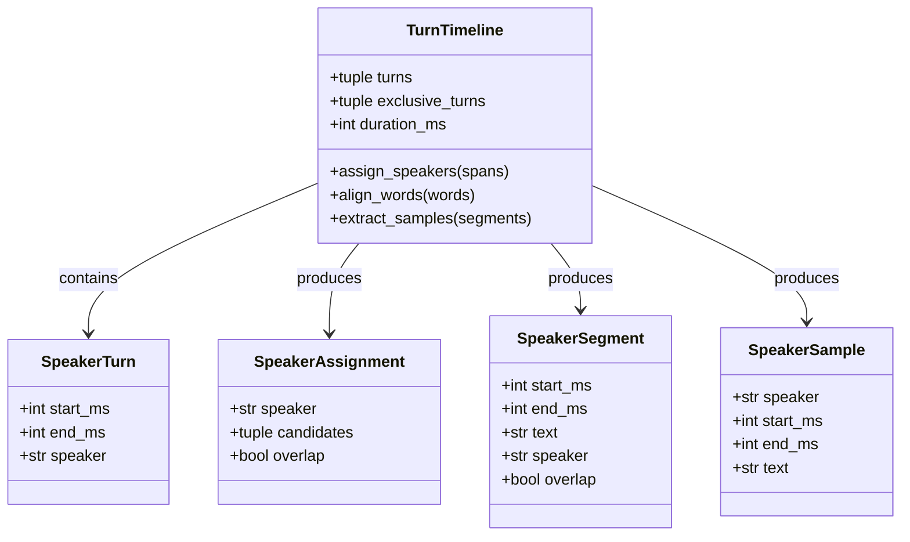
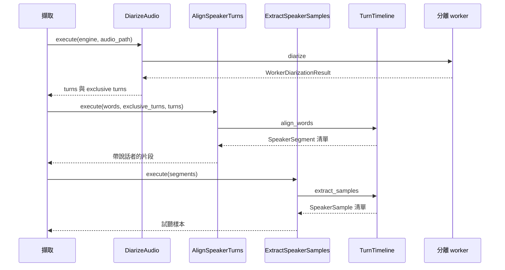

# 說話者分離

## 負責什麼、不負責什麼

說話者分離負責判斷音訊裡誰在什麼時候說話，產出可重疊的說話者片段與互不重疊的片段，並把逐字稿的時間範圍對到說話者。它不執行語音轉寫、文件 OCR 或結構化，也不下載、安裝或移除引擎。

## 用語

說話者片段與說話者的定義見 [glossary 的語音轉寫與說話者分離段落](../../.agents/PLANS/ddd-refactor/glossary.md#語音轉寫與說話者分離)。程式、文件與公開合約沿用相同用語。

## 聚合與不變條件

說話者分離上下文依聚合分子套件（W6 定案）：
1. **片段時間軸 (`turn`)**：
   - `TurnTimeline` 為聚合根，守住不變條件：互斥片段（`exclusive_turns`）按時間遞增且**絕不可互相重疊**；所有片段的時間範圍必須合法（`0 <= start_ms < end_ms <= duration_ms`）。
   - 值物件 `SpeakerTurn` 代表單一說話者的時間範圍，說話者標籤必須符合標籤規範（`SPEAKER_LABEL`）。
   - 對齊結果 `SpeakerAssignment`、對齊後的詞彙段落 `SpeakerSegment` 與試聽樣本 `SpeakerSample` 均為純領域值物件。
   - 對齊政策：對齊只依互斥片段決定一位說話者；平手或沒有覆蓋的時間範圍維持未指定，不猜測。試聽樣本只取單獨發言且在長度上限（10 秒）內的段落。

## 主要流程

## 用例

| 中文 | 用例（程式名稱） | 說明 |
| :--- | :--- | :--- |
| 對齊說話者片段 | `AlignSpeakerTurns` | 將語音轉寫的詞彙依分離時間對齊至說話者與重疊狀態 |
| 擷取試聽樣本 | `ExtractSpeakerSamples` | 挑選每位說話者單獨發言且長度適中的試聽樣本片段 |
| 執行說話者分離 | `DiarizeAudio` | 呼叫分離 worker 辨識音訊並產生互斥與可重疊說話者片段 |

## 與其他上下文的關係

語音轉寫提供帶時間的逐字稿；本上下文只負責說話者片段與對齊，兩邊的 worker 互不依賴。引擎供應提供 `speaker-diarization` 的 worker 與模型目錄。擷取讀取對齊後的片段與試聽樣本，寫入原始擷取。本上下文不讀取文件 OCR、結構化或擷取儲存。

## 規則與資料來源

領域模型位於 `capture_runtime.diarization.domain.turn`。用例位於 `capture_runtime.diarization.application.use_cases`。基礎設施位於 `capture_runtime.diarization.infrastructure`：`speaker_diarization`（Nemotron 本機轉接與 CPU 重試政策）、`speaker_worker_result`（worker 結果解析與協定）及 `speaker_alignment`、`speaker_turns` 相容匯出。`workers/diarization_main.py` 是 PyInstaller worker 進入點。

## W6 ??????

Worker ????? domain ? `DiarizationResult`??????? `DiarizeAudio`?`AlignSpeakerTurns` ? `ExtractSpeakerSamples` ???????????????? port ??? infrastructure ?????? worker frame ??????????
