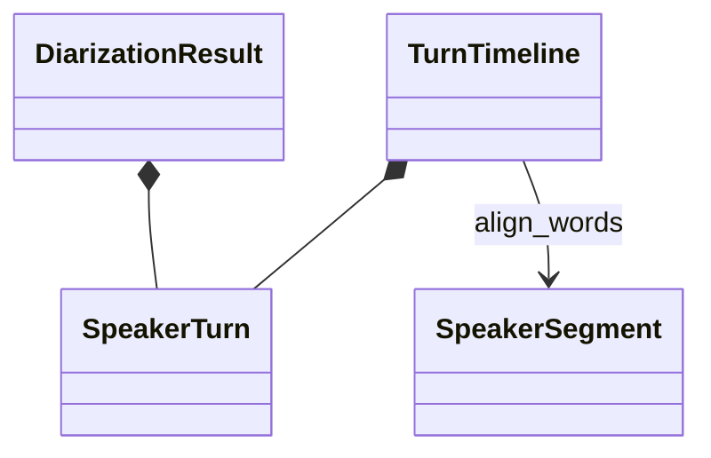
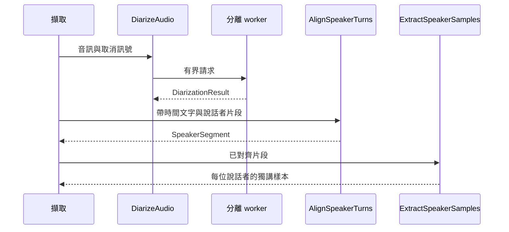

# 說話者分離

## 負責什麼、不負責什麼

辨識匿名說話者片段、對齊文字並挑選獨講樣本。不執行語音轉寫，也不替使用者猜測說話者姓名。

## 用語

用語與公開領域類別見 [glossary](../../.agents/PLANS/ddd-refactor/glossary.md)。概念 ID 與合約值映射以 `capture-vocabulary-v1.json` 為準。

## 用例

| 操作 | 程式名稱 | 說明 |
| --- | --- | --- |
| 對齊說話者 | `AlignSpeakerTurns` | 依片段重疊時間指派文字的說話者。 |
| 分離說話者 | `DiarizeAudio` | 執行有界 worker 請求並傳回領域結果。 |
| 挑選獨講樣本 | `ExtractSpeakerSamples` | 挑選符合長度及無重疊限制的命名樣本。 |

## 聚合與不變條件

`SpeakerTurn` 驗證非負且有序的時間與匿名標籤。`TurnTimeline` 驗證 exclusive turns 不重疊，依時間重疊對齊文字。`DiarizationResult` 保留 worker 模型、裝置、摘要、警告與耗時。

## 主要流程

## 與其他上下文的關係

由擷取組合語音轉寫與說話者分離結果；兩個 worker 互不依賴。

## 規則與資料來源

原 worker frame 與公開輸出保持不變。無法明確指派或多位說話者同時發聲時，保留候選或重疊狀態；只有符合既有最長十秒規則的獨講片段才可作為命名樣本。

## Recording path and memory

Speaker identification passes the finalized ingestion path directly to the speech and
diarization workers. The runtime sniffs only the first 200 bytes and probes timeout
duration from that path; it neither buffers the compressed recording nor writes
worker-source copies. Active captures protect the ingestion from deletion and expiry.
Both recording workers accept nonempty sources up to 2 GiB; PDF/image remain at 50 MiB.
Diarization consumes decoded frames lazily into one mono 16 kHz int16 PCM buffer,
stopping at the configured duration budget (default 90 minutes). Float32 conversion
normalizes in place and releases PCM before inference. Waveform and model memory
still grow with duration; this is not a fixed-memory inference path.

Capture deletion waits for the task and its worker cleanup before removing the
capture record or its last-reference ingestion. Cancellation is requested once;
worker cleanup remains joined even if cancellation is repeated. Deleting a
terminal capture's ingestion also waits for cleanup, while deleting an ingestion
used by a non-terminal capture retains the existing rejection. Disconnecting a
waiting DELETE request cancels only that wait and does not schedule deletion.
Pruning skips live tasks, including tasks whose capture is already cancelled.
