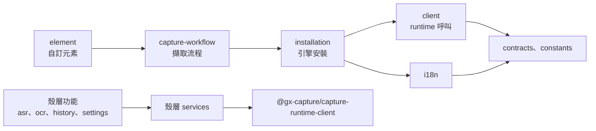
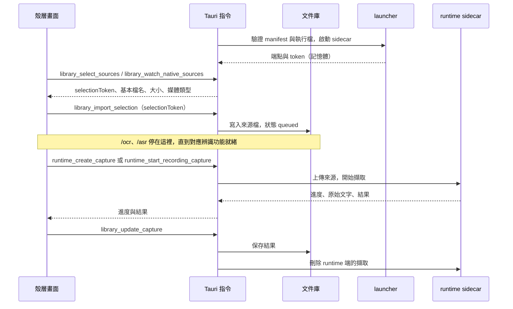

# 工作台主機

## 負責什麼、不負責什麼

Capture Workbench 這個產品本身：畫面、桌面殼層、啟動與看管 runtime sidecar，以及使用者的文件庫。文件庫是耐久資料，由主機持有；runtime 的作業是暫時的，用完就刪。

主機不做辨識，也不碰模型與引擎檔案。它只經[執行環境合約](contracts.md)呼叫 runtime；行程、檔案系統與模型的生命週期屬於 runtime 或 launcher。

## 組成

| 部分 | 程式 | 內容 |
| --- | --- | --- |
| Web Component | `packages/capture-workbench-ui`（`@gx-capture/capture-workbench-ui`） | 發布給其他主機的自訂元素；與主機的 Angular 版本無關，只經 DOM 屬性、事件與 runtime 合約溝通 |
| 桌面殼層 | `apps/capture-workbench` | Angular 畫面：OCR、ASR、紀錄、設定 |
| Tauri 主機 | `apps/capture-workbench-desktop` | 文件庫、Tauri 指令、轉呼叫 runtime、GPU 設定 |
| Sidecar launcher | `packages/capture-sidecar-launcher` | 驗證 runtime 執行檔、啟動 sidecar、loopback 連接埠、bearer token、健康檢查；Cert Prep 與 LAW 也用它 |

### UI 模組（Sheriff）

依功能分資料夾，依賴只往一個方向（`sheriff.config.ts`）：

各層之間的實際依賴見產生的 [UI 模組圖](../architecture/)。

## 用語

| 中文 | 程式名稱 | 意思 |
| --- | --- | --- |
| 文件庫 | `LibraryStore`、`LibraryIndex`、`StoredDocument` | 主機保存的來源檔與擷取結果，存在 App 資料目錄 |
| sidecar | `SidecarConnection` | launcher 啟動的 runtime 行程，以及連它所需的端點與 token |
| runtime manifest | `capture-runtime-manifest.json` | 隨產品發布的 runtime 與 API 版本、文件 schema 版本，以及執行檔與 schema 的大小和 SHA-256；啟動前先驗證 |

## 不變條件

- bearer token 只存在記憶體，不寫進紀錄或檔案。
- Rust 開啟檔案選擇視窗並接收原生拖放，檢查本機一般檔案與格式後保留已開啟的 handle。畫面只收到一次性、限視窗、30 分鐘有效的 selection token，以及基本檔名、大小與媒體類型；`library_import_selection` 消耗 token 後串流匯入。路徑不經過 IPC，空檔由主機拒絕；錄音（含轉錄音軌的影片）上限為 2 GiB，PDF 與圖片仍為 50 MiB。匯入前要求可用磁碟空間至少為來源大小的兩倍加 512 MiB，以容納資料庫與 runtime 的副本。超過 50 MiB 的錄音不載入畫面播放，仍顯示逐字稿與時間戳記。最多保留 64 個 selection；丟棄、到期或視窗銷毀即釋放 handle。事件訂閱及 renderer dialog 權限明確拒絕。
- 文件庫的寫入先記交易日誌再提交（`library/transaction.rs`），寫到一半中斷不會留下不一致的索引。
- 交易失敗後，主機立即在執行中回復（回滾或完成，與開啟時相同）並從磁碟重新載入索引，之後才接受下一次寫入（#343）。回復失敗時讀取照常，寫入在索引鎖內先重試回復；仍失敗就拒絕，不改動已存的資料。留下的已提交日誌同樣要先完成，後續交易才不會覆蓋它。匯入在複製來源時不持有索引鎖，只在寫入索引時取得。
- 向前完成的回復失敗時（例如清理失敗），只有日誌有效、且所有目標檔都已就位時才重新載入索引，寫入仍保持封鎖直到回復完成；回滾或無法讀取的日誌則保留記憶體中的索引。
- 當機後的文件庫在 `open` 時收尾：完成交易回復並讀取主索引後，處理 `items/` 中最後修改已超過一小時、不是符號連結或重新剖析點的目錄。名稱為合法文件 ID 但未被索引引用的目錄（匯入在寫索引前中斷）會移除；刪除留下的 `<id>.deleting`，若文件仍在索引中就改回原名（刪除在寫索引前中斷），否則移除。使用備份索引，或索引不存在而 `items/` 有內容時，不移除也不改名任何項目目錄，並在索引記下 `orphanCleanupDisabled`：之後每次儲存都帶著它，這份文件庫從此不再做孤兒清理，因為備份可能少列已發布的文件。`items/` 本身若是符號連結或 junction，也不清理。
- 擷取結束時，先把結果存進文件庫，再刪除 runtime 端的擷取。
- 上傳期間取消文件時，原生端在分段之間停止上傳並刪除 runtime 端的 ingestion，文件記為已取消。取消若比上傳的開始更早送達，會保留到該上傳開始時套用；上傳完成後才送達的取消，改由 renderer 透過 runtime 取消已建立的擷取。
- 主機只啟動通過 manifest 與執行檔驗證的 runtime。

## 主要流程

ASR 佇列透過擷取服務的公開 `reattach$` 與 `startDocument$` 協調擷取，沿用匯入時儲存的語言與說話者選項。每個 capture ID 只自動重新連接一次；失敗後由使用者明確重試或重新開始。舊的即時逐字稿由擷取服務在新的擷取真正開始的那一刻清除，畫面只採用目前 capture ID 的 partial；被忽略（文件已被佔有）或不成立的重試、重新開始不會清除進行中擷取的逐字稿，接回同一個擷取的重試也保留它。

佇列手上的文件清單可能比擷取服務最後一次寫入還舊（重新載入的回覆還沒到）。因此擷取服務的 `startDocument$`、`reattach$` 與 `retry$` 在動作前先向文件庫讀取該文件目前儲存的狀態，並依它決定：只有仍是 `queued` 的文件才開始擷取；已經沒有 `captureId` 的文件不再讀取 runtime 端的擷取；結果已經保存、只剩 runtime 清理的文件只重試清理。佇列的要求因清單過舊而不成立時，擷取服務要求重新載入清單。

決定從訂閱入口的那一刻起佔有該文件，和進行中的擷取一樣（`isDocumentClaimed`）。入口都是冷的 Observable：只呼叫而不訂閱，不佔有、不讀取也不寫入；佇列與殼層的每個呼叫端都在呼叫的同一個同步步驟裡訂閱，所以對它們而言呼叫就是佔有的起點。
同一份文件同時只有一個決定或一次擷取，被佔有的文件不接受其他入口（開始、重新連接、重試、重新開始與取消入口 `cancelDocument$` 都不動作；佇列對被佔有文件的取消交給 `cancel`，由進行中的決定或擷取套用），也不能刪除；錄音佇列把它算成佔用中，不會同時開始下一筆。重新開始（`restartLost$`）走同一道檢查，只有儲存的文件仍顯示擷取已遺失時，才將文件排回佇列並開始一個新的擷取。決定進行中收到的取消優先：不會開始擷取，文件記為已取消；若決定的結果是接回 runtime 端還沒有終止資料的擷取，取消會先送到 runtime，不先讀取該擷取；runtime 的回覆就是擷取當下的狀態（已取消，或取消到達前已經結束，這時保留結果），取消被拒絕時保留連結並記為取消失敗。接回時第一次讀取擷取還沒回覆就收到的取消，同樣立即送出，並放棄那次讀取：它之後才到的回覆或失敗都不採用，以取消的回覆為準；進行中的單次擷取（OCR）的輪詢讀取也是如此。進行中的錄音與接回的錄音也放棄取消當下還在途中的輪詢讀取，它之後才到的回覆或失敗都不採用：取消的回覆若已是終止狀態就直接保存，不再讀取事件、即時逐字稿或擷取狀態；回覆仍在進行時才繼續輪詢，取消被拒絕時仍保留連結並記為取消失敗。已保存終止資料的文件不送取消，只做清理。
決定以錯誤結束時（讀取儲存的文件失敗，或它引出的文件庫寫入失敗），佔有與佇列的重新連接記號都會釋放；該文件進入 2 秒的暫停（`isDecisionPaused`），每份文件各自計時：暫停期間佇列對它的要求不動作，佇列也不把它記成已重新連接。暫停結束時擷取服務遞增 `failedDecisions`，兩個佇列讀取它，因此不必有人重新載入清單就會自己再看一次並重新決定。持續失敗時每份文件每次暫停只重試一次，先後失敗的兩份文件不會縮短彼此的暫停；使用者明確按下取消、重試或重新開始會結束該文件的暫停。決定進行中收到、但還沒套用的取消不會因此遺失：它留在擷取服務裡，由該文件的下一個決定套用（等待中的文件記為已取消，接回的擷取向 runtime 取消），或在儲存的文件已經沒有可取消的東西、或讀取證實文件已不存在時丟棄；文件經由文件庫刪除時也一併丟棄，不會留在已刪除的文件上；使用者明確按下重試或重新開始是新的要求，不受先前未套用的取消影響。

需要恢復且仍有 `captureId` 的文件顯示「重試」（`retry$`）。重試會向 runtime 查詢同一個擷取：已結束就取得並保存結果或終止狀態，仍在進行就繼續追蹤。擷取狀態查詢回覆 HTTP 404 時，文件寫為 `recovery_required`，保留 `capture_recovery_required` 並清除 `captureId`，重新載入後也會顯示「重新開始」。其他查詢錯誤保留連結，仍可重試。舊版帶有相同代碼及連結的文件也依這個規則處理，即使有先前保存的原始資料。

- `capture_recovery_required` 表示擷取需要恢復。仍有連結時，擷取是否存在有待確認；沒有連結時，佇列提供「重新開始」。沒有連結的處理中或保存中文件也提供「重新開始」。這個動作會開始一個新的擷取，以新結果取代舊結果。若清單仍顯示已失效的「重試」，服務會要求重新載入清單。
- `cancel_failed` 表示 runtime 拒絕取消，或取消請求結束時沒有收到回覆。文件保留連結，重試時重新連接擷取，依目前狀態繼續追蹤或保存。runtime 已回覆取消後，如果後續查詢、取得結果或寫入文件庫失敗，依失敗步驟分類：尚待恢復擷取時記為 `capture_recovery_required`，終止資料已保存而清理失敗時記為 `runtime_cleanup_failed`。
- `runtime_cleanup_failed` 表示終止資料已保存，仍需刪除 runtime 端的擷取或清除文件的連結。重試只做清理。

一般失敗或已取消且沒有 `captureId` 的文件仍可用「重試」開始新的擷取。已保存結果或還在等待的文件不會因重試而重新擷取。

只剩 runtime 清理的文件保留它已儲存的終止狀態：終止結果已知的清理紀錄（`runtime_cleanup_failed`），`stage` 寫入終止階段，清理重試依它還原狀態（`awaiting_structuring` 僅對 OCR 媒體類型 PDF 或圖片代表 `awaiting_confirmation`）；結果無法判定的舊版紀錄（見本段後文）保留原本的 `stage`，清理再次失敗時也一樣。已保存終止資料的文件（已結束、等待確認的 OCR 結果、或清理紀錄）只做清理，不再讀取 runtime 端的擷取：擷取已不存在（主機把刪除的 404 視為完成）不會讓它變成「擷取遺失」，佇列也就不會對它提供重新開始。舊版在取消連結失敗時可能把錄音的清理紀錄寫成非終止的 `stage`（或結構化檢查點的 `awaiting_structuring`）；這種紀錄依文件自己保存的資料還原狀態（有終止錯誤是失敗，有保存結果是完成），兩者都沒有時保留原狀態，只移除連結，不猜測。只有沒有終止資料的連結文件才向 runtime 查詢該擷取。

ASR 與 OCR 佇列取消未被佔有的文件時，都由擷取服務的 `cancelDocument$` 佔有文件並讀取文件庫。只在儲存狀態仍是 `queued` 且沒有 `captureId` 時，才把文件寫成 `canceled`（`stage` 為 `cancelled`，沒有擷取連結）並重新載入清單。仍有擷取連結但沒有終止資料時，沿用重新連接的流程向 runtime 取消，依回覆保存狀態。runtime 尚未就緒時先重新載入清單，保留取消供下一次決定套用。已有終止資料、只剩清理或文件已不存在時，只重新載入清單。使用者明確取消會結束該文件的暫停，立即重新讀取；若讀取或等待中文件的寫入失敗，則釋放佔有、顯示錯誤並重新暫停，取消仍留給下一次決定。第一個取消還在決定時，再次取消共用同一次決定。ASR 佇列會自動重新連接仍有連結的處理中、保存中與待恢復錄音，每個 capture ID 一次。取消失敗的錄音等使用者明確按下重試；已確認擷取遺失的文件沒有連結，等使用者按下重新開始。OCR 佇列只自動重新連接仍有連結的處理中與保存中文件；重新載入時，仍有連結的待恢復文件等使用者按下重試。

ASR 的顯示與啟動順序共用 OCR 的匯入順序選擇器：先反轉文件庫的新到舊順序，再依建立時間穩定排序，同毫秒匯入仍按選取順序處理。批次匯入逐筆收集錯誤，單筆失敗不會阻止後續檔案匯入。

語音辨識已就緒而說話者辨識未安裝時，ASR 選項列顯示小型外框安裝按鈕與預估大小；安裝排隊或執行中改顯示簡短的進度文字。大小與百分比由佇列 store 推導，取消安裝留在「設定 › 辨識功能」。

`/ocr` 與 `/asr` 把匯入和擷取分開。丟進來或選取的檔案以 selection token 呼叫 `library_import_selection`，文件庫立刻記成 `queued`、沒有 `captureId`，畫面顯示等待中；對應的辨識引擎（`text-recognition` 或 `speech-recognition`）還沒安裝也一樣，安裝完成後等待中的檔案會自己開始擷取，不需要再按一次。`library_select_sources` 支援 `documents`、`recordings` 與 `all` 三種選取類型。畫面只要求 `documents`（`/ocr`）和 `recordings`（`/asr`）；`all` 仍是指令接受的類型，渲染程序不再要求它。整個視窗只有一個原生 drop channel：在 `/ocr` 路徑進入 OCR 佇列、在 `/asr` 路徑進入 ASR 佇列（拒絕非錄音格式），在其他頁面則由工作台先匯入整批 selection，再依序開始擷取。

等待中的檔案留在文件庫。重新載入視窗後，佇列仍列出它們，並接回還在跑的擷取。整個程式重開後，runtime 作業已經消失的文件或錄音標成 `recovery_required`，佇列顯示已中斷，可以重新開始。

PDF 可以帶 `captureOptions` 的 `pdfPageCount`（前 K 頁，只接受 `1..=K`，最多 500）。錄音可以帶 `spokenLanguage`（依 runtime 合約的語系代碼，畫面提供 `zh`／`en`／`ja`，主機轉送 `POST /v2/captures` 並拒絕無效值，錯誤不含路徑）與 `identifySpeakers`；`/asr` 佇列與自動啟動順序依匯入順序（`createdAtMs` 升冪，同時間保留加入順序，#348），進行中時透過 `recordingOperations` 與 `streamingPartials` 顯示即時逐字稿與「已聽到／總長」。舊索引沒有這個欄位也讀得回來。直書日文閱讀器沒有逐次開關：runtime 在 `vertical-japanese-reader` 已安裝時會自己把它交給辨識工作。

`/ocr` 的 `.txt` 由畫面用文件庫裡的原始文字組成（頁面順序，頁與頁之間空一行），不新增匯出指令。沒有 Ollama 的結構化結果時，只要原始文字在，這一頁就算完成。列表上的 `hasRaw` 表示原始文字已經寫進文件庫。

## 與其他上下文的關係

主機只是合約的消費者，和 Cert Prep、LAW 地位相同；runtime 不知道主機。引擎安裝也經合約（`runtime_start_installation` 等指令）由 runtime 執行。設定 › 辨識功能在確認大小後以 `runtime_uninstall_requirement` 移除已安裝的引擎；文件庫裡的文件與逐字稿留在這台電腦。

## 規則與資料來源

- launcher 只有一條啟動路徑：每次啟動用新的 loopback port 與 token，runtime 放進 `KILL_ON_JOB_CLOSE` 的 Job；主機結束時系統關閉 Job 並停掉整棵程序樹。launcher 不寫磁碟、不記錄啟動過的程序；runtime 在執行啟動清理前先對自己的 App 資料目錄取得獨佔鎖（`runtime.lock`，等候 10 秒仍被占用時以代碼 `10` 拒絕啟動），當機後殘留的檔案由 runtime 啟動時清掉（見 [Phase 2 SPEC 的 runtime process lifecycle](../../.agents/SPECS/capture-runtime-042-p2-hardening.md#runtime-process-lifecycle)）。
- 桌面版只執行一個實例（#343）：再次啟動時不開第二個視窗，而是把既有視窗還原、顯示並帶到前景，第二個行程隨即結束，不使用它的參數與工作目錄。文件庫索引與 runtime 的 App 資料因此只有一個擁有者。使用隔離資料目錄的建置（`acceptance-harness`，包括 deterministic QA）不套用這項限制，可以與產品同時執行。
- 測試用的假 runtime 只在 QA 安裝檔（Capture Workbench QA Fake Data）與 deterministic smoke 使用，資料寫在獨立目錄，不碰使用者真實的 App 資料（見 [desktop README](../../apps/capture-workbench-desktop/README.md)）。
- 改 UI 模組或殼層資料夾時，同一個 PR 更新 `sheriff.config.ts` 並執行 `pnpm run architecture:update`。

工作台先匯入同批的所有 selection，再依序擷取，避免後續 token 在前一份錄音轉錄期間過期。佇列拒絕的 selection 立即交還 Rust 丟棄；原生拒絕原因依批次計數呈現，不含來源路徑或檔名。
