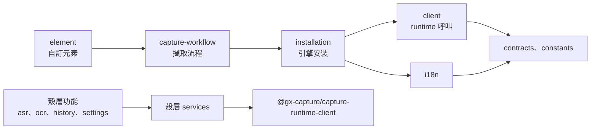
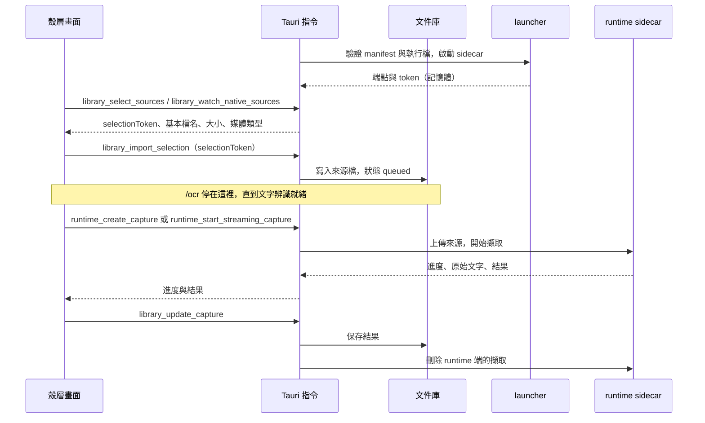

# 工作台主機

## 負責什麼、不負責什麼

Capture Workbench 這個產品本身：畫面、桌面殼層、啟動與看管 runtime sidecar，以及使用者的文件庫。文件庫是耐久資料，由主機持有；runtime 的作業是暫時的，用完就刪。

主機不做辨識，也不碰模型與引擎檔案。它只經[執行環境合約](contracts.md)呼叫 runtime；行程、檔案系統與模型的生命週期屬於 runtime 或 launcher。

## 組成

| 部分 | 程式 | 內容 |
| --- | --- | --- |
| Web Component | `packages/capture-workbench-ui`（`@gx-capture/capture-workbench-ui`） | 發布給其他主機的自訂元素；與主機的 Angular 版本無關，只經 DOM 屬性、事件與 runtime 合約溝通 |
| 桌面殼層 | `apps/capture-workbench` | Angular 畫面：OCR、ASR、紀錄、設定 |
| Tauri 主機 | `apps/capture-workbench-desktop` | 文件庫、Tauri 指令、轉呼叫 runtime、GPU 設定 |
| Sidecar launcher | `packages/capture-sidecar-launcher` | 驗證 runtime 執行檔、啟動 sidecar、loopback 連接埠、bearer token、健康檢查；Cert Prep 與 LAW 也用它 |

### UI 模組（Sheriff）

依功能分資料夾，依賴只往一個方向（`sheriff.config.ts`）：

各層之間的實際依賴見產生的 [UI 模組圖](../architecture/)。

## 用語

| 中文 | 程式名稱 | 意思 |
| --- | --- | --- |
| 文件庫 | `LibraryStore`、`LibraryIndex`、`StoredDocument` | 主機保存的來源檔與擷取結果，存在 App 資料目錄 |
| sidecar | `SidecarConnection` | launcher 啟動的 runtime 行程，以及連它所需的端點與 token |
| runtime manifest | `capture-runtime-manifest.json` | 隨產品發布的 runtime 與 API 版本、文件 schema 版本，以及執行檔與 schema 的大小和 SHA-256；啟動前先驗證 |

## 不變條件

- bearer token 只存在記憶體，不寫進紀錄或檔案。
- Rust 開啟檔案選擇視窗並接收原生拖放，檢查本機一般檔案與格式後保留已開啟的 handle。畫面只收到一次性、限視窗、30 分鐘有效的 selection token，以及基本檔名、大小與媒體類型；`library_import_selection` 消耗 token 後串流匯入。路徑不經過 IPC，空檔由主機拒絕；錄音（含轉錄音軌的影片）上限為 2 GiB，PDF 與圖片仍為 50 MiB。匯入前要求可用磁碟空間至少為來源大小的兩倍加 512 MiB，以容納資料庫與 runtime 的副本。超過 50 MiB 的錄音不載入畫面播放，仍顯示逐字稿與時間戳記。最多保留 64 個 selection；丟棄、到期或視窗銷毀即釋放 handle。事件訂閱及 renderer dialog 權限明確拒絕。
- 文件庫的寫入先記交易日誌再提交（`library/transaction.rs`），寫到一半中斷不會留下不一致的索引。
- 擷取結束時，先把結果存進文件庫，再刪除 runtime 端的擷取。
- 上傳期間取消文件時，原生端在分段之間停止上傳並刪除 runtime 端的 ingestion，文件記為已取消。取消若比上傳的開始更早送達，會保留到該上傳開始時套用；上傳完成後才送達的取消，改由 renderer 透過 runtime 取消已建立的擷取。
- 主機只啟動通過 manifest 與執行檔驗證的 runtime。

## 主要流程

`/ocr` 把匯入和擷取分開。丟進來或選取的 PDF、圖片以 selection token 呼叫 `library_import_selection`，文件庫立刻記成 `queued`、沒有 `captureId`，畫面顯示等待中。`windowsml-ocr` 還沒安裝也一樣。安裝完成後，等待中的文件自己開始擷取，不需要再按一次。整個視窗只有一個原生 drop channel：在 `/ocr` 路徑進入這個佇列，在其他頁面則由工作台先匯入整批 selection，再依序開始擷取。`/history` 的選擇檔案仍接受錄音。

等待中的文件留在文件庫。重新載入視窗後，佇列仍列出它們，並接回還在跑的擷取。整個程式重開後，runtime 作業已經消失的文件標成 `recovery_required`，`/ocr` 顯示已中斷，可以重新開始。

PDF 可以帶 `captureOptions`，目前只有 `pdfPageCount`（前 K 頁，只接受 `1..=K`，最多 500）。舊索引沒有這個欄位也讀得回來。直書日文閱讀器沒有逐次開關：runtime 在 `vertical-japanese-reader` 已安裝時會自己把它交給辨識工作。

`/ocr` 的 `.txt` 由畫面用文件庫裡的原始文字組成（頁面順序，頁與頁之間空一行），不新增匯出指令。沒有 Ollama 的結構化結果時，只要原始文字在，這一頁就算完成。列表上的 `hasRaw` 表示原始文字已經寫進文件庫。

## 與其他上下文的關係

主機只是合約的消費者，和 Cert Prep、LAW 地位相同；runtime 不知道主機。引擎安裝也經合約（`runtime_start_installation` 等指令）由 runtime 執行。設定 › 辨識功能在確認大小後以 `runtime_uninstall_requirement` 移除已安裝的引擎；文件庫裡的文件與逐字稿留在這台電腦。

## 規則與資料來源

- launcher 只有一條啟動路徑：每次啟動用新的 loopback port 與 token，runtime 放進 `KILL_ON_JOB_CLOSE` 的 Job；主機結束時系統關閉 Job 並停掉整棵程序樹。launcher 不寫磁碟、不記錄啟動過的程序；runtime 在執行啟動清理前先對自己的 App 資料目錄取得獨佔鎖（`runtime.lock`，等候 10 秒仍被占用時以代碼 `10` 拒絕啟動），當機後殘留的檔案由 runtime 啟動時清掉（見 [Phase 2 SPEC 的 runtime process lifecycle](../../.agents/SPECS/capture-runtime-042-p2-hardening.md#runtime-process-lifecycle)）。
- 測試用的假 runtime 只在 QA 安裝檔（Capture Workbench QA Fake Data）與 deterministic smoke 使用，資料寫在獨立目錄，不碰使用者真實的 App 資料（見 [desktop README](../../apps/capture-workbench-desktop/README.md)）。
- 改 UI 模組或殼層資料夾時，同一個 PR 更新 `sheriff.config.ts` 並執行 `pnpm run architecture:update`。

工作台先匯入同批的所有 selection，再依序擷取，避免後續 token 在前一份錄音轉錄期間過期。佇列拒絕的 selection 立即交還 Rust 丟棄；原生拒絕原因依批次計數呈現，不含來源路徑或檔名。
