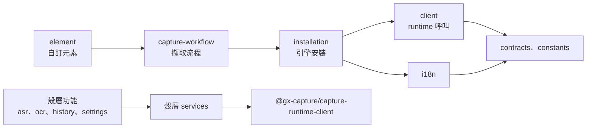
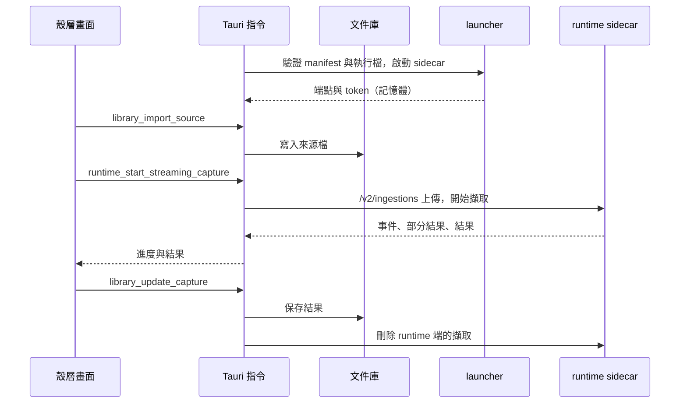

# 工作台主機

## 負責什麼、不負責什麼

Capture Workbench 這個產品本身：畫面、桌面殼層、啟動與看管 runtime sidecar，以及使用者的文件庫。文件庫是耐久資料，由主機持有；runtime 的作業是暫時的，用完就刪。

主機不做辨識，也不碰模型與引擎檔案。它只經[執行環境合約](contracts.md)呼叫 runtime；行程、檔案系統與模型的生命週期屬於 runtime 或 launcher。

## 組成

| 部分 | 程式 | 內容 |
| --- | --- | --- |
| Web Component | `packages/capture-workbench-ui`（`@gx-capture/capture-workbench-ui`） | 發布給其他主機的自訂元素；與主機的 Angular 版本無關，只經 DOM 屬性、事件與 runtime 合約溝通 |
| 桌面殼層 | `apps/capture-workbench` | Angular 畫面：OCR、ASR、紀錄、設定 |
| Tauri 主機 | `apps/capture-workbench-desktop` | 文件庫、Tauri 指令、轉呼叫 runtime、GPU 設定 |
| Sidecar launcher | `packages/capture-sidecar-launcher` | 驗證 runtime 執行檔、啟動 sidecar、loopback 連接埠、bearer token、健康檢查；Cert Prep 與 LAW 也用它 |

### UI 模組（Sheriff）

依功能分資料夾，依賴只往一個方向（`sheriff.config.ts`）：

各層之間的實際依賴見產生的 [UI 模組圖](../architecture/)。

## 用語

| 中文 | 程式名稱 | 意思 |
| --- | --- | --- |
| 文件庫 | `LibraryStore`、`LibraryIndex`、`StoredDocument` | 主機保存的來源檔與擷取結果，存在 App 資料目錄 |
| sidecar | `SidecarConnection` | launcher 啟動的 runtime 行程，以及連它所需的端點與 token |
| runtime manifest | `capture-runtime-manifest.json` | 隨產品發布的 runtime 與 API 版本、文件 schema 版本，以及執行檔與 schema 的大小和 SHA-256；啟動前先驗證 |

## 不變條件

- bearer token 只存在記憶體，不寫進紀錄或檔案。
- renderer 拿不到來源檔的路徑：匯入、讀取來源位元組、匯出都經 Tauri 指令。
- 文件庫的寫入先記交易日誌再提交（`library/transaction.rs`），寫到一半中斷不會留下不一致的索引。
- 擷取結束時，先把結果存進文件庫，再刪除 runtime 端的擷取。
- 主機只啟動通過 manifest 與執行檔驗證的 runtime。

## 主要流程

## 與其他上下文的關係

主機只是合約的消費者，和 Cert Prep、LAW 地位相同；runtime 不知道主機。引擎安裝也經合約（`runtime_start_installation` 等指令）由 runtime 執行。

## 規則與資料來源

- launcher 的啟動日誌（journal）與重啟對帳（reconcile）目前只有驗證值與讀取觀察的基礎，尚未接上正式路徑；是否接上待產品負責人決定（[#246](https://github.com/gx-capture/capture-workbench/issues/246)）。
- 測試用的假 runtime 只在 QA 安裝檔（Capture Workbench QA Fake Data）與 deterministic smoke 使用，資料寫在獨立目錄，不碰使用者真實的 App 資料（見 [desktop README](../../apps/capture-workbench-desktop/README.md)）。
- 改 UI 模組或殼層資料夾時，同一個 PR 更新 `sheriff.config.ts` 並執行 `pnpm run architecture:update`。
