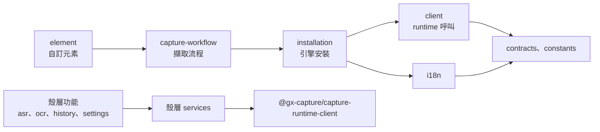
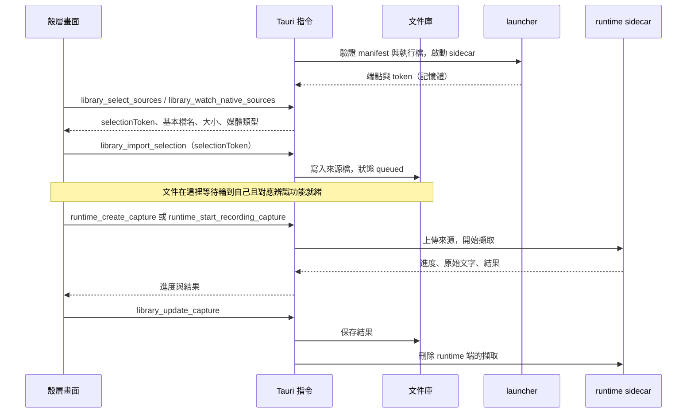

# 工作台主機

## 負責什麼、不負責什麼

Capture Workbench 這個產品本身：畫面、桌面殼層、啟動與看管 runtime sidecar，以及使用者的文件庫。文件庫是耐久資料，由主機持有；runtime 的作業是暫時的，用完就刪。

主機不做辨識，也不碰模型與引擎檔案。它只經[執行環境合約](contracts.md)呼叫 runtime；行程、檔案系統與模型的生命週期屬於 runtime 或 launcher。

## 組成

| 部分 | 程式 | 內容 |
| --- | --- | --- |
| Web Component | `packages/capture-workbench-ui`（`@gx-capture/capture-workbench-ui`） | 發布給其他主機的自訂元素；與主機的 Angular 版本無關，只經 DOM 屬性、事件與 runtime 合約溝通 |
| 桌面殼層 | `apps/capture-workbench` | Angular 畫面：OCR、ASR、紀錄、設定 |
| Tauri 主機 | `apps/capture-workbench-desktop` | 文件庫、Tauri 指令、轉呼叫 runtime、GPU 設定 |
| Sidecar launcher | `packages/capture-sidecar-launcher` | 驗證 runtime 執行檔、啟動 sidecar、loopback 連接埠、bearer token、健康檢查；Cert Prep 與 LAW 也用它 |

### UI 模組（Sheriff）

依功能分資料夾，依賴只往一個方向（`sheriff.config.ts`）：

各層之間的實際依賴見產生的 [UI 模組圖](../architecture/)。

## 用語

| 中文 | 程式名稱 | 意思 |
| --- | --- | --- |
| 文件庫 | `LibraryStore`、`LibraryIndex`、`StoredDocument` | 主機保存的來源檔與擷取結果，存在 App 資料目錄 |
| sidecar | `SidecarConnection` | launcher 啟動的 runtime 行程，以及連它所需的端點與 token |
| runtime manifest | `capture-runtime-manifest.json` | 隨產品發布的 runtime 與 API 版本、文件 schema 版本，以及執行檔與 schema 的大小和 SHA-256；啟動前先驗證 |

## 不變條件

- bearer token 只存在記憶體，不寫進紀錄或檔案。
- Rust 開啟檔案選擇視窗並接收原生拖放，檢查本機一般檔案與格式後保留已開啟的 handle。畫面只收到一次性、限視窗、30 分鐘有效的 selection token，以及基本檔名、大小與媒體類型；`library_import_selection` 消耗 token 後串流匯入。路徑不經過 IPC，空檔由主機拒絕；錄音（含轉錄音軌的影片）上限為 2 GiB，PDF 與圖片仍為 50 MiB。匯入前要求可用磁碟空間至少為來源大小的兩倍加 512 MiB，以容納資料庫與 runtime 的副本。超過 50 MiB 的錄音不載入畫面播放，仍顯示逐字稿與時間戳記。最多保留 64 個 selection；丟棄、到期或視窗銷毀即釋放 handle。事件訂閱及 renderer dialog 權限明確拒絕。
- 文件庫的寫入先記交易日誌再提交（`library/transaction.rs`），寫到一半中斷不會留下不一致的索引。
- 交易失敗後，主機立即在執行中回復（回滾或完成，與開啟時相同）並從磁碟重新載入索引，之後才接受下一次寫入（#343）。回復失敗時讀取照常，寫入在索引鎖內先重試回復；仍失敗就拒絕，不改動已存的資料。留下的已提交日誌同樣要先完成，後續交易才不會覆蓋它。匯入在複製來源時不持有索引鎖，只在寫入索引時取得。
- 向前完成的回復失敗時（例如清理失敗），只有日誌有效、且所有目標檔都已就位時才重新載入索引，寫入仍保持封鎖直到回復完成；回滾或無法讀取的日誌則保留記憶體中的索引。
- 當機後的文件庫在 `open` 時收尾：完成交易回復並讀取主索引後，處理 `items/` 中最後修改已超過一小時、不是符號連結或重新剖析點的目錄。名稱為合法文件 ID 但未被索引引用的目錄（匯入在寫索引前中斷）會移除；刪除留下的 `<id>.deleting`，若文件仍在索引中就改回原名（刪除在寫索引前中斷），否則移除。使用備份索引，或索引不存在而 `items/` 有內容時，不移除也不改名任何項目目錄，並在索引記下 `orphanCleanupDisabled`：之後每次儲存都帶著它，這份文件庫從此不再做孤兒清理，因為備份可能少列已發布的文件。`items/` 本身若是符號連結或 junction，也不清理。
- 擷取結束時，先把結果存進文件庫，再刪除 runtime 端的擷取。
- 上傳期間取消文件時，原生端在分段之間停止上傳並刪除 runtime 端的 ingestion，文件記為已取消。取消若比上傳的開始更早送達，會保留到該上傳開始時套用；上傳完成後才送達的取消，改由畫面送出一次 runtime 刪除；取消後才傳回的擷取 ID 也只送一次 runtime 刪除，絕不寫入連結。
- 擷取屬於啟動它的這一次程式執行；重新載入或重開後不接回舊擷取，舊連結只作刪除地址。
- 一次只執行一筆擷取，文件與錄音依匯入順序共用同一個排隊。
- 每次擷取只做一次終止寫入；寫入結束後（含寫入失敗），僅在已有擷取 ID、取消未曾先送出刪除且 runtime 就緒時，才以不等待、不追蹤的方式刪除 runtime 端的擷取。
- 已有原始文字的文件不可原地重新擷取；若要重做，必須刪除後重新匯入。
- 主機只啟動通過 manifest 與執行檔驗證的 runtime。
- `LibraryCaptureUpdate` 只有在明確傳入 `clearCaptureId: true` 時才清除已存的 `captureId`；同時省略 `captureId` 與 `clearCaptureId` 會保留原連結。

## 主要流程

- **一次一筆、依匯入順序**：擷取服務只有一個准許入口，從程式啟動起在任何頁面都會自動運作。每次只執行一筆擷取（文件與錄音共用排隊），依匯入順序取用最舊、對應辨識功能已就緒且沒有本輪記憶體失敗標記的「等待中」文件；前一筆的最後一次寫入回覆後，才開始下一筆。功能未安裝的文件不卡住其他文件。等待中的列在各佇列顯示「等待中」與「取消」。
- **中斷與重新開始**：擷取屬於啟動它的這一次程式執行；重新載入或重開後，仍記為 `processing` 的列（不論有無連結）由「這次執行未處理它」推導為「已中斷」，不改寫資料、不提供「取消」，也不顯示即時逐字稿。runtime 就緒時，主機對每個舊連結送出一次不追蹤的 runtime 刪除。按下「重新開始」需要 runtime 就緒；對仍記為 `queued` 但帶有本輪失敗標記的列，只清除該標記（不寫入文件庫）；其餘可重試列則對舊連結送出不等待的 runtime 刪除，並存回 `queued`（清除連結與錯誤）。
- **取消**：主機沒有取消擷取的指令，runtime 刪除會先停掉工作再移除擷取（404 視為成功）。取消「處理中」的列時，若已有擷取 ID，先送出 `DELETE` 並等它回覆（或逾時）後才寫入 `canceled`；若正在上傳且尚無擷取 ID，由主機取消上傳並交由建立結果決定；若尚未開始上傳也沒有擷取 ID，則不送出擷取刪除。「取消中」狀態會維持到文件庫寫入結束。寫入成功才存成 `canceled`（清除連結、不留原始文字）；寫入失敗則保留最後已提交的狀態與原連結，並記下本輪失敗標記。取消在終止寫入送出前優先，送出後無效。取消「等待中」的列直接存成 `canceled`，不呼叫 runtime。
- **結果的保存**：完成的錄音在同一次寫入存成 `completed`（含結果、清除連結）。OCR 擷取只在 runtime 回報 `awaiting_structuring` 檢查點時，於同一次寫入存成 `awaiting_confirmation`（含原始文字與完成的證據、清除連結）；主機文件庫接受這組狀態、允許覆寫失敗的證據，且完成的證據只寫一次。終止寫入結束後（含失敗），僅在已有擷取 ID、取消未先送出刪除且 runtime 就緒時，送出不等待、不追蹤的 runtime 刪除。在 OCR 與 ASR 兩個佇列中，顯示為「完成」或已有原始文字（`hasRaw`）的列提供「檢視」；「紀錄」頁的每一列都提供「檢視」，已中斷或需要處理的列也能從結果頁看到原因。只有顯示為「完成」且已有原始文字的列才提供「匯出」（含舊版 `recovery_required` 且階段為 `completed` 的列）。已有原始文字的列從不提供「重新開始」。`library_get` 回傳 `raw: null`、`result: null` 時畫面視為無內容；已開啟的結果頁會在列表有新提交變更時自動重讀明細（不輪詢）。
- **失敗與佔有**：每份文件同時最多只有一個決定、一次擷取或一次刪除，且所有動作都依剛從文件庫讀出的狀態決定（刪除的例外見下條）。失敗即結束該次嘗試、不自動重試：runtime 回報的擷取失敗會把錯誤代碼與 `errorMessage` 存進文件庫（`failed`，無連結、原始文字與證據）並提供「重新開始」；若後續寫入失敗，列維持最後已提交的狀態與當時實際擁有的連結（例如終止寫入失敗時維持 `processing` 與原連結，顯示「已中斷」與「重新開始」）。本輪讀取或終止寫入失敗的紅字原因僅存在記憶體（`unstoredOutcomes`，不入庫），使用者主動按「重新開始」或「取消」寫入失敗則不記原因文字（由頁面錯誤列顯示）；這類失敗不設全域訊息。仍記為 `queued` 且帶有此本輪標記的列顯示「需要處理」（不顯示「等待中」）、准許入口會跳過它、提供「重新開始」（與「刪除」）且不提供佇列「取消」。本輪原因只顯示在因這次執行而顯示「已中斷」或「需要處理」的列上；文件庫之後若顯示「完成」、「已取消」、「等待中」或已存的 `failed`（例如回覆失敗但主機已提交的寫入），該列依已存的狀態顯示，不再顯示本輪原因。OCR 佇列與「紀錄」頁只顯示本輪記憶體原因（不顯示文件庫的 `errorMessage`）；ASR 佇列有本輪原因就顯示它，否則只在列顯示「需要處理」且不是「已中斷」時顯示文件庫的 `errorMessage`；結果頁在文件沒有原始內容時顯示原因列，同樣先取本輪原因，否則取文件庫的 `errorMessage`，狀態與原因出自同一個列狀態；本輪原因在使用者按「重新開始」或「取消」成功後清除。
- **刪除**：所有未被這次執行佔用的列（含帶有連結的列）都可按「刪除」；「紀錄」頁提供「刪除」（不提供「取消」），進行中的列「刪除」停用。刪除會重讀文件庫取得連結，但若重讀失敗或無結果，會刻意改用列表顯示的連結，讓每列都有退路（期間新連上的擷取會留到 runtime 保留期到期再清除）。只要索引項目已移除即視為刪除成功，即使檔案移除失敗亦同（殘留檔案於下次啟動清理）；若有連結則送出不等待的 runtime 刪除。
- **舊版留下的列**：只讀取、不在啟動時改寫。文件庫照原樣讀取並列出舊版存下的 `persisting`、`recovery_required` 與復原欄位（`recoveryCode`、`recoveryMessage`）；`library_update_capture` 拒絕帶有這兩種狀態或任一復原欄位的新寫入，其他有效的 `library_update_capture` 取代擷取狀態時，一併清除該列的復原欄位；`library_save_edits` 只寫入編輯內容，不動這些欄位。舊版留下的 `persisting`、`recovery_required`、帶有連結或已有原始文字的 `queued`、沒有原始文字或屬於錄音的 `awaiting_confirmation`，以及復原碼為 `capture_recovery_required` 的 `failed`，都顯示「已中斷」（僅在沒有原始文字時提供「重新開始」）。若 `recovery_required` 的復原碼為 `runtime_cleanup_failed`，依序看：該媒體類型的終止階段、已存的錯誤代碼（`failed`）、已有原始文字（`completed`），皆無則顯示「已中斷」；佇列中的「檢視」仍依是否顯示「完成」或已有原始文字決定。

不接回舊擷取是刻意的取捨：runtime 的擷取是暫時的，來源檔留在文件庫，任何擷取都能重做；理由與放棄的功能見[決策紀錄](../../.agents/DECISIONS/workbench-capture-ownership.md)。以上行為由 dev host 的生命週期旅程（[capture-lifecycle.dev-host.spec.ts](../../apps/capture-workbench-e2e/src/capture-lifecycle.dev-host.spec.ts)）與擷取服務測試（[desktop-capture.service.spec.ts](../../apps/capture-workbench/src/app/services/desktop-capture.service.spec.ts)）驗證。

文件與錄音共用同一個匯入順序（依建立時間由舊到新，同毫秒匯入仍保留選取順序）。批次匯入逐筆收集錯誤，單筆失敗不會阻止後續檔案匯入。

語音辨識已就緒而說話者辨識未安裝時，ASR 選項列顯示小型外框安裝按鈕與預估大小；安裝排隊或執行中改顯示簡短的進度文字。大小與百分比由佇列 store 推導，取消安裝留在「設定 › 辨識功能」。

`/ocr` 與 `/asr` 把匯入和擷取分開。丟進來或選取的檔案以 selection token 呼叫 `library_import_selection`，文件庫立刻記成 `queued`、沒有 `captureId`，畫面顯示等待中；對應的辨識引擎（`text-recognition` 或 `speech-recognition`）還沒安裝也一樣，安裝完成後等待中的檔案會自己開始擷取，不需要再按一次。`library_select_sources` 支援 `documents`、`recordings` 與 `all` 三種選取類型。畫面只要求 `documents`（`/ocr`）和 `recordings`（`/asr`）；`all` 仍是指令接受的類型，渲染程序不再要求它。整個視窗只有一個原生 drop channel：在 `/ocr` 路徑進入 OCR 佇列、在 `/asr` 路徑進入 ASR 佇列（拒絕非錄音格式），在其他頁面則由工作台逐筆匯入 selection，並由准許入口依匯入順序啟動等待中的擷取。

等待中的檔案留在文件庫。啟動後從任何頁面都會自動依序開始等待中的擷取，不必先打開佇列頁；重新載入視窗或重開程式後，先前正在進行的擷取顯示為「已中斷」，可按「重新開始」。

PDF 可以帶 `captureOptions` 的 `pdfPageNumbers`（指定頁碼）或 `pdfPageCount`（前 K 頁，只接受 `1..=K`，最多 500）。錄音可以帶 `spokenLanguage`（依 runtime 合約的語系代碼，畫面提供 `zh`／`en`／`ja`，主機轉送 `POST /v2/captures` 並拒絕無效值，錯誤不含路徑）與 `identifySpeakers`；`/asr` 佇列與全域自動啟動順序依匯入順序（`createdAtMs` 升冪，同時間保留加入順序，#348），進行中時透過 `recordingOperations` 與 `streamingPartials` 顯示即時逐字稿與「已聽到／總長」。舊索引沒有這個欄位也讀得回來。直書日文閱讀器沒有逐次開關：runtime 在 `vertical-japanese-reader` 已安裝時會自己把它交給辨識工作。

`/ocr` 的 `.txt` 由畫面用文件庫裡的原始文字組成（頁面順序，頁與頁之間空一行），不新增匯出指令。沒有 Ollama 的結構化結果時，只要原始文字在，這一頁就算完成。列表上的 `hasRaw` 表示原始文字已經寫進文件庫。

## 與其他上下文的關係

主機只是合約的消費者，和 Cert Prep、LAW 地位相同；runtime 不知道主機。引擎安裝也經合約（`runtime_start_installation` 等指令）由 runtime 執行。設定 › 辨識功能在確認大小後以 `runtime_uninstall_requirement` 移除已安裝的引擎；文件庫裡的文件與逐字稿留在這台電腦。

## 規則與資料來源

- launcher 只有一條啟動路徑：每次啟動用新的 loopback port 與 token，runtime 放進 `KILL_ON_JOB_CLOSE` 的 Job；主機結束時系統關閉 Job 並停掉整棵程序樹。launcher 不寫磁碟、不記錄啟動過的程序；runtime 在執行啟動清理前先對自己的 App 資料目錄取得獨佔鎖（`runtime.lock`，等候 10 秒仍被占用時以代碼 `10` 拒絕啟動），當機後殘留的檔案由 runtime 啟動時清掉（見 [Phase 2 SPEC 的 runtime process lifecycle](../../.agents/SPECS/capture-runtime-042-p2-hardening.md#runtime-process-lifecycle)）。
- 桌面版只執行一個實例（#343）：再次啟動時不開第二個視窗，而是把既有視窗還原、顯示並帶到前景，第二個行程隨即結束，不使用它的參數與工作目錄。文件庫索引與 runtime 的 App 資料因此只有一個擁有者。使用隔離資料目錄的建置（`acceptance-harness`，包括 deterministic QA）不套用這項限制，可以與產品同時執行。
- 測試用的假 runtime 只在 QA 安裝檔（Capture Workbench QA Fake Data）、headless dev host（`capture-workbench-e2e:e2e-dev-host`）與 deterministic smoke 使用，資料寫在獨立目錄，不碰使用者真實的 App 資料（見 [desktop README](../../apps/capture-workbench-desktop/README.md)）。
- 改 UI 模組或殼層資料夾時，同一個 PR 更新 `sheriff.config.ts` 並執行 `pnpm run architecture:update`（詳見 `AGENTS.md` 的「Architecture」）。
- 呼叫 `LibraryStore` 或 `runtime_client` 的 Tauri 指令透過 `tauri::async_runtime::spawn_blocking` 在背景執行緒執行，不阻塞主執行緒（`commands.rs`）；`desktop_runtime_status` 維持短暫同步讀取。
- 主機對 runtime 的 HTTP 請求（`runtime_client/transport.rs`）在建立連線、每一次讀取與每一次寫入各套用 60 秒逾時，不是整個請求的期限：runtime 只要每 60 秒內仍有送出資料，一次請求就可以更久；讀取擷取事件串流的一次呼叫則另有 10 秒的整體期限。取消時等待該次 `DELETE` 回覆，或等到上述逾時。

批次匯入的 selection 會逐筆寫入文件庫，准許入口在沒有擷取進行時依匯入順序取用最舊且就緒的已存列，不保證整批全部匯入完才開始第一筆。佇列拒絕的 selection 立即交還 Rust 丟棄；原生拒絕原因依批次計數呈現，不含來源路徑或檔名。
