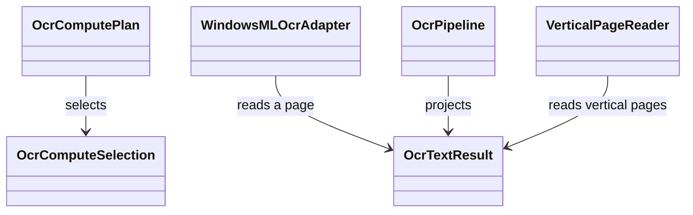
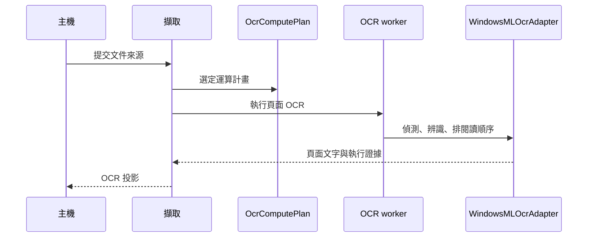

# 文件 OCR

## 負責什麼、不負責什麼

文件 OCR 負責把 PDF 與圖片讀成每頁的文字、區塊、信心值與出處，包含運算計畫、閱讀順序、直書閱讀與執行證據。它不下載或安裝引擎與模型（那是引擎供應），不轉寫語音、不分離說話者，也不把原始擷取整理成主機的擷取文件。

## 用語

運算計畫、執行證據、OCR 設定檔、OCR 投影、閱讀順序與直書閱讀器的定義見 [glossary 的文件 OCR 段落](../../.agents/PLANS/ddd-refactor/glossary.md#文件-ocr)。程式、文件與公開合約沿用相同用語。

## 聚合與不變條件

W5 只搬移現有模組，保留原有行為。W6 才會加入 `compute_plan`、`page` 與 `evidence` 聚合。目前 `OcrComputePlan` 選定運算計畫，`OcrTextResult` 與 `OcrRegion` 表示一頁的讀取結果，`OcrPipeline` 組成 OCR 投影，`VerticalPageReader` 讀直書頁面。閱讀順序、區塊出處與執行證據沿用既有實作。

## 主要流程

## 與其他上下文的關係

引擎供應提供 `windowsml-ocr` 與選用的 `vertical-japanese-reader`。擷取呼叫本上下文把文件來源變成 OCR 投影，再交給結構化。worker 入口 `workers/ocr_main.py` 留在原路徑，只更新 import。W5 保留既有跨模組依賴，不表示已完成 W6 的領域模型與分層整理。

## 規則與資料來源

模組都在 `capture_runtime.ocr.infrastructure`：`ocr_preflight`（運算計畫）、`ocr_profile`（OCR 設定檔）、`ocr_projection`（OCR 投影）、`ocr_page_result`、`ocr_reading_order`、`ocr_region_lineage`、`ocr_composite_regions`、`ocr_alignment`、`ocr_paddle_normalization`、`ocr_windowsml_adapter`、`ocr_offline_stubs`、`ocr_execution_evidence`、`ocr_execution_proof`、`ocr_vertical_routing`、`ocr_vertical_reader`、`ocr_worker_result`、`ocr_worker_run` 與 `image_normalization`。直書版面程式在 `capture_runtime.ocr.infrastructure._vendor`。設定檔與合約雜湊仍放在 `capture_runtime/assets`。公開型別仍由 `capture_runtime.contracts` 定義。遷移邊界與後續步驟見 [DDD 重構計畫](../../.agents/PLANS/ddd-refactor/README.md)。
