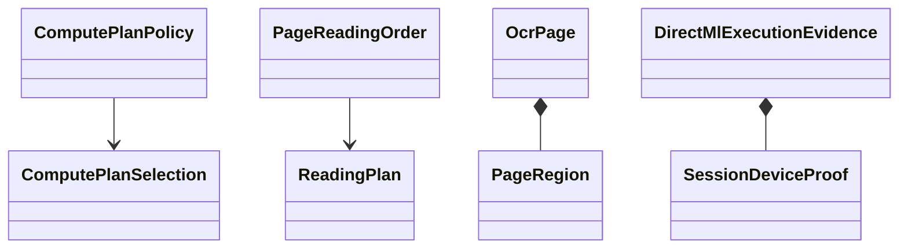
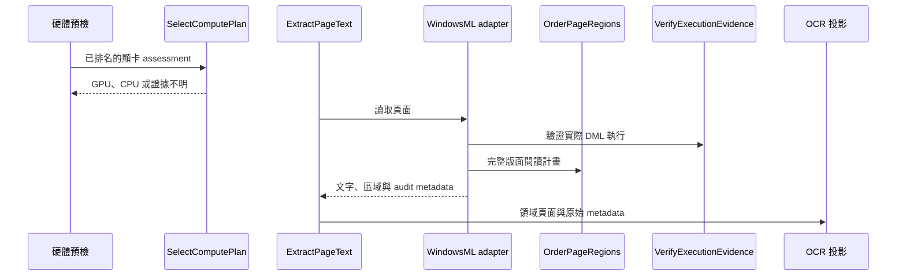

# 文件 OCR

## 負責什麼、不負責什麼

選擇運算計畫、讀取文件頁面、保留來源與版面證據，並依完整版面演算法決定閱讀順序。不持有擷取任務或下載生命週期。

## 用語

用語與公開領域類別見 [glossary](../../.agents/PLANS/ddd-refactor/glossary.md)。概念 ID 與合約值映射以 `capture-vocabulary-v1.json` 為準。

## 用例

| 操作 | 程式名稱 | 說明 |
| --- | --- | --- |
| 擷取頁面文字 | `ExtractPageText` | 辨識頁面並建立投影實際使用的領域頁面。 |
| 規劃閱讀順序 | `OrderPageRegions` | 保留來源位置、版面角色與振假名關係。 |
| 選擇運算計畫 | `SelectComputePlan` | 依排名與可觀測證據選擇裝置或保持未定。 |
| 驗證執行證據 | `VerifyExecutionEvidence` | 確認實際執行了 DML 工作。 |

## 聚合與不變條件

`ComputePlanPolicy` 依既有排名及逐顯卡 assessment 選擇裝置；較高順位證據不明時不退回較低順位或 CPU。`OcrPage` 與 `PageRegion` 保留頁面文字與幾何。`PageReadingOrder` 使用完整的 `ReadingPlan` 演算法，含直書、多欄、振假名與不完整幾何的保守退路。`DirectMlExecutionEvidence` 與 `SessionDeviceProof` 驗證實際節點與裝置證據。

## 主要流程

## 與其他上下文的關係

擷取上下文呼叫 OCR 用例；引擎供應提供已安裝的 worker 與模型。Worker JSON frame、公開 provenance 及投影格式維持原有合約。

## 規則與資料來源

公開 port 以結構型別定義。投影讀取 `ExtractedPage` 的領域頁面欄位，adapter-only audit metadata 則保留於原結果。閱讀順序純演算法位於 domain；舊 infrastructure 匯入仍供已知呼叫端使用。執行證據沿用既有規則：必須觀察到 DML 節點，CPU bookkeeping 節點本身不代表 GPU 執行失敗。
