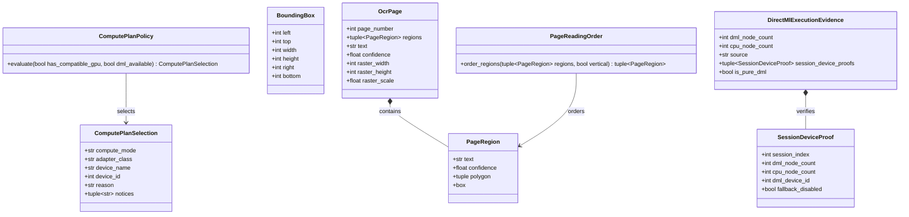
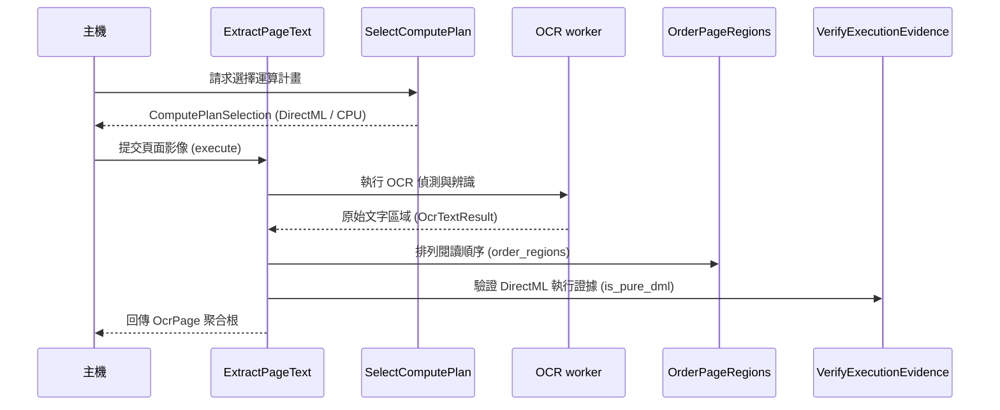

# 文件 OCR

## 負責什麼、不負責什麼

文件 OCR 負責把 PDF 與圖片讀成每頁的文字、區塊、信心值與出處，包含運算計畫、閱讀順序、直書閱讀與執行證據。它不下載或安裝引擎與模型（那是引擎供應），不轉寫語音、不分離說話者，也不把原始擷取整理成主機的擷取文件。

## 用語

運算計畫、執行證據、OCR 設定檔、OCR 投影、閱讀順序與直書閱讀器的定義見 [glossary 的文件 OCR 段落](../../.agents/PLANS/ddd-refactor/glossary.md#文件-ocr)。程式、文件與公開合約沿用相同用語。

## 用例

| 用例 | 程式名稱 | 說明 |
| --- | --- | --- |
| 選擇運算計畫 | `SelectComputePlan` | 評估 DirectML 與 CPU 執行能力並選定運算計畫 |
| 擷取頁面文字 | `ExtractPageText` | 透過 OCR 適配器從頁面影像中讀取文字與區域 |
| 排列閱讀順序 | `OrderPageRegions` | 依版面結構排列文字區域的閱讀順序 |
| 驗證執行證據 | `VerifyExecutionEvidence` | 驗證 DirectML 實際節點執行證據與硬體裝置證明 |

## 聚合與不變條件

文件 OCR 劃分三組核心聚合：
1. **運算計畫聚合（`compute_plan`）**：
   - `ComputePlanSelection` 值物件：守住運算模式（`gpu-dml` 或 `cpu-fallback`）、顯卡類別（`dedicated`、`integrated`、`unknown`）與 CPU 回退時必須具備的原因碼。
   - `ComputePlanPolicy` 領域政策：依 GPU 相容性與 DirectML 執行環境評估選擇最佳硬體配置。
2. **頁面聚合（`page`）**：
   - `BoundingBox` 值物件：維護非負像素邊界與正向寬高不變條件（`width > 0`、`height > 0`）。
   - `PageRegion` 值物件：封裝多邊形輪廓、文字與信心值（0.0 至 1.0），並衍生相容的矩形外框。
   - `PageReadingOrder` 領域政策：純演算法排列文字區域閱讀順序（橫排由上至下由左至右、直書日文由右至左由上至下）。
   - `OcrPage` 聚合根：統整單一頁面之頁碼（`>= 1`）、文字區域、解析度尺寸與縮放比。
3. **執行證據聚合（`evidence`）**：
   - `SessionDeviceProof` 值物件：驗證 ONNX Runtime 工作階段 DirectML 節點執行數量、CPU 節點數量與關閉回退不變條件。
   - `DirectMlExecutionEvidence` 聚合根：匯總各 session 執行節點數，驗證總節點數量守恆與純硬體 DirectML 執行證據。

## 主要流程

## 與其他上下文的關係

引擎供應提供 `windowsml-ocr` 與選用的 `vertical-japanese-reader`。擷取呼叫本上下文把文件來源變成 OCR 投影，再交給結構化。worker 入口 `workers/ocr_main.py` 留在原路徑，只更新 import。

## 規則與資料來源

領域模型位於 `capture_runtime.ocr.domain`（`compute_plan`、`page` 與 `evidence` 聚合），應用用例位於 `capture_runtime.ocr.application`。技術實作與適配器位於 `capture_runtime.ocr.infrastructure`：`ocr_preflight`（運算計畫）、`ocr_profile`（OCR 設定檔）、`ocr_projection`（OCR 投影）、`ocr_page_result`、`ocr_reading_order`、`ocr_region_lineage`、`ocr_composite_regions`、`ocr_alignment`、`ocr_paddle_normalization`、`ocr_windowsml_adapter`、`ocr_offline_stubs`、`ocr_execution_evidence`、`ocr_execution_proof`、`ocr_vertical_routing`、`ocr_vertical_reader`、`ocr_worker_result`、`ocr_worker_run` 與 `image_normalization`。公開型別仍由 `capture_runtime.contracts` 定義。
