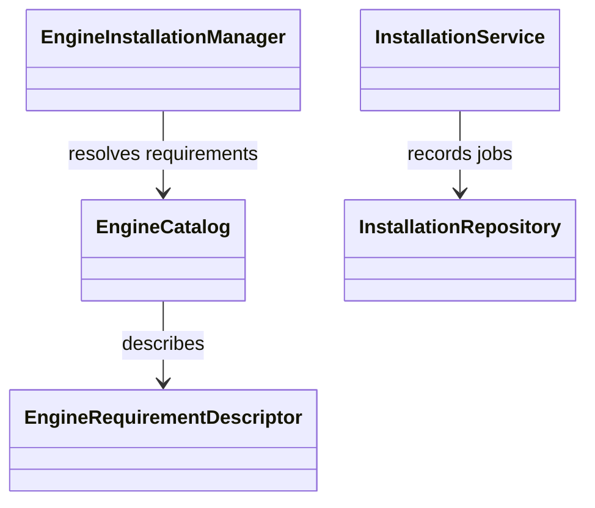
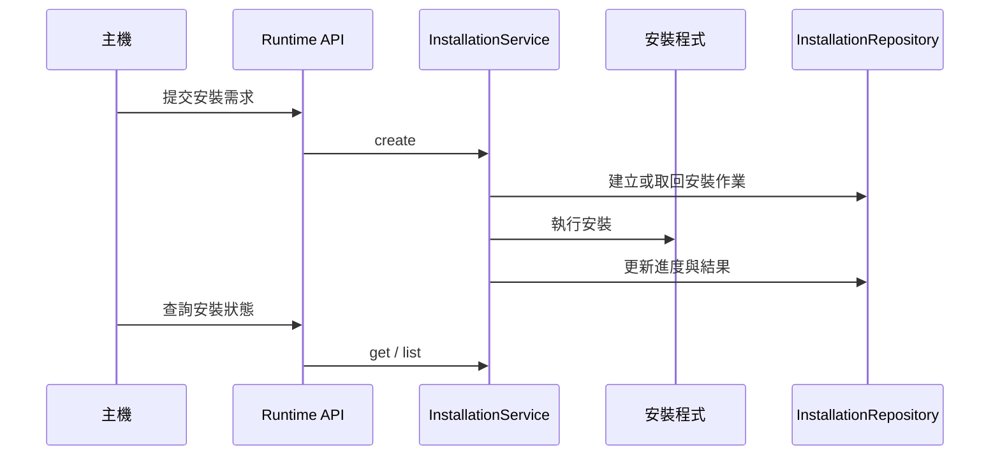

# 引擎供應

## 負責什麼、不負責什麼

引擎供應負責 runtime 所需引擎與模型的目錄、下載快取、安裝、驗證、啟用及移除，並透過 runtime API 提供需求與安裝作業資訊。它不執行 OCR、語音轉寫或說話者分離，也不保存主機應用的來源與領域資料。

## 用語

需求、安裝、引擎、引擎目錄、模型來源鎖與下載快取的定義見 [glossary 的引擎供應段落](../../.agents/PLANS/ddd-refactor/glossary.md#引擎供應)。程式、文件與公開合約沿用相同用語。

## 聚合與不變條件

W5 只搬移現有模組，保留原有行為；聚合、值物件與狀態機的語意整理留待 W6。現有 `EngineCatalog` 描述引擎需求與其檔案，`InstallationRepository` 保存安裝作業紀錄，`EngineInstallationManager` 解析並安裝需求。下載完整性驗證、安裝互斥與啟用順序沿用既有實作。

## 主要流程

## 與其他上下文的關係

文件 OCR、語音轉寫與說話者分離使用本上下文供應的引擎與模型；結構化使用供應的 Ollama runtime。worker 的推論與結果解析由各引擎上下文負責。W5 保留既有跨模組依賴，不表示已完成 W6 的領域模型與分層整理。

## 規則與資料來源

目錄載入、檔案下載、快取與安裝儲存庫位於 `capture_runtime.provisioning.infrastructure`。現有 `application.installation_service.InstallationService` 以 `create`、`get`、`list` 提供安裝作業的建立與查詢，HTTP 路由位於 `provisioning.api.runtime`。公開型別仍由 `capture_runtime.contracts` 定義。引擎目錄與模型來源鎖提供版本、檔案及完整性資訊；遷移邊界與後續步驟見 [DDD 重構計畫](../../.agents/PLANS/ddd-refactor/README.md)。
