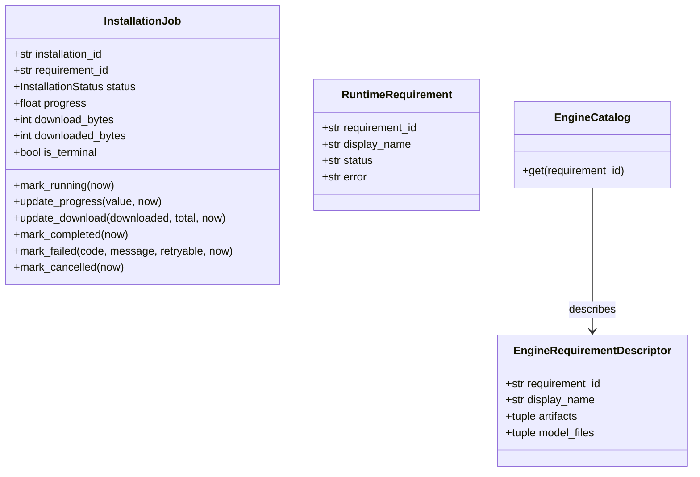
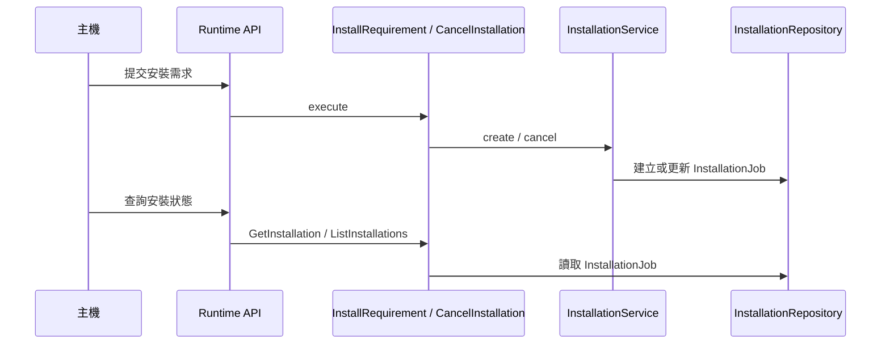

# 引擎供應

## 負責什麼、不負責什麼

引擎供應負責 runtime 所需引擎與模型的目錄、下載快取、安裝、驗證、啟用及移除，並透過 runtime API 提供需求與安裝作業資訊。它不執行 OCR、語音轉寫或說話者分離，也不保存主機應用的來源與領域資料。

## 用語

需求、安裝、引擎、引擎目錄、模型來源鎖與下載快取的定義見 [glossary 的引擎供應段落](../../.agents/PLANS/ddd-refactor/glossary.md#引擎供應)。程式、文件與公開合約沿用相同用語。

## 聚合與不變條件

引擎供應上下文依聚合分子套件（W6 定案）：
1. **安裝作業 (`installation`)**：`InstallationJob` 聚合根守住安裝狀態機（`InstallationStatus`）與不變條件。只有非終態能推進，終態不可再變更進度或下載位元組；進度介於 0.0 與 1.0；已下載位元組不大於總位元組。
2. **需求 (`requirement`)**：`RuntimeRequirement` 實體描述需求識別碼、顯示名稱與就緒狀態。
3. **引擎目錄 (`catalog`)**：`EngineCatalog` 與 `EngineRequirementDescriptor` 描述需求的檔案規格與校驗雜湊。

## 主要流程

## 用例

| 中文 | 用例（程式名稱） | 說明 |
| :--- | :--- | :--- |
| 安裝需求 | `InstallRequirement` | 建立或取回安裝作業，並非同步執行下載、驗證與啟用 |
| 取消安裝 | `CancelInstallation` | 取消進行中或等待中的安裝作業 |
| 取得安裝作業 | `GetInstallation` | 依識別碼查詢單一安裝作業狀態 |
| 列出安裝作業 | `ListInstallations` | 列出目前所有已記錄的安裝作業 |
| 卸載需求 | `UninstallRequirement` | 在無進行中擷取與安裝時，釋放暖 worker 並移除安裝之引擎 |
| 查詢需求清單 | `ListRequirements` | 查詢可用的執行環境需求與當前安裝狀態 |

桌面應用的設定 › 辨識功能在使用者確認引擎名稱與大小之後，才透過 `runtime_uninstall_requirement` 呼叫卸載需求。已經做好的文件與逐字稿留在主機，不會跟著引擎刪除。

## 與其他上下文的關係

文件 OCR、語音轉寫與說話者分離使用本上下文供應的引擎與模型；結構化使用供應的 Ollama runtime。worker 的推論與結果解析由各引擎上下文負責。

## 規則與資料來源

領域模型位於 `capture_runtime.provisioning.domain`。用例位於 `capture_runtime.provisioning.application.use_cases`。目錄載入、檔案下載、快取與安裝儲存庫位於 `capture_runtime.provisioning.infrastructure`。HTTP 路由位於 `capture_runtime.provisioning.api.runtime`。公開型別由 `capture_runtime.contracts` 定義，在 API 與 application 邊界與領域物件互轉。

## 一個需求的多個內容

一個需求可以是單一交付（`artifacts`、`modelFiles`、`unavailableReason`），也可以改為 `contents`。每個內容的 `id` 是 `cuda` 或 `cpu`，並各自遵守同一套完整性規則。沒有 `contents` 的需求（包含目前目錄裡的語音）在每台機器上的行為與單一交付相同；`CAPTURE_SPEECH_RECOGNITION_VARIANT` 不影響它。這個變數套用在任何帶有 `contents` 的需求上；目前只有 `speech-recognition` 有 `contents`。

`CAPTURE_SPEECH_RECOGNITION_VARIANT` 為 `auto`（未設定時的預設）、`cuda` 或 `cpu`，在程序啟動時驗證，其他值會使程序無法啟動。`auto` 在 Windows 且 `%SystemRoot%\System32\nvcuda.dll` 是檔案時偏好 `cuda`，否則偏好 `cpu`。非 Windows、沒有 `SystemRoot`，或該路徑不是檔案，都視為沒有驅動。目錄有偏好的內容就用它。`auto` 而目錄沒有該內容時，改用目錄裡現有的內容（先用偵測到的，否則就是唯一的那一個）。因此目錄只有 `cuda`、變數是 `auto`、機器沒有驅動時，需求仍可安裝，大小是 `cuda` 的大小。`cuda` 與 `cpu` 強制該內容，不看驅動。被強制的內容不在目錄裡時，需求狀態是 `unavailable`，`downloadBytes` 為 null。列出需求與安裝由同一個函式決定內容。

內容在取得安裝鎖、且確認尚未安裝之後選定一次，寫入 `active.json`。沒有 `contents` 的需求仍寫 `stateVersion` `"1"`。有 `contents` 的寫 `"2"` 與 `contentId`。就緒與啟動讀這筆記錄，不再偵測驅動。卸載不讀這筆記錄：它刪掉該需求的整個目錄，並釋放每個內容的快取下載；另一個需求識別碼仍使用的摘要則保留。已就緒時再次安裝是空操作，不會下載另一個內容。要換內容須先卸載再安裝。

尚未安裝時，`GET /v2/runtime/requirements` 的 `downloadBytes` 是這台機器將下載的內容大小。已安裝時狀態是 `ready`，大小是已安裝內容的大小，即使之後驅動或覆寫改變也一樣。安裝作業的位元組計數在安裝開始時凍結為當時選定的內容。語音需求的每個內容都讓公開的 `artifact` 保持 null，主機不會在部分機器上自行開始下載 worker。
