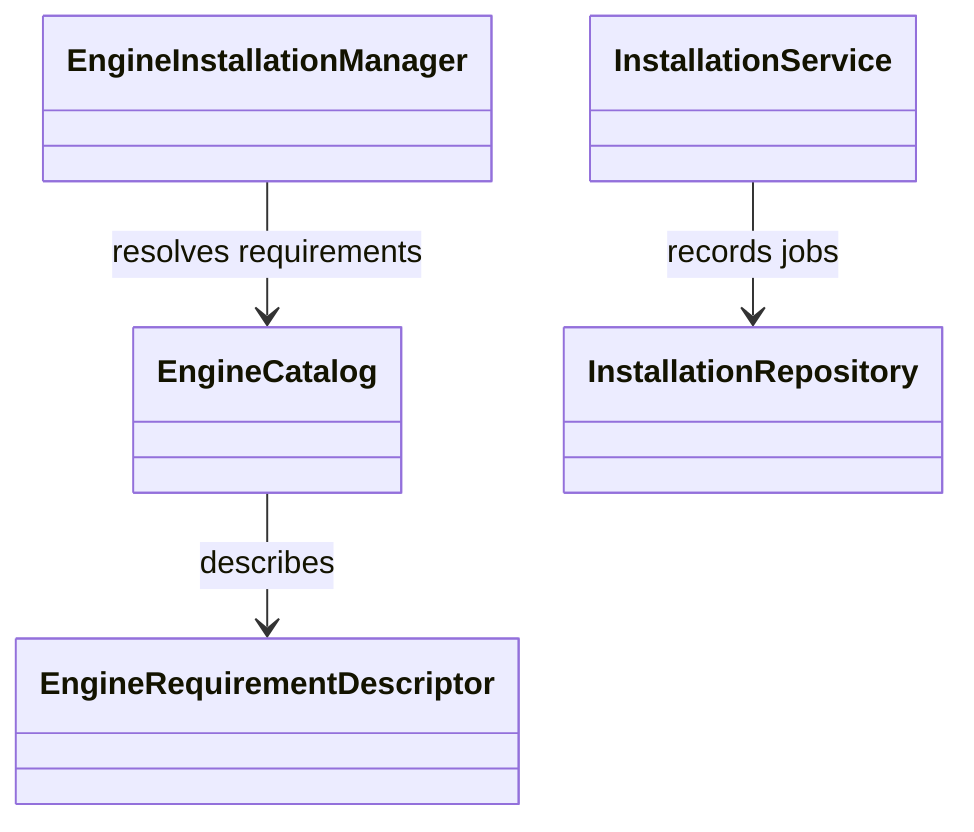
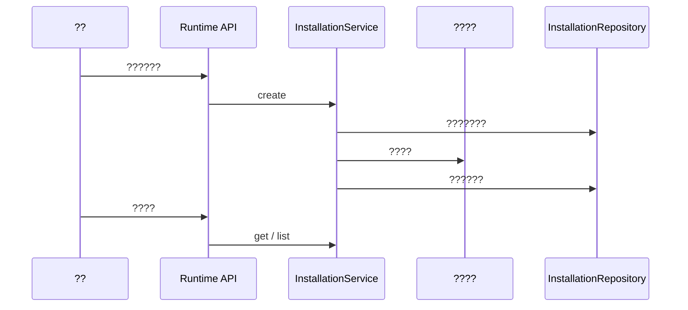

# ????

## ??????

?????? runtime ????????????????????????????????????????? runtime API ????????????????????????????

## ??

??????????????????? [glossary](../../.agents/PLANS/ddd-refactor/glossary.md)????????????????????????????

## ???????

W5 ????????????????????? W6 ???????? `EngineCatalog` ?????? `InstallationRepository` ???????????? `EngineInstallationManager` ????????????????????????????????????

## ????

## ?????????

?? OCR????????????????????????? Ollama runtime??????????? worker???????????W5 ????????????????? DDD ???????

## ???????

????????????????? `capture_runtime.provisioning.infrastructure`?????????? `capture_runtime.provisioning.application`?HTTP ???? `capture_runtime.provisioning.api`??????? `capture_runtime.contracts` ????????????? [DDD ????](../../.agents/PLANS/ddd-refactor/README.md)?
