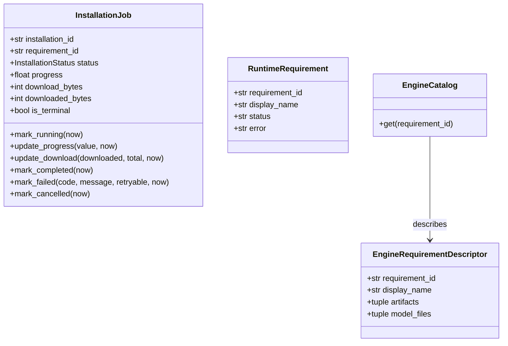
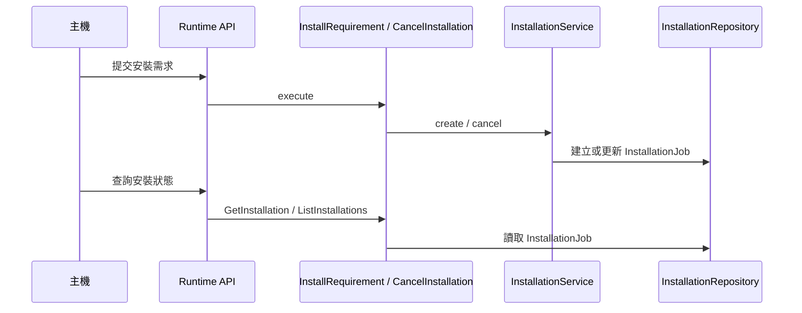

# 引擎供應

## 負責什麼、不負責什麼

引擎供應負責 runtime 所需引擎與模型的目錄、下載快取、安裝、驗證、啟用及移除，並透過 runtime API 提供需求與安裝作業資訊。它不執行 OCR、語音轉寫或說話者分離，也不保存主機應用的來源與領域資料。

## 用語

需求、安裝、引擎、引擎目錄、模型來源鎖與下載快取的定義見 [glossary 的引擎供應段落](../../.agents/PLANS/ddd-refactor/glossary.md#引擎供應)。程式、文件與公開合約沿用相同用語。

## 聚合與不變條件

引擎供應上下文依聚合分子套件（W6 定案）：
1. **安裝作業 (`installation`)**：`InstallationJob` 聚合根守住安裝狀態機（`InstallationStatus`）與不變條件。只有非終態能推進，終態不可再變更進度或下載位元組；進度介於 0.0 與 1.0；已下載位元組不大於總位元組。
2. **需求 (`requirement`)**：`RuntimeRequirement` 實體描述需求識別碼、顯示名稱與就緒狀態。
3. **引擎目錄 (`catalog`)**：`EngineCatalog` 與 `EngineRequirementDescriptor` 描述需求的檔案規格與校驗雜湊。

一般安裝（`POST /v2/runtime/installations`）不接受結構化模型：它由結構化模型安裝選擇與安裝，請求寫 `structuring-model` 是驗證錯誤並指向模型安裝；查詢與結果仍用完整的需求識別碼。安裝作業的檔案錯誤分成逾時 `installation_timeout` 與其他 I/O 錯誤 `installation_io_failed`（先判斷逾時，因為逾時也是 I/O 錯誤）；0.10.x 存下、分不出是否逾時的舊檔案錯誤代碼讀成一般的 `installation_failed`，保留原本的訊息與可重試旗標，檔案不改寫。模型安裝只在另一次嘗試可能成功時標為可重試：選項不在發布目錄、目錄的 profile 位元組不符，或拉下的模型摘要或大小與目錄不符時不可重試。卸載時，另一個行程正在安裝或檔案仍被開啟回答 409 `requirement_in_use`，其他失敗回答 500 `uninstall_failed`，訊息不含路徑。422 `requirement_disabled`（訊息「Structuring model management is not available in this runtime's structuring mode.」）的條件依路由而定。一般安裝與卸載只在主機（`host`）與外部 Ollama（`external-ollama`）模式下，對 `structuring-runtime` 與 `structuring-model` 回答它；一般安裝的請求先經過驗證，寫 `structuring-model` 在任何模式都是 422 `validation_error`，所以一般安裝實際只對 `structuring-runtime` 回答 `requirement_disabled`。模型選項（`GET /v2/runtime/structuring-model-options`）與開始模型安裝（`POST /v2/runtime/structuring-model-installations`）在內建 Ollama（`ollama`）以外的每個模式（主機、外部 Ollama、假供應者 `fake`）都回答它；讀取或取消既有的模型安裝作業不看模式。假供應者模式下，一般安裝與卸載照常交給安裝器。

## 主要流程

## 用例

| 中文 | 用例（程式名稱） | 說明 |
| :--- | :--- | :--- |
| 安裝需求 | `InstallRequirement` | 建立或取回安裝作業，並非同步執行下載、驗證與啟用 |
| 取消安裝 | `CancelInstallation` | 取消進行中或等待中的安裝作業 |
| 取得安裝作業 | `GetInstallation` | 依識別碼查詢單一安裝作業狀態 |
| 列出安裝作業 | `ListInstallations` | 列出目前所有已記錄的安裝作業 |
| 卸載需求 | `UninstallRequirement` | 在無進行中擷取與安裝時，釋放暖 worker 並移除安裝之引擎 |
| 查詢需求清單 | `ListRequirements` | 查詢可用的執行環境需求與當前安裝狀態 |

桌面應用的設定 › 辨識功能在使用者確認引擎名稱與大小之後，才透過 `runtime_uninstall_requirement` 呼叫卸載需求。已經做好的文件與逐字稿留在主機，不會跟著引擎刪除。

## 與其他上下文的關係

文件 OCR、語音轉寫與說話者分離使用本上下文供應的引擎與模型；結構化使用供應的 Ollama runtime。worker 的推論與結果解析由各引擎上下文負責。

引擎供應定義 `RequirementInstaller`、`StructuringRequirementInstaller` 與 `ManualActionRequiredError`。`SystemRequirementInstaller` 依目錄列出並安裝引擎，並透過 `StructuringRequirementInstaller` 委派結構化需求的查詢與安裝。

## 規則與資料來源

領域模型位於 `capture_runtime.provisioning.domain`。用例位於 `capture_runtime.provisioning.application.use_cases`。目錄載入、檔案下載、快取與安裝儲存庫位於 `capture_runtime.provisioning.infrastructure`。HTTP 就緒檢查、需求及需求安裝路由位於 `capture_runtime.provisioning.api.runtime`。公開型別由 `capture_runtime.contracts` 定義，在 API 與 application 邊界與領域物件互轉。

## 一個需求的多個內容

一個需求可以是單一交付（`artifacts`、`modelFiles`、`unavailableReason`），也可以改為 `contents`。每個內容的 `id` 是 `cuda` 或 `cpu`，並各自遵守同一套完整性規則。發行目錄的 `speech-recognition` 一定同時提供 `cuda` 與 `cpu`，只有其中一種的發行會被發行工具擋下。沒有 `contents` 的需求（OCR、說話者分離、直書日文閱讀器，以及 0.9.0 以前發行目錄裡的語音）在每台機器上的行為與單一交付相同；`CAPTURE_SPEECH_RECOGNITION_VARIANT` 不影響它。這個變數套用在任何帶有 `contents` 的需求上；目前只有 `speech-recognition` 有 `contents`。

`CAPTURE_SPEECH_RECOGNITION_VARIANT` 為 `auto`（未設定時的預設）、`cuda` 或 `cpu`，在程序啟動時驗證，其他值會使程序無法啟動。`auto` 在 Windows 且 `%SystemRoot%\System32\nvcuda.dll` 是檔案時偏好 `cuda`，否則偏好 `cpu`。非 Windows、沒有 `SystemRoot`，或該路徑不是檔案，都視為沒有驅動。目錄有偏好的內容就用它。`auto` 而目錄沒有該內容時，改用目錄裡現有的內容（先用偵測到的，否則就是唯一的那一個）。因此目錄只有 `cuda`、變數是 `auto`、機器沒有驅動時，需求仍可安裝，大小是 `cuda` 的大小。`cuda` 與 `cpu` 強制該內容，不看驅動。被強制的內容不在目錄裡時，需求狀態是 `unavailable`，`downloadBytes` 為 null。列出需求與安裝由同一個函式決定內容。

內容在取得安裝鎖、且確認尚未安裝之後選定一次，寫入 `active.json`。沒有 `contents` 的需求仍寫 `stateVersion` `"1"`。有 `contents` 的寫 `"2"` 與 `contentId`。就緒與啟動讀這筆記錄，不再偵測驅動。卸載不讀這筆記錄：它刪掉該需求的整個目錄，並釋放每個內容的快取下載；另一個需求識別碼仍使用的摘要則保留。已就緒時再次安裝是空操作，不會下載另一個內容。要換內容須先卸載再安裝。

安裝及啟用完成後，版本目錄（`versions/<產物版本>/`，只有模型的單元也一樣）會以原子寫入保存 `verified-files.json`，放在 `worker/`、`model/` 之外；它隨版本目錄一起移除，卸載後才完成的驗證不會把它寫回。驗證紀錄綁定紀錄格式版本、需求識別碼、產物版本、內容識別碼（若有）、已啟用的工作程序封存檔與模型清單摘要，以及每個檔案的相對路徑、大小、修改時間，以及 Windows 上的建立時間（奈秒）。重新啟動時，只有這些資料與目前的檔案快照完全一致才沿用驗證結果，同樣大小的改寫若還原修改時間便不會被偵測，其信任範圍與程序內的驗證快取相同。安裝時、任何檔案 stat 改變時，或紀錄缺少、無法讀取及無效時，都會執行完整 SHA-256 驗證；成功後重寫紀錄，失敗則不再信任舊紀錄。卸載、重新安裝與移除非使用中版本時，紀錄隨對應檔案移除。

尚未安裝時，`GET /v2/runtime/requirements` 的 `downloadBytes` 是這台機器將下載的內容大小。已安裝時狀態是 `ready`，大小是已安裝內容的大小，即使之後驅動或覆寫改變也一樣。安裝作業的位元組計數在安裝開始時凍結為當時選定的內容。語音需求的每個內容都讓公開的 `artifact` 保持 null，主機不會在部分機器上自行開始下載 worker。

## 網路中斷

worker 壓縮檔與直接下載的模型檔遇到網路失敗時，依同一個排程重試：連線被拒或中斷、讀取逾時，以及 5xx、408、429 回應。各次等待為 1、2、4、8、15、30 秒，合計約 1 分鐘，足以撐過一次 Wi-Fi 或網路切換。每次重試都從部分檔案接續。一次嘗試只要收到比先前更多的位元組，排程就從頭計算，所以緩慢但仍在前進的下載不會被中斷。取消會立即結束等待。

重試用完時，部分檔案保留給下次安裝接續；模型檔回報 `direct_model_retries_exhausted`，worker 壓縮檔回報 `installation_failed`。來源回答其他 4xx 時不重試，兩者都回報 `installation_failed`。檢查碼與位元組數錯誤不重試，並刪除部分檔案。檔案錯誤也不重試，回報 `installation_io_failed`。網路類失敗目前沒有專屬的失敗代碼。

## 共用下載快取

下載快取以 SHA-256 為鍵。快取未命中時，以 `<root>/.locks/<sha256>.lock` 的跨程序排他鎖序列化同一內容的下載，持鎖至發布與儲存完成；同程序的並行安裝也使用這把鎖。取得鎖後再次驗證快取，重用其他安裝完成的內容。等待可取消，沒有總逾時；持有程序終止後由作業系統釋放鎖，後續下載可續傳留下的部分檔案。鎖檔保留，閒置清理排除 `.locks`。
