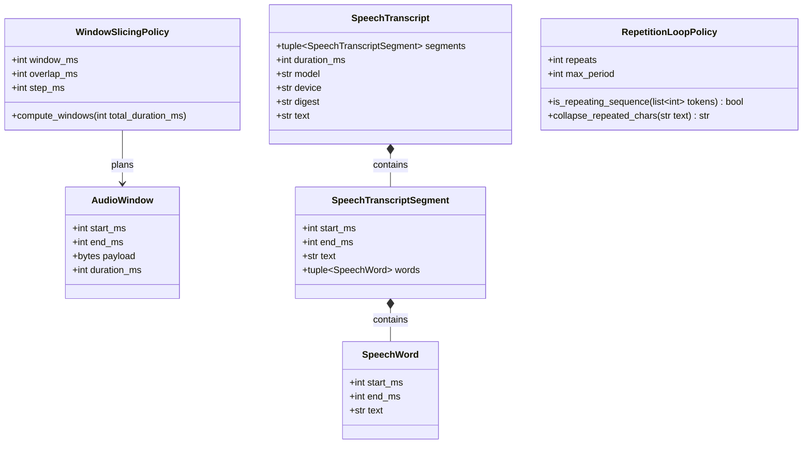
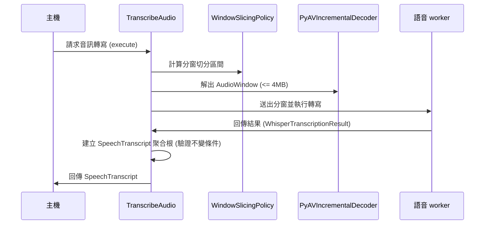

# 語音轉寫

## 負責什麼、不負責什麼

語音轉寫負責把錄音轉成帶時間的逐字稿，包含 TEA-ASR 轉寫、分窗與重疊、迴圈停止，以及擷取結束後保留模型的暖 worker。它不執行文件 OCR、說話者分離或結構化，也不下載與安裝引擎；引擎與模型由引擎供應提供。

## 用語

逐字稿、分窗、暖 worker 與語音模型的定義見 [glossary 的語音轉寫與說話者分離段落](../../.agents/PLANS/ddd-refactor/glossary.md#語音轉寫與說話者分離)。程式、文件與公開合約沿用相同用語。

## 用例

| 用例 | 程式名稱 | 說明 |
| --- | --- | --- |
| 轉寫音訊 | `TranscribeAudio` | 將音訊檔案或串流轉寫為帶時間標記的逐字稿 |
| 分窗轉寫 | `TranscribeAudioWindow` | 轉寫單一解碼後的音訊窗 |
| 分割音訊串流 | `SliceAudioStream` | 依分窗與重疊政策計算音訊窗切分區間 |
| 偵測重複迴圈 | `DetectRepetitionLoop` | 檢查貪婪解碼過程中的重複 token 序列與字元摺疊政策 |

## 聚合與不變條件

語音轉寫定義兩組核心聚合：
1. **分窗聚合（`window`）**：
   - `AudioWindow` 值物件：守住音訊窗不變條件（`start_ms >= 0`、`end_ms > start_ms`、二進位有效長度介於 1 到 4 MB 安全上限之間）。
   - `WindowSlicingPolicy` 領域政策：管理 120 秒分窗與 30 秒重疊邊界，計算不重疊遞進步長（90 秒）與總時長切分窗區間。
2. **逐字稿聚合（`transcript`）**：
   - `SpeechWord` 與 `SpeechTranscriptSegment` 值物件：維護單詞與片段的時間戳記不變條件（`start_ms <= end_ms`，非負區間）。
   - `SpeechTranscript` 聚合根：保證片段依時間嚴格遞增排序，且總時長涵蓋全部片段。
   - `RepetitionLoopPolicy` 領域政策：守住貪婪解碼過程中的 token 週期性重複判定與長字元摺疊規則。

## 主要流程

## 與其他上下文的關係

引擎供應提供語音模型與 worker。擷取呼叫本上下文的分窗處理與一次性轉寫；說話者分離使用逐字稿的時間，但不由本上下文執行。文件 OCR 與結構化不參與轉寫。worker 入口 `workers/speech_recognition_main.py` 與 `workers/session_server.py` 留在原路徑，供 PyInstaller 規格引用。`japanese_kanji` 仍在 `capture_runtime.japanese_kanji`。

## 規則與資料來源

領域模型位於 `capture_runtime.speech.domain`（`window` 與 `transcript` 聚合），應用用例位於 `capture_runtime.speech.application`。技術實作與適配器位於 `capture_runtime.speech.infrastructure`：`speech_recognition`（`TeaAsrAdapter`）、`speech_transcript`（`WhisperAdapter`）、`speech_worker_result`（`SpeechWorkerMethods`）、`progressive_audio`（`ProgressiveAudioSession`）、`progressive_capture`（`ProgressiveCaptureProcessor`）、`progressive_decoder`（`PyAVIncrementalDecoder`）、`progressive_whisper`（窗轉寫）與 `whisper_session`（暖 worker 訊框）。公開型別仍由 `capture_runtime.contracts` 定義。
