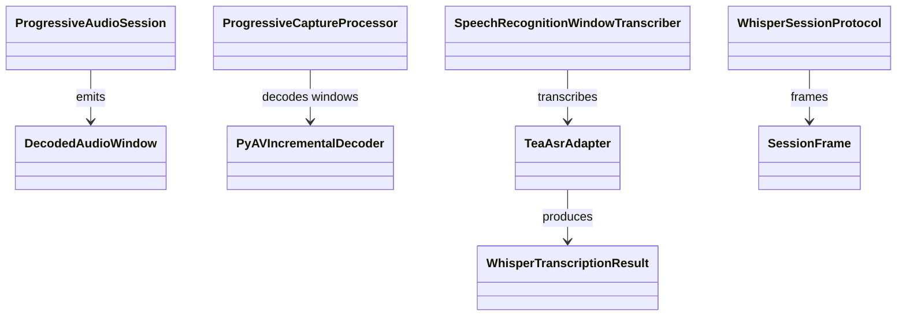
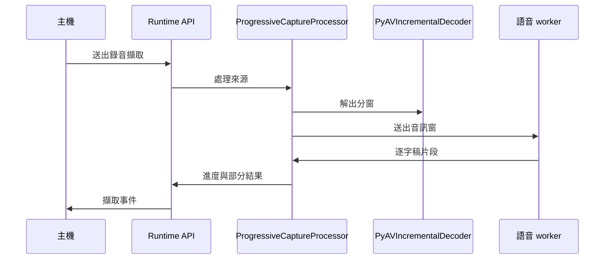

# 語音轉寫

## 負責什麼、不負責什麼

語音轉寫負責把錄音轉成帶時間的逐字稿，包含 TEA-ASR 轉寫、分窗與重疊、迴圈停止，以及擷取結束後保留模型的暖 worker。它不執行文件 OCR、說話者分離或結構化，也不下載與安裝引擎；引擎與模型由引擎供應提供。

## 用語

逐字稿、分窗、暖 worker 與語音模型的定義見 [glossary 的語音轉寫與說話者分離段落](../../.agents/PLANS/ddd-refactor/glossary.md#語音轉寫與說話者分離)。程式、文件與公開合約沿用相同用語。

## 聚合與不變條件

W5 只搬移現有模組，保留原有行為。W6 才會加入分窗（window）與逐字稿（transcript）聚合。現有 `ProgressiveAudioSession` 依分窗與重疊送出音訊，`TeaAsrAdapter` 產生 `WhisperTranscriptionResult`，`WhisperSessionProtocol` 維持暖 worker 的訊框協定。分窗長度、重疊、迴圈停止與暖 worker 的閒置時間沿用既有實作，尚未整理成領域模型。

## 主要流程

## 與其他上下文的關係

引擎供應提供語音模型與 worker。擷取呼叫本上下文的分窗處理與一次性轉寫；說話者分離使用逐字稿的時間，但不由本上下文執行。文件 OCR 與結構化不參與轉寫。worker 入口 `workers/speech_recognition_main.py` 與 `workers/session_server.py` 留在原路徑，供 PyInstaller 規格引用。`japanese_kanji` 仍在 `capture_runtime.japanese_kanji`。W5 保留既有跨模組依賴，不表示已完成 W6 的領域模型與分層整理。

## 規則與資料來源

搬移後的模組位於 `capture_runtime.speech.infrastructure`：`speech_recognition`（`TeaAsrAdapter`）、`speech_transcript`（片段與 `WhisperAdapter`）、`speech_worker_result`（`SpeechWorkerMethods`）、`progressive_audio`（分窗與 `ProgressiveAudioSession`）、`progressive_capture`（`ProgressiveCaptureProcessor`）、`progressive_decoder`（`PyAVIncrementalDecoder`）、`progressive_whisper`（窗轉寫）與 `whisper_session`（暖 worker 訊框）。公開型別仍由 `capture_runtime.contracts` 定義。W6 將加入分窗與逐字稿聚合；遷移邊界見 [DDD 重構計畫](../../.agents/PLANS/ddd-refactor/README.md)。
