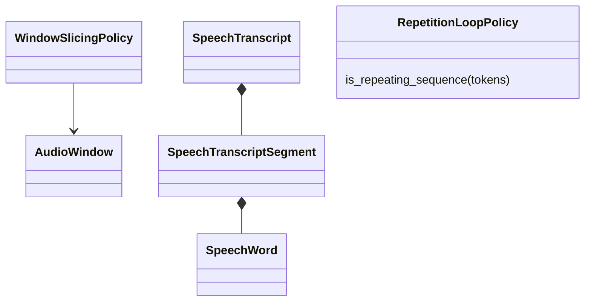
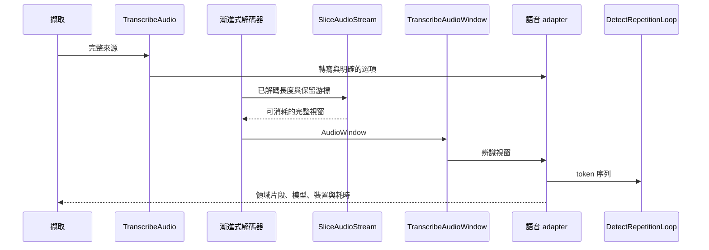

# 語音轉寫

## 負責什麼、不負責什麼

負責語音辨識、分窗、重疊與重複迴圈停止。不管理擷取任務或耐久的主機文件。

## 用語

用語與公開領域類別見 [glossary](../../.agents/PLANS/ddd-refactor/glossary.md)。概念 ID 與合約值映射以 `capture-vocabulary-v1.json` 為準。

## 用例

| 操作 | 程式名稱 | 說明 |
| --- | --- | --- |
| 偵測重複迴圈 | `DetectRepetitionLoop` | 對 token 尾端套用停止政策。 |
| 切分音訊串流 | `SliceAudioStream` | 依保留游標與重疊政策計算完整視窗。 |
| 轉寫完整來源 | `TranscribeAudio` | 傳入明確選項並保留模型、裝置及耗時。 |
| 轉寫視窗 | `TranscribeAudioWindow` | 辨識一個有界的音訊窗。 |

## 聚合與不變條件

`AudioWindow` 有時間與容量上限；`WindowSlicingPolicy` 依目前保留游標計算完整視窗與結尾部分視窗。`SpeechTranscript` 驗證片段時間與總長度。辨識結果以 `SpeechRecognitionResult`、`WindowTranscript`、`WindowTranscriptSegment` 傳遞。`RepetitionLoopPolicy` 決定 token 迴圈停止。

## 主要流程

## 與其他上下文的關係

擷取使用語音的公開用例；說話者分離只讀取時間對齊結果。模型與 worker 的供應由引擎供應上下文負責。

## 規則與資料來源

保留 TEA-ASR 的裝置、模型、摘要、警告、`elapsed_ms` 與 `stage_ms`。分窗從保留的重疊游標開始；沒有完整視窗時不提前提交，結束時才沖出剩餘部分。每個工作階段只組裝一次視窗轉寫用例。
