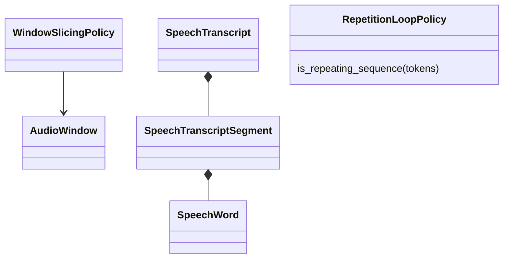
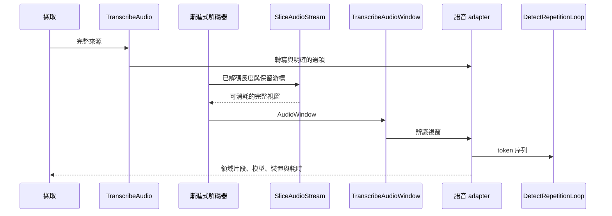

# 語音轉寫

## 負責什麼、不負責什麼

負責語音辨識、分窗、重疊與重複迴圈停止。不管理擷取任務或耐久的主機文件。

## 用語

用語與公開領域類別見 [glossary](../../.agents/PLANS/ddd-refactor/glossary.md)。概念 ID 與合約值映射以 `capture-vocabulary-v1.json` 為準。

## 用例

| 操作 | 程式名稱 | 說明 |
| --- | --- | --- |
| 偵測重複迴圈 | `DetectRepetitionLoop` | 對 token 尾端套用停止政策。 |
| 切分音訊串流 | `SliceAudioStream` | 依保留游標與重疊政策計算完整視窗。 |
| 轉寫完整來源 | `TranscribeAudio` | 傳入明確選項並保留模型、裝置及耗時。 |
| 轉寫視窗 | `TranscribeAudioWindow` | 辨識一個有界的音訊窗。 |

## 聚合與不變條件

`AudioWindow` 有時間與容量上限；`WindowSlicingPolicy` 依目前保留游標計算完整視窗與結尾部分視窗。`SpeechTranscript` 驗證片段時間與總長度。辨識結果以 `SpeechRecognitionResult`、`WindowTranscript`、`WindowTranscriptSegment` 傳遞。`RepetitionLoopPolicy` 決定 token 迴圈停止。

## 主要流程

## 與其他上下文的關係

擷取使用語音的公開用例；說話者分離只讀取時間對齊結果。模型與 worker 的供應由引擎供應上下文負責。

## 規則與資料來源

保留 TEA-ASR 的裝置、模型、摘要、警告、`elapsed_ms` 與 `stage_ms`。分窗從保留的重疊游標開始；沒有完整視窗時不提前提交，結束時才沖出剩餘部分。每個工作階段只組裝一次視窗轉寫用例。

## 已安裝的內容

發行目錄把語音需求分成 `cuda` 與 `cpu` 兩種內容。有 NVIDIA 驅動的機器安裝 `cuda`，沒有的安裝 `cpu`；選擇規則見[引擎供應](provisioning.md#一個需求的多個內容)。0.9.0 以前的發行目錄只有單一交付，沒有 `contents`；那種舊安裝與 `cuda` 內容使用同一套模型與裝置規則。

狀態 `"2"` 的安裝把 `contentId` 交給語音 worker：一次擷取的執行選項是 `content`，串流工作階段的環境變數是 `CAPTURE_SESSION_SPEECH_CONTENT`。沒有內容 id 的引擎不送這兩項，行為與今日相同。這個 id 是安裝當下記下的值，啟動時不重新偵測顯示卡，也不依磁碟上有哪些模型資料夾來猜測。未知的內容 id 直接失敗，不會當成 `cuda`。

`cuda` 與舊安裝：`auto` 與 `tea-asr-1.1` 載入 `primary`，回報模型 `tea-asr-1.1`。偏好 GPU 且 CUDA 可用時使用 CUDA；被歸類的 CUDA 失敗以同一個檢查點在 CPU 重試。明確的 `tea-asr-1.1-mini` 維持 mini。`probe` 要求 primary、mini、兩邊的架構目錄與 aligner。

`cpu` 內容沒有 GPU 路徑，一律在 CPU 上執行。`preferGpu` 與 `allowCpuFallback` 不改變裝置，也不會因為不允許 CPU 後援而回報 CUDA 裝置不存在。`auto` 載入 TEA-ASR-1.1-mini，回報模型 `tea-asr-1.1-mini`、裝置 `cpu`。明確的 `tea-asr-1.1-mini` 同樣載入 mini。明確的 `tea-asr-1.1` 在任何 worker 啟動或沿用之前失敗，不會改載 mini。擷取以既有的 `requirement_unavailable` 失敗，階段是 `extraction`，`retryable` 為 false。訊息說明這個模型不在已安裝的 `cpu` 內容，並請把 `CAPTURE_SPEECH_RECOGNITION_MODEL` 設成 `auto` 或 `tea-asr-1.1-mini`，或是解除安裝 `speech-recognition` 後以 `CAPTURE_SPEECH_RECOGNITION_VARIANT=cuda` 重新安裝。`GET /v2/runtime/requirements` 仍是 `ready`（`auto` 與 mini 仍可執行），`detail` 是同一句話。worker 內部仍以 `model not installed` 拒絕，留作第二道檢查。`probe` 在 mini、它的架構目錄與 aligner 都存在時就緒，不要求 primary。
