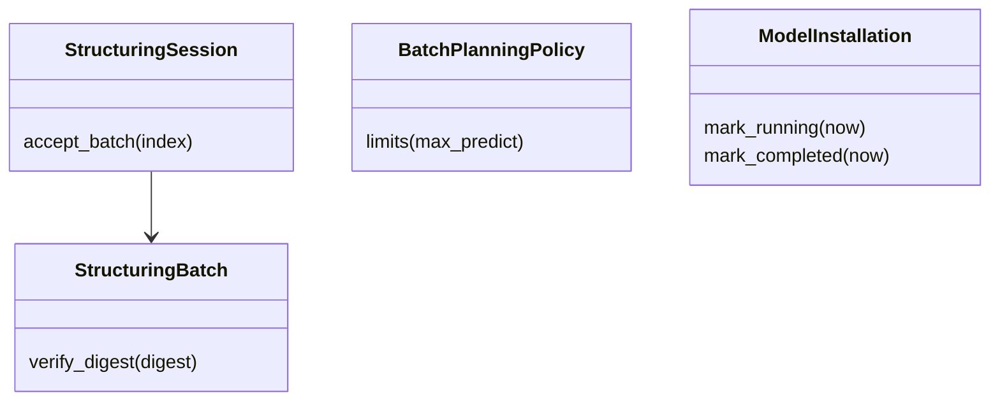
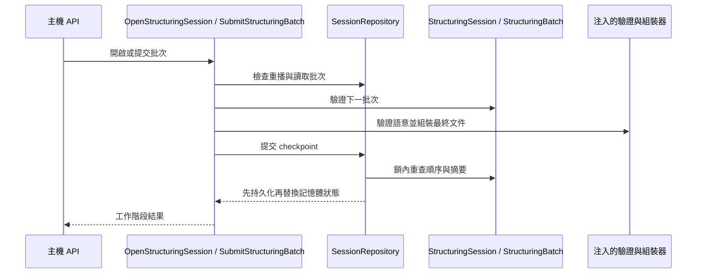

# 結構化

結構化使用 `structuring-runtime` 與 `structuring-model` 兩項需求。需求清單的 `kind` 與 `requirementId` 使用相同的 ID。

## 負責什麼、不負責什麼

把原始擷取整理為擷取文件，支援 runtime 供應者及主機分批提交，並管理允許的模型安裝作業。不執行 OCR 或語音推論。

## 用語

用語與公開領域類別見 [glossary](../../.agents/PLANS/ddd-refactor/glossary.md)。概念 ID 與合約值映射以 `capture-vocabulary-v1.json` 為準。

## 用例

| 操作 | 程式名稱 | 說明 |
| --- | --- | --- |
| 取消模型安裝 | `CancelModelInstallation` | 停止任務後寫入取消 checkpoint。 |
| 取得模型安裝 | `GetModelInstallation` | 讀取安裝狀態與進度。 |
| 取得工作階段 | `GetStructuringSession` | 依擷取識別碼讀取主機工作階段。 |
| 安裝模型 | `InstallModelOption` | 建立允許的模型作業，只對新作業排程。 |
| 開啟工作階段 | `OpenStructuringSession` | 擷取取自路由、請求識別取自 `X-Idempotency-Key`，本文只帶 `profileId`、供應者與方言；檢查來源與方言，依 `profileId` 建立批次計畫；新請求帶有消費者前綴的舊 profile 識別碼回答 422 `validation_error`。0.10.x 存下的工作階段（本文帶 `captureId`、`clientRequestId`、`capability`）以原本的形式驗證指紋後照常讀取；之後接受的批次讓紀錄維持原本的形式：請求、請求指紋與先前批次的重播回應不變，新的檢查點以同一形式計算摘要。 |
| 提交批次 | `SubmitStructuringBatch` | 先檢查重播、摘要及順序，再驗證語意與持久化。 |

## 聚合與不變條件

`StructuringSession.require_next_batch/accept_batch` 守住開放狀態與批次順序；`StructuringBatch.verify_digest/accept` 守住摘要及接受狀態。`BatchPlanningPolicy` 計算輸入、輸出與保留 token 的限制。`ModelInstallation` 管理模型安裝的執行、進度、完成、失敗與取消，終態不可覆寫。領域錯誤包含 `SessionTransitionError`、`RetiredStructuringProfileError`、`StructuringValidationError` 與 `StructuringSessionDigestConflictError`。

## 主要流程

## 與其他上下文的關係

讀取擷取上下文的公開結果；Ollama adapter 負責模型及 HTTP 技術機制。模型選項（`/v2/runtime/structuring-model-options`）與模型安裝（`/v2/runtime/structuring-model-installations`）路由位於 `capture_runtime.structuring.api.model_routes`。模型安裝 API 經 `InstallModelOption`、`GetModelInstallation`、`CancelModelInstallation`。

`OllamaRequirementInstaller` 實作引擎供應的 `StructuringRequirementInstaller`，查詢 Ollama 需求並處理應用程式的安裝。同一個介接器也供 `ModelInstallationService` 安裝選定的模型。

## 規則與資料來源

重播先於語意驗證；順序檢查先於最後批次的文件組裝，錯序回傳 409。Repository 的鎖內檢查仍為寫入的權威。模型下載的鎖、任務 registry 與取消等待由生命週期服務持有。

擷取 API 的 `POST /v2/captures/{id}/structure` 在 runtime 供應者未設定，或供應者回報不可用時，回答 503，問題代碼 `requirement_unavailable`，擷取留在 `awaiting_structuring`。供應者的結果通不過驗證，或結構化引擎與供應者身份不符時，回答 422，問題代碼 `structuring_invalid_output`，訊息固定為「Structuring output failed strict schema or provenance validation.」，擷取回到 `awaiting_structuring`，呼叫端可以再送一次，作業不會被記成失敗。runtime 自己跑的擷取沒有呼叫端可重試，仍以同一個問題代碼把擷取記成失敗。供應者工作中若擷取被取消，作業停在 `cancelled`，這條路由回答 409，問題代碼 `invalid_capture_state`，訊息固定為「The capture was cancelled.」。取消不會把作業退回 `awaiting_structuring`。其他供應者錯誤（含逾時）也把擷取退回 `awaiting_structuring`，回應維持該錯誤原本的伺服器錯誤。開啟工作階段、提交批次與 commit 是主機路徑，不呼叫該供應者，也不宣告這些問題代碼。

隔離的 Ollama 程序在 PID 檔寫下程序識別碼，以及作業系統回報的原始建立時間（`processCreationTime`：Windows `GetProcessTimes` 的 FILETIME 整數，或 Linux `/proc/<pid>/stat` 的 starttime；該平台讀不到時不寫此欄）。下次啟動時：識別碼已結束就刪除檔案並繼續；識別碼仍在且建立時間相同就拒絕再啟動；建立時間不同表示該識別碼已交給別的程序，刪除過期檔案並繼續。舊檔沒有建立時間，或當時讀不到建立時間，仍拒絕。程序映像名稱與命令列不用來判斷。
