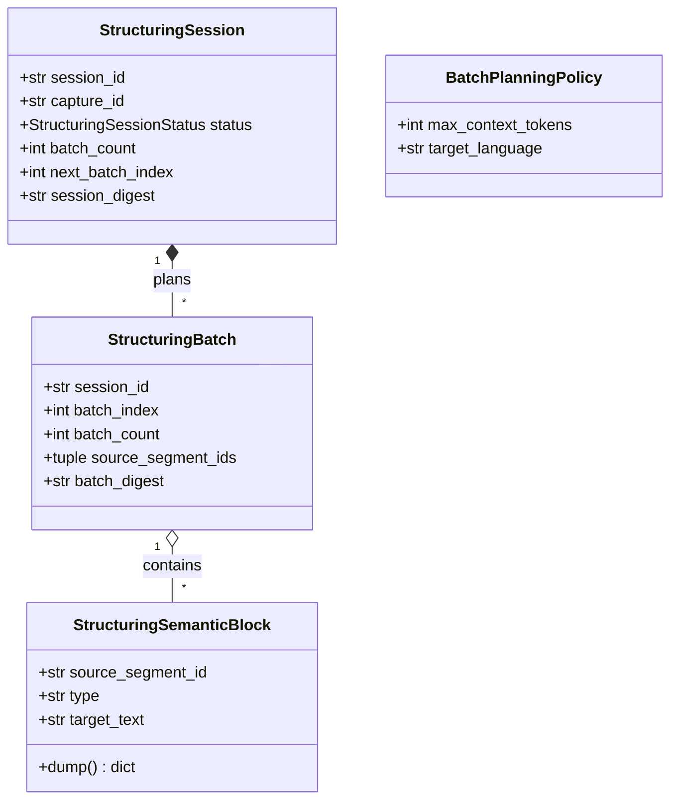
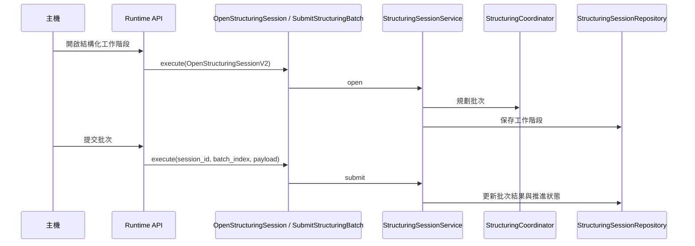

# 結構化

## 負責什麼、不負責什麼

結構化負責把原始擷取整理成擷取文件。Runtime 可以經 Ollama 供應者完成，主機也可以用結構化工作階段分批提交。它不執行文件 OCR、語音轉寫或說話者分離，也不下載那些引擎；引擎目錄、下載快取與安裝作業屬於引擎供應。它不保存主機應用自己的文件庫。

## 用語

結構化與結構化工作階段的定義見 [glossary 的結構化段落](../../.agents/PLANS/ddd-refactor/glossary.md#結構化)。程式、文件與公開合約沿用相同用語。

## 聚合與不變條件

領域模型依聚合組織於 `capture_runtime.structuring.domain`：

- **工作階段聚合（`session`）**：
  - `StructuringSession`：拉取式結構化工作階段聚合根，管理整體進度狀態機（`open` → `completed` / `failed` / `cancelled`）。不變條件：`batch_count >= 1`、批次必須依 `next_batch_index` 順序逐一推進、處於終端狀態時不可再接受推進或轉移。
  - `StructuringBatch`：工作階段內的單一批次值物件。不變條件：`0 <= batch_index < batch_count`、來源片段 `source_segment_ids` 不可為空、提供 `verify_digest()` 確保提交內容雜湊與規劃相符。
  - `StructuringSemanticBlock`：提交或接受的語意區塊值物件。不變條件：`source_segment_id` 不可為空、`type` 必須為 `heading`、`paragraph`、`list-item`、`table`、`quote`、`transcript` 之一。
  - `BatchPlanningPolicy`：批次規劃政策。不變條件：`max_context_tokens >= 1`，根據模型上下文限制預估批次分割邊界。

驗證失敗沿用既有的 `StructuringValidationError` 與 `StructuringSessionTransitionError`。

## 用例

應用層用例定義於 `capture_runtime.structuring.application.use_cases`：

| 用例 | 程式名稱 | 說明 |
| --- | --- | --- |
| 開啟結構化工作階段 | `OpenStructuringSession` | 為主機擷取開啟持久化的拉取式結構化工作階段並規劃批次 |
| 提交結構化批次 | `SubmitStructuringBatch` | 提交結構化批次語意區塊，進行驗證並推進工作階段；最後一批次完成時觸發文件組裝 |
| 取得結構化工作階段 | `GetStructuringSession` | 取得指定結構化工作階段的當前狀態與批次資訊 |
| 安裝模型選項 | `InstallModelOption` | 為白名單內的模型選項啟動非同步下載與安裝作業 |
| 取消模型安裝 | `CancelModelInstallation` | 取消進行中的模型安裝作業 |
| 取得模型安裝狀態 | `GetModelInstallation` | 取得模型安裝作業的進度與狀態 |

## 主要流程

## 與其他上下文的關係

擷取把原始擷取交給本上下文整理成擷取文件。引擎供應安裝 Ollama runtime；結構化使用該 runtime 與模型清單，不負責引擎目錄與下載快取。文件 OCR、語音轉寫與說話者分離不依賴結構化。

## 規則與資料來源

領域物件與政策位於 `capture_runtime.structuring.domain.session`。用例位於 `capture_runtime.structuring.application.use_cases`；工作階段與模型安裝服務位於 `capture_runtime.structuring.application`。批次常數、內部合約、協調器、驗證與文件組裝、供應者協定、模型清單、工作階段與模型安裝儲存庫，以及 Ollama 生命週期，位於 `capture_runtime.structuring.infrastructure`（含 `ollama`）。公開型別仍由 `capture_runtime.contracts` 定義。遷移邊界與後續步驟見 [DDD 重構計畫](../../.agents/PLANS/ddd-refactor/README.md)。
