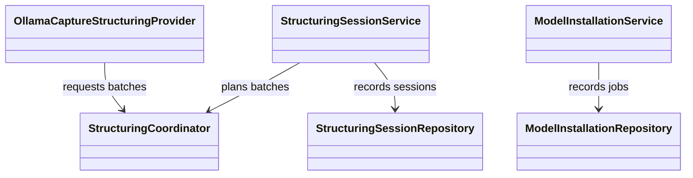
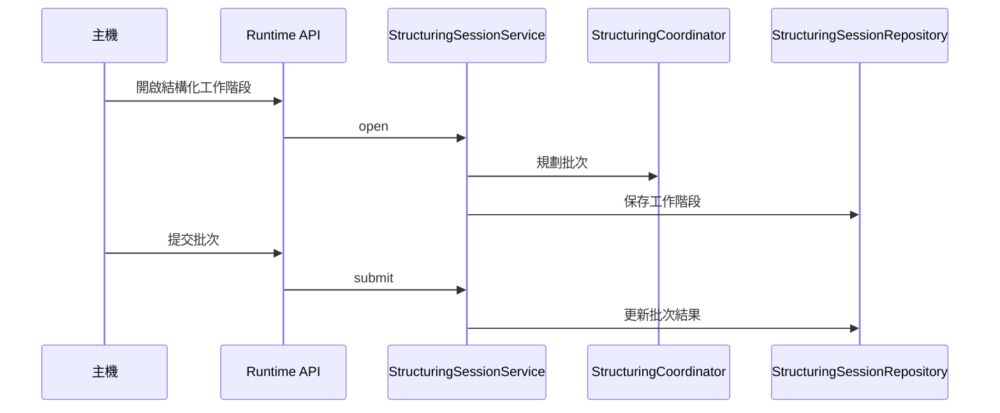

# 結構化

## 負責什麼、不負責什麼

結構化負責把原始擷取整理成擷取文件。Runtime 可以經 Ollama 供應者完成，主機也可以用結構化工作階段分批提交。它不執行文件 OCR、語音轉寫或說話者分離，也不下載那些引擎；引擎目錄、下載快取與安裝作業屬於引擎供應。它不保存主機應用自己的文件庫。

## 用語

結構化與結構化工作階段的定義見 [glossary 的結構化段落](../../.agents/PLANS/ddd-refactor/glossary.md#結構化)。程式、文件與公開合約沿用相同用語。

## 聚合與不變條件

W5 只搬移現有模組，保留原有行為；W6 才會加入工作階段聚合。現有 `StructuringSessionService` 開啟並提交結構化工作階段，`StructuringCoordinator` 做與供應者無關的批次規劃，`StructuringSessionRepository` 保存工作階段紀錄。模型安裝仍由 `ModelInstallationService` 與 `ModelInstallationRepository` 記錄。驗證失敗沿用既有的 `StructuringValidationError`，不新增錯誤型別。

## 主要流程

## 與其他上下文的關係

擷取把原始擷取交給本上下文整理成擷取文件。引擎供應安裝 Ollama runtime；結構化使用該 runtime 與模型清單，不負責引擎目錄與下載快取。文件 OCR、語音轉寫與說話者分離不依賴結構化。W5 保留既有跨模組依賴，不表示已完成 W6 的領域模型與分層整理。

## 規則與資料來源

工作階段與模型安裝的應用服務位於 `capture_runtime.structuring.application`（`structuring_session_service`、`model_installation_service`）。批次常數、內部合約、協調器、驗證與文件組裝、供應者協定、模型清單、工作階段與模型安裝儲存庫，以及 Ollama 生命週期，位於 `capture_runtime.structuring.infrastructure`（含 `ollama`）。公開型別仍由 `capture_runtime.contracts` 定義。W6 將補上 `session` 聚合；遷移邊界與後續步驟見 [DDD 重構計畫](../../.agents/PLANS/ddd-refactor/README.md)。
